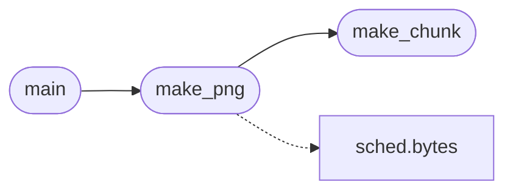

# `tools.gen_icons`

> Source: [tools/gen_icons.py:1](../../tools/gen_icons.py#L1) | language `py` | coverage 50.0% | [API index](../index.md)

gen_icons.py -- generate 32x32 RGBA PNG icon files for the MiniOS desktop.

Each icon is defined as a 32-line string of hex characters (0-F), where each
char maps to a colour in the icon palette.  The script writes minimal valid
PNG files (no zlib import needed -- raw deflate via the stored method).

Usage:  python3 tools/gen_icons.py progs/icons/

## Contents

- **Functions:** [`make_png`](#make_png), [`make_chunk`](#make_chunk), [`main`](#main)
- **Constants:** [`PALETTE`](#palette), [`ICONS`](#icons)

## Call Graph

Solid arrows stay in this module, dashed arrows leave it.



## Functions

<a id="make_png"></a>

### `make_png`

`function` | [tools/gen_icons.py:179](../../tools/gen_icons.py#L179)

```python
def make_png(pixels, palette, width=32, height=32)
```

Create a minimal indexed-colour PNG from pixel indices and a palette.

**Parameters**

| Name | Type | Default | Description |
|---|---|---|---|
| `pixels` |  |  |  |
| `palette` |  |  |  |
| `width` |  | `32` |  |
| `height` |  | `32` |  |

*Calls:* [`bytes`](headers.sched.h.md#bytes), [`make_chunk`](#make_chunk)

*Called by:* [`main`](#main)

---

<a id="make_chunk"></a>

### `make_chunk`

`function` | [tools/gen_icons.py:209](../../tools/gen_icons.py#L209)

```python
def make_chunk(chunk_type, data)
```

**Parameters**

| Name | Type | Default | Description |
|---|---|---|---|
| `chunk_type` |  |  |  |
| `data` |  |  |  |

*Called by:* [`make_png`](#make_png)

---

<a id="main"></a>

### `main`

`function` | [tools/gen_icons.py:214](../../tools/gen_icons.py#L214)

```python
def main()
```

*Calls:* [`make_png`](#make_png)

---

## Constants

<a id="palette"></a>

### `PALETTE`

`constant` | [tools/gen_icons.py:19](../../tools/gen_icons.py#L19)

```python
PALETTE
```

---

<a id="icons"></a>

### `ICONS`

`constant` | [tools/gen_icons.py:39](../../tools/gen_icons.py#L39)

```python
ICONS
```

---
