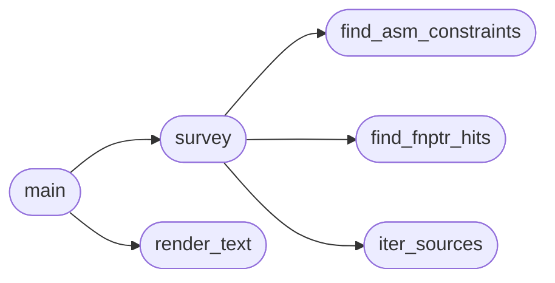

# `tools.kernel_feature_survey`

> Source: [tools/kernel_feature_survey.py:1](../../tools/kernel_feature_survey.py#L1) | language `py` | coverage 100.0% | [API index](../index.md)

kernel_feature_survey.py - verify which C features the MiniOS kernel needs.

Scans kernel and ring-3 sources for constructs miniGCC must support before
it can compile them: function pointers, extended-asm constraints, wide
calls, unions, long long, bitfields, privileged mnemonics and section
attributes. Every claim the SDD specs make about a gap must reproduce
through this tool first, so plans never rest on hallucinated file paths.

Usage: kernel_feature_survey.py [root] [--format text|md]
Exit 0 always; findings print to stdout.

## Contents

- **Classes:** [`SurveyConfig`](#surveyconfig)
- **Functions:** [`iter_sources`](#iter_sources), [`find_fnptr_hits`](#find_fnptr_hits), [`find_asm_constraints`](#find_asm_constraints), [`count_params`](#count_params), [`survey`](#survey), [`render_text`](#render_text), [`main`](#main)

## Call Graph

Solid arrows stay in this module, dashed arrows leave it.



## Classes

<a id="surveyconfig"></a>

### `SurveyConfig`

`class` | [tools/kernel_feature_survey.py:18](../../tools/kernel_feature_survey.py#L18)

```python
class SurveyConfig
```

Centralized tunables for the survey.

**Attributes**

| Name | Type | Default | Description |
|---|---|---|---|
| [`SOURCE_SUFFIXES`](#surveyconfig-source_suffixes) |  | `('.c', '.h')` |  |
| [`SKIP_DIRS`](#surveyconfig-skip_dirs) |  | `('.git', 'readmenator-agent', 'readmenator-maps', 'third_party', 'build', '__pycache__')` |  |
| [`MAX_PARAMS_MINIGCC`](#surveyconfig-max_params_minigcc) |  | `6` |  |
| [`FNPTR_DECL_RE`](#surveyconfig-fnptr_decl_re) |  | `re.compile('\\(\\s*\\*\\s*[A-Za-z_]\\w*\\s*\\)\\s*\\(')` |  |
| [`ASM_CONSTRAINT_RE`](#surveyconfig-asm_constraint_re) |  | `re.compile('"([=+%]*)([a-zA-Z])"')` |  |
| [`UNION_RE`](#surveyconfig-union_re) |  | `re.compile('(?<![A-Za-z_])union(?![A-Za-z_])')` |  |
| [`LONGLONG_RE`](#surveyconfig-longlong_re) |  | `re.compile('(?<![A-Za-z_])long\\s+long(?![A-Za-z_])')` |  |
| [`BITFIELD_RE`](#surveyconfig-bitfield_re) |  | `re.compile(':\\s*\\d+\\s*;')` |  |
| [`PRIV_RE`](#surveyconfig-priv_re) |  | `re.compile('"[^"]*(lidt\|lgdt\|ltr\|fxsave\|fxrstor\|mov\\s+%+\\w+,\\s*%+cr\\d\|mov\\s+%+cr\\d\|in\\s*\\(\\s*%+\\w+\\s*\\)\|in[lwb]?\\s\|out[lwb]?\\s)[^"]*"')` |  |
| [`SECTION_RE`](#surveyconfig-section_re) |  | `re.compile('section\\s*\\(\\s*"([^"]+)"\\s*\\)')` |  |
| [`FUNCDEF_RE`](#surveyconfig-funcdef_re) |  | `re.compile('^\\s*(?:static\\s+)?(?:inline\\s+)?[A-Za-z_][\\w\\s\\*]*?\\b([A-Za-z_]\\w*)\\s*\\(([^;{}]*)\\)\\s*\\{?\\s*$')` |  |

---

## Functions

<a id="iter_sources"></a>

### `iter_sources`

`function` `generator` | [tools/kernel_feature_survey.py:34](../../tools/kernel_feature_survey.py#L34)

```python
def iter_sources(root)
```

Yield C source paths under root, skipping vendored and cache dirs.

**Parameters**

| Name | Type | Default | Description |
|---|---|---|---|
| `root` |  |  |  |

*Called by:* [`survey`](#survey)

---

<a id="find_fnptr_hits"></a>

### `find_fnptr_hits`

`function` | [tools/kernel_feature_survey.py:43](../../tools/kernel_feature_survey.py#L43)

```python
def find_fnptr_hits(path, text)
```

Return line numbers declaring function pointers.

**Parameters**

| Name | Type | Default | Description |
|---|---|---|---|
| `path` |  |  |  |
| `text` |  |  |  |

*Called by:* [`survey`](#survey)

---

<a id="find_asm_constraints"></a>

### `find_asm_constraints`

`function` | [tools/kernel_feature_survey.py:49](../../tools/kernel_feature_survey.py#L49)

```python
def find_asm_constraints(path, text)
```

Return sorted constraint letters used in extended asm.

**Parameters**

| Name | Type | Default | Description |
|---|---|---|---|
| `path` |  |  |  |
| `text` |  |  |  |

*Called by:* [`survey`](#survey)

---

<a id="count_params"></a>

### `count_params`

`function` | [tools/kernel_feature_survey.py:59](../../tools/kernel_feature_survey.py#L59)

```python
def count_params(params)
```

Count parameters, treating void and empty as zero.

**Parameters**

| Name | Type | Default | Description |
|---|---|---|---|
| `params` |  |  |  |

---

<a id="survey"></a>

### `survey`

`function` | [tools/kernel_feature_survey.py:67](../../tools/kernel_feature_survey.py#L67)

```python
def survey(root)
```

Collect findings per category across all sources.

**Parameters**

| Name | Type | Default | Description |
|---|---|---|---|
| `root` |  |  |  |

*Calls:* [`find_asm_constraints`](#find_asm_constraints), [`find_fnptr_hits`](#find_fnptr_hits), [`iter_sources`](#iter_sources)

*Called by:* [`main`](#main)

---

<a id="render_text"></a>

### `render_text`

`function` | [tools/kernel_feature_survey.py:103](../../tools/kernel_feature_survey.py#L103)

```python
def render_text(findings)
```

Render findings as plain text.

**Parameters**

| Name | Type | Default | Description |
|---|---|---|---|
| `findings` |  |  |  |

*Called by:* [`main`](#main)

---

<a id="main"></a>

### `main`

`function` | [tools/kernel_feature_survey.py:122](../../tools/kernel_feature_survey.py#L122)

```python
def main(argv)
```

Entry point for the survey tool.

**Parameters**

| Name | Type | Default | Description |
|---|---|---|---|
| `argv` |  |  |  |

*Calls:* [`render_text`](#render_text), [`survey`](#survey)

---
