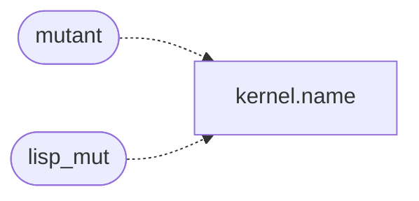

# `tools/lisp_scoped.sh`

> Source: [tools/lisp_scoped.sh:1](../../tools/lisp_scoped.sh#L1) | language `sh` | coverage 16.7% | [API index](../index.md)

Docstring: Scoped Lisp validation for the MiniOS interpreter contract.

Builds the ring-3 static ELF with zero warnings, runs the host suite, and asserts each scoped mutant dies. Fails closed on first gap.

## Contents

- **Functions:** [`say`](#say), [`die`](#die), [`mutant`](#mutant), [`lisp_mut`](#lisp_mut), [`mut_usage`](#mut_usage)

## Call Graph

Solid arrows stay in this module, dashed arrows leave it.



## Functions

<a id="say"></a>

### `say`

`function` | [tools/lisp_scoped.sh:8](../../tools/lisp_scoped.sh#L8)

```bash
say() { printf '%s\n' "$1"; }
```

---

<a id="die"></a>

### `die`

`function` | [tools/lisp_scoped.sh:9](../../tools/lisp_scoped.sh#L9)

```bash
die() { say "FAIL: $1"; fail=1; }
```

---

<a id="mutant"></a>

### `mutant`

`function` | [tools/lisp_scoped.sh:20](../../tools/lisp_scoped.sh#L20)

```bash
mutant()
```

*Calls:* [`name`](headers.kernel.h.md#name)

---

<a id="lisp_mut"></a>

### `lisp_mut`

`function` | [tools/lisp_scoped.sh:41](../../tools/lisp_scoped.sh#L41)

```bash
lisp_mut()
```

*Calls:* [`name`](headers.kernel.h.md#name)

---

<a id="mut_usage"></a>

### `mut_usage`

`function` | [tools/lisp_scoped.sh:63](../../tools/lisp_scoped.sh#L63)

```bash
mut_usage()
```

---
