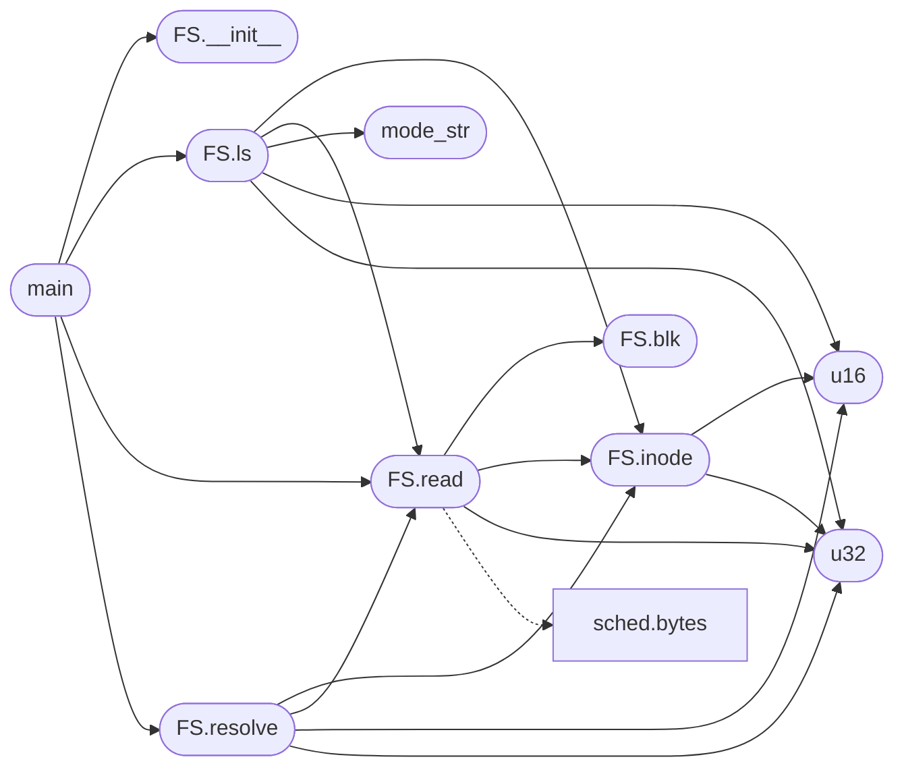

# `tools.minifs_dump`

> Source: [tools/minifs_dump.py:1](../../tools/minifs_dump.py#L1) | language `py` | coverage 8.3% | [API index](../index.md)

minifs_dump.py - Dump/inspect a MiniFS filesystem image.

## Contents

- **Classes:** [`FS`](#fs)
- **Functions:** [`u16`](#u16), [`u32`](#u32), [`mode_str`](#mode_str), [`main`](#main)
- **Constants:** [`MAGIC`](#magic), [`BLOCK_SIZE`](#block_size), [`ROOT_INODE`](#root_inode), [`S_IFMT`](#s_ifmt), [`S_IFDIR`](#s_ifdir), [`DIR_HDR`](#dir_hdr)

## Call Graph

Solid arrows stay in this module, dashed arrows leave it.



## Classes

<a id="fs"></a>

### `FS`

`class` | [tools/minifs_dump.py:25](../../tools/minifs_dump.py#L25)

```python
class FS
```

**Members**

| Member | Kind | Summary |
|---|---|---|
| [`__init__`](#fs-__init__) | constructor |  |
| [`blk`](#fs-blk) | method |  |
| [`inode`](#fs-inode) | method |  |
| [`read`](#fs-read) | method |  |
| [`resolve`](#fs-resolve) | method |  |
| [`ls`](#fs-ls) | method |  |

<a id="fs-__init__"></a>

#### `FS.__init__`

`constructor` | [tools/minifs_dump.py:26](../../tools/minifs_dump.py#L26)

```python
def __init__(self, fn)
```

**Parameters**

| Name | Type | Default | Description |
|---|---|---|---|
| `fn` |  |  |  |

*Called by:* [`main`](#main)

<a id="fs-blk"></a>

#### `FS.blk`

`method` | [tools/minifs_dump.py:29](../../tools/minifs_dump.py#L29)

```python
def blk(self, n)
```

**Parameters**

| Name | Type | Default | Description |
|---|---|---|---|
| `n` |  |  |  |

*Called by:* [`FS.read`](#fs-read)

<a id="fs-inode"></a>

#### `FS.inode`

`method` | [tools/minifs_dump.py:38](../../tools/minifs_dump.py#L38)

```python
def inode(self, i)
```

**Parameters**

| Name | Type | Default | Description |
|---|---|---|---|
| `i` |  |  |  |

*Calls:* [`u16`](#u16), [`u32`](#u32)

*Called by:* [`FS.ls`](#fs-ls), [`FS.read`](#fs-read), [`FS.resolve`](#fs-resolve), [`FS.read_file`](tools.minifs_saves.py.md#fs-read_file), [`FS.read_file_dir`](tools.minifs_saves.py.md#fs-read_file_dir), [`FS.resolve`](tools.minifs_saves.py.md#fs-resolve), [`cmd_backup`](tools.minifs_saves.py.md#cmd_backup)

<a id="fs-read"></a>

#### `FS.read`

`method` | [tools/minifs_dump.py:47](../../tools/minifs_dump.py#L47)

```python
def read(self, ino)
```

**Parameters**

| Name | Type | Default | Description |
|---|---|---|---|
| `ino` |  |  |  |

*Calls:* [`bytes`](headers.sched.h.md#bytes), [`FS.blk`](#fs-blk), [`FS.inode`](#fs-inode), [`u32`](#u32)

*Called by:* [`FS.ls`](#fs-ls), [`FS.resolve`](#fs-resolve), [`main`](#main)

<a id="fs-resolve"></a>

#### `FS.resolve`

`method` | [tools/minifs_dump.py:67](../../tools/minifs_dump.py#L67)

```python
def resolve(self, path)
```

**Parameters**

| Name | Type | Default | Description |
|---|---|---|---|
| `path` |  |  |  |

*Calls:* [`FS.inode`](#fs-inode), [`FS.read`](#fs-read), [`u16`](#u16), [`u32`](#u32)

*Called by:* [`main`](#main), [`cmd_backup`](tools.minifs_saves.py.md#cmd_backup)

<a id="fs-ls"></a>

#### `FS.ls`

`method` | [tools/minifs_dump.py:86](../../tools/minifs_dump.py#L86)

```python
def ls(self, ino, prefix='')
```

**Parameters**

| Name | Type | Default | Description |
|---|---|---|---|
| `ino` |  |  |  |
| `prefix` |  | `''` |  |

*Calls:* [`FS.inode`](#fs-inode), [`FS.read`](#fs-read), [`mode_str`](#mode_str), [`u16`](#u16), [`u32`](#u32)

*Called by:* [`main`](#main)

---

## Functions

<a id="u16"></a>

### `u16`

`function` | [tools/minifs_dump.py:13](../../tools/minifs_dump.py#L13)

```python
def u16(d, o)
```

**Parameters**

| Name | Type | Default | Description |
|---|---|---|---|
| `d` |  |  |  |
| `o` |  |  |  |

*Called by:* [`FS.inode`](#fs-inode), [`FS.ls`](#fs-ls), [`FS.resolve`](#fs-resolve)

---

<a id="u32"></a>

### `u32`

`function` | [tools/minifs_dump.py:14](../../tools/minifs_dump.py#L14)

```python
def u32(d, o)
```

**Parameters**

| Name | Type | Default | Description |
|---|---|---|---|
| `d` |  |  |  |
| `o` |  |  |  |

*Called by:* [`FS.inode`](#fs-inode), [`FS.ls`](#fs-ls), [`FS.read`](#fs-read), [`FS.resolve`](#fs-resolve)

---

<a id="mode_str"></a>

### `mode_str`

`function` | [tools/minifs_dump.py:16](../../tools/minifs_dump.py#L16)

```python
def mode_str(m)
```

**Parameters**

| Name | Type | Default | Description |
|---|---|---|---|
| `m` |  |  |  |

*Called by:* [`FS.ls`](#fs-ls)

---

<a id="main"></a>

### `main`

`function` | [tools/minifs_dump.py:105](../../tools/minifs_dump.py#L105)

```python
def main()
```

*Calls:* [`FS.__init__`](#fs-__init__), [`FS.ls`](#fs-ls), [`FS.read`](#fs-read), [`FS.resolve`](#fs-resolve)

---

## Constants

<a id="magic"></a>

### `MAGIC`

`constant` | [tools/minifs_dump.py:6](../../tools/minifs_dump.py#L6)

```python
MAGIC = 1296649801
```

---

<a id="block_size"></a>

### `BLOCK_SIZE`

`constant` | [tools/minifs_dump.py:7](../../tools/minifs_dump.py#L7)

```python
BLOCK_SIZE = 4096
```

---

<a id="root_inode"></a>

### `ROOT_INODE`

`constant` | [tools/minifs_dump.py:8](../../tools/minifs_dump.py#L8)

```python
ROOT_INODE = 2
```

---

<a id="s_ifmt"></a>

### `S_IFMT`

`constant` | [tools/minifs_dump.py:9](../../tools/minifs_dump.py#L9)

```python
S_IFMT = 61440
```

---

<a id="s_ifdir"></a>

### `S_IFDIR`

`constant` | [tools/minifs_dump.py:10](../../tools/minifs_dump.py#L10)

```python
S_IFDIR = 16384
```

---

<a id="dir_hdr"></a>

### `DIR_HDR`

`constant` | [tools/minifs_dump.py:11](../../tools/minifs_dump.py#L11)

```python
DIR_HDR = 8
```

---
