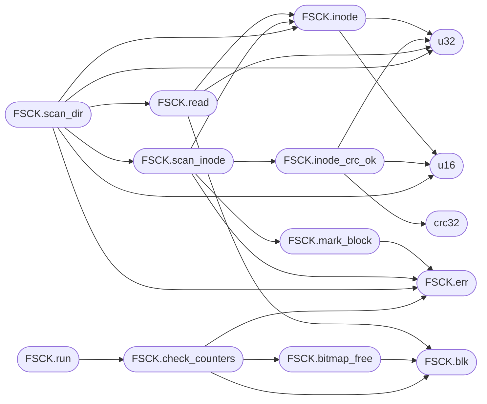

# `tools.minifs_fsck`

> Source: [tools/minifs_fsck.py:1](../../tools/minifs_fsck.py#L1) | language `py` | coverage 16.7% | [API index](../index.md)

minifs_fsck.py - Check MiniFS filesystem consistency.

## Contents

- **Classes:** [`FSCK`](#fsck)
- **Functions:** [`u16`](#u16), [`u32`](#u32), [`crc32`](#crc32), [`main`](#main)
- **Constants:** [`MAGIC`](#magic), [`BLOCK_SIZE`](#block_size), [`ROOT_INODE`](#root_inode), [`DIR_HDR`](#dir_hdr), [`S_IFMT`](#s_ifmt), [`S_IFDIR`](#s_ifdir)

## Call Graph

Solid arrows stay in this module, dashed arrows leave it.



## Classes

<a id="fsck"></a>

### `FSCK`

`class` | [tools/minifs_fsck.py:23](../../tools/minifs_fsck.py#L23)

```python
class FSCK
```

**Members**

| Member | Kind | Summary |
|---|---|---|
| [`__init__`](#fsck-__init__) | constructor |  |
| [`blk`](#fsck-blk) | method |  |
| [`inode`](#fsck-inode) | method |  |
| [`inode_crc_ok`](#fsck-inode_crc_ok) | method |  |
| [`read`](#fsck-read) | method |  |
| [`err`](#fsck-err) | method |  |
| [`mark_block`](#fsck-mark_block) | method |  |
| [`scan_inode`](#fsck-scan_inode) | method |  |
| [`scan_dir`](#fsck-scan_dir) | method |  |
| [`bitmap_free`](#fsck-bitmap_free) | method | Clear bits among the first count bits of the bitmap at block start. |
| [`check_counters`](#fsck-check_counters) | method | The superblock free counters must match the bitmaps, or every free-space report (and the kernel's own decrement) starts wrong. |
| [`run`](#fsck-run) | method |  |

<a id="fsck-__init__"></a>

#### `FSCK.__init__`

`constructor` | [tools/minifs_fsck.py:24](../../tools/minifs_fsck.py#L24)

```python
def __init__(self, fn)
```

**Parameters**

| Name | Type | Default | Description |
|---|---|---|---|
| `fn` |  |  |  |

*Called by:* [`main`](#main)

<a id="fsck-blk"></a>

#### `FSCK.blk`

`method` | [tools/minifs_fsck.py:49](../../tools/minifs_fsck.py#L49)

```python
def blk(self, n)
```

**Parameters**

| Name | Type | Default | Description |
|---|---|---|---|
| `n` |  |  |  |

*Called by:* [`FSCK.bitmap_free`](#fsck-bitmap_free), [`FSCK.check_counters`](#fsck-check_counters), [`FSCK.read`](#fsck-read)

<a id="fsck-inode"></a>

#### `FSCK.inode`

`method` | [tools/minifs_fsck.py:58](../../tools/minifs_fsck.py#L58)

```python
def inode(self, i)
```

**Parameters**

| Name | Type | Default | Description |
|---|---|---|---|
| `i` |  |  |  |

*Calls:* [`u16`](#u16), [`u32`](#u32)

*Called by:* [`FSCK.read`](#fsck-read), [`FSCK.scan_dir`](#fsck-scan_dir), [`FSCK.scan_inode`](#fsck-scan_inode)

<a id="fsck-inode_crc_ok"></a>

#### `FSCK.inode_crc_ok`

`method` | [tools/minifs_fsck.py:65](../../tools/minifs_fsck.py#L65)

```python
def inode_crc_ok(self, i)
```

**Parameters**

| Name | Type | Default | Description |
|---|---|---|---|
| `i` |  |  |  |

*Calls:* [`bytes`](headers.sched.h.md#bytes), [`crc32`](#crc32), [`u16`](#u16), [`u32`](#u32)

*Called by:* [`FSCK.scan_inode`](#fsck-scan_inode)

<a id="fsck-read"></a>

#### `FSCK.read`

`method` | [tools/minifs_fsck.py:71](../../tools/minifs_fsck.py#L71)

```python
def read(self, ino)
```

**Parameters**

| Name | Type | Default | Description |
|---|---|---|---|
| `ino` |  |  |  |

*Calls:* [`bytes`](headers.sched.h.md#bytes), [`FSCK.blk`](#fsck-blk), [`FSCK.inode`](#fsck-inode), [`u32`](#u32)

*Called by:* [`FSCK.scan_dir`](#fsck-scan_dir)

<a id="fsck-err"></a>

#### `FSCK.err`

`method` | [tools/minifs_fsck.py:86](../../tools/minifs_fsck.py#L86)

```python
def err(self, msg)
```

**Parameters**

| Name | Type | Default | Description |
|---|---|---|---|
| `msg` |  |  |  |

*Called by:* [`FSCK.check_counters`](#fsck-check_counters), [`FSCK.mark_block`](#fsck-mark_block), [`FSCK.run`](#fsck-run), [`FSCK.scan_dir`](#fsck-scan_dir), [`FSCK.scan_inode`](#fsck-scan_inode)

<a id="fsck-mark_block"></a>

#### `FSCK.mark_block`

`method` | [tools/minifs_fsck.py:88](../../tools/minifs_fsck.py#L88)

```python
def mark_block(self, n)
```

**Parameters**

| Name | Type | Default | Description |
|---|---|---|---|
| `n` |  |  |  |

*Calls:* [`FSCK.err`](#fsck-err)

*Called by:* [`FSCK.scan_inode`](#fsck-scan_inode)

<a id="fsck-scan_inode"></a>

#### `FSCK.scan_inode`

`method` | [tools/minifs_fsck.py:93](../../tools/minifs_fsck.py#L93)

```python
def scan_inode(self, i)
```

**Parameters**

| Name | Type | Default | Description |
|---|---|---|---|
| `i` |  |  |  |

*Calls:* [`FSCK.err`](#fsck-err), [`FSCK.inode`](#fsck-inode), [`FSCK.inode_crc_ok`](#fsck-inode_crc_ok), [`FSCK.mark_block`](#fsck-mark_block)

*Called by:* [`FSCK.scan_dir`](#fsck-scan_dir)

<a id="fsck-scan_dir"></a>

#### `FSCK.scan_dir`

`method` | [tools/minifs_fsck.py:105](../../tools/minifs_fsck.py#L105)

```python
def scan_dir(self, ino)
```

**Parameters**

| Name | Type | Default | Description |
|---|---|---|---|
| `ino` |  |  |  |

*Calls:* [`FSCK.err`](#fsck-err), [`FSCK.inode`](#fsck-inode), [`FSCK.read`](#fsck-read), [`FSCK.scan_inode`](#fsck-scan_inode), [`u16`](#u16), [`u32`](#u32)

*Called by:* [`FSCK.run`](#fsck-run)

<a id="fsck-bitmap_free"></a>

#### `FSCK.bitmap_free`

`method` | [tools/minifs_fsck.py:137](../../tools/minifs_fsck.py#L137)

```python
def bitmap_free(self, start, count)
```

Clear bits among the first count bits of the bitmap at block start.

**Parameters**

| Name | Type | Default | Description |
|---|---|---|---|
| `start` |  |  |  |
| `count` |  |  |  |

*Calls:* [`FSCK.blk`](#fsck-blk)

*Called by:* [`FSCK.check_counters`](#fsck-check_counters)

<a id="fsck-check_counters"></a>

#### `FSCK.check_counters`

`method` | [tools/minifs_fsck.py:146](../../tools/minifs_fsck.py#L146)

```python
def check_counters(self)
```

The superblock free counters must match the bitmaps, or every free-space report (and the kernel's own decrement) starts wrong.

*Calls:* [`FSCK.bitmap_free`](#fsck-bitmap_free), [`FSCK.blk`](#fsck-blk), [`FSCK.err`](#fsck-err)

*Called by:* [`FSCK.run`](#fsck-run)

<a id="fsck-run"></a>

#### `FSCK.run`

`method` | [tools/minifs_fsck.py:161](../../tools/minifs_fsck.py#L161)

```python
def run(self)
```

*Calls:* [`FSCK.check_counters`](#fsck-check_counters), [`FSCK.err`](#fsck-err), [`FSCK.scan_dir`](#fsck-scan_dir)

*Called by:* [`main`](#main)

---

## Functions

<a id="u16"></a>

### `u16`

`function` | [tools/minifs_fsck.py:13](../../tools/minifs_fsck.py#L13)

```python
def u16(d, o)
```

**Parameters**

| Name | Type | Default | Description |
|---|---|---|---|
| `d` |  |  |  |
| `o` |  |  |  |

*Called by:* [`FSCK.inode`](#fsck-inode), [`FSCK.inode_crc_ok`](#fsck-inode_crc_ok), [`FSCK.scan_dir`](#fsck-scan_dir)

---

<a id="u32"></a>

### `u32`

`function` | [tools/minifs_fsck.py:14](../../tools/minifs_fsck.py#L14)

```python
def u32(d, o)
```

**Parameters**

| Name | Type | Default | Description |
|---|---|---|---|
| `d` |  |  |  |
| `o` |  |  |  |

*Called by:* [`FSCK.inode`](#fsck-inode), [`FSCK.inode_crc_ok`](#fsck-inode_crc_ok), [`FSCK.read`](#fsck-read), [`FSCK.scan_dir`](#fsck-scan_dir)

---

<a id="crc32"></a>

### `crc32`

`function` | [tools/minifs_fsck.py:15](../../tools/minifs_fsck.py#L15)

```python
def crc32(data)
```

**Parameters**

| Name | Type | Default | Description |
|---|---|---|---|
| `data` |  |  |  |

*Called by:* [`FSCK.inode_crc_ok`](#fsck-inode_crc_ok)

---

<a id="main"></a>

### `main`

`function` | [tools/minifs_fsck.py:173](../../tools/minifs_fsck.py#L173)

```python
def main()
```

*Calls:* [`FSCK.__init__`](#fsck-__init__), [`FSCK.run`](#fsck-run)

---

## Constants

<a id="magic"></a>

### `MAGIC`

`constant` | [tools/minifs_fsck.py:6](../../tools/minifs_fsck.py#L6)

```python
MAGIC = 1296649801
```

---

<a id="block_size"></a>

### `BLOCK_SIZE`

`constant` | [tools/minifs_fsck.py:7](../../tools/minifs_fsck.py#L7)

```python
BLOCK_SIZE = 4096
```

---

<a id="root_inode"></a>

### `ROOT_INODE`

`constant` | [tools/minifs_fsck.py:8](../../tools/minifs_fsck.py#L8)

```python
ROOT_INODE = 2
```

---

<a id="dir_hdr"></a>

### `DIR_HDR`

`constant` | [tools/minifs_fsck.py:9](../../tools/minifs_fsck.py#L9)

```python
DIR_HDR = 8
```

---

<a id="s_ifmt"></a>

### `S_IFMT`

`constant` | [tools/minifs_fsck.py:10](../../tools/minifs_fsck.py#L10)

```python
S_IFMT = 61440
```

---

<a id="s_ifdir"></a>

### `S_IFDIR`

`constant` | [tools/minifs_fsck.py:11](../../tools/minifs_fsck.py#L11)

```python
S_IFDIR = 16384
```

---
