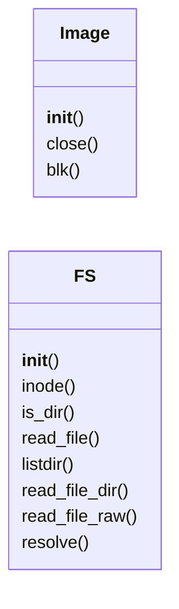
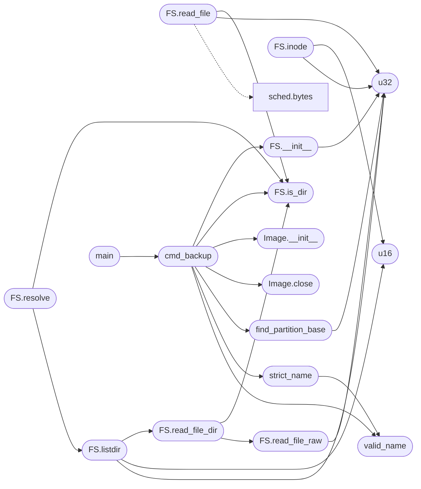

# `tools.minifs_saves`

> Source: [tools/minifs_saves.py:1](../../tools/minifs_saves.py#L1) | language `py` | coverage 14.3% | [API index](../index.md)

minifs_saves.py - preserve the guest's saves/ dir across image rebuilds.

Regenerating minifs.bin from scratch wipes everything the guest wrote at
runtime (Pokemon battery .sav/.rtc and .state savestates live in saves/ on
MiniFS). Before mkfs runs, this tool extracts the live saves/ tree out of
the previous os.img into a staging dir; the Makefile then passes that dir
back into mkfs, so a rebuild carries the saves forward instead of wiping
them. Only doom maps and Pokemon saves persist (PERSIST_SUFFIXES);
minicraft chunks are skipped with a log line, never packed.

Usage: minifs_saves.py backup <os.img|minifs.bin> <stagedir>

The saves land in <stagedir>/saves/... (nothing is created when the image
is missing or carries no saves/ dir). Guest files are written raw by
minifs_write, never compressed, so extraction is byte-exact; a file found
with the compressed flag set or with double-indirect blocks (both outside
what the guest write path produces) aborts with a nonzero exit instead of
backing up corrupt data.

## Contents

- **Classes:** [`Image`](#image), [`FS`](#fs)
- **Functions:** [`u16`](#u16), [`u32`](#u32), [`valid_name`](#valid_name), [`strict_name`](#strict_name), [`find_partition_base`](#find_partition_base), [`cmd_backup`](#cmd_backup), [`main`](#main)
- **Constants:** [`MAGIC`](#magic), [`VERSION`](#version), [`BLOCK_SIZE`](#block_size), [`ROOT_INODE`](#root_inode), [`S_IFMT`](#s_ifmt), [`S_IFDIR`](#s_ifdir), [`FLAG_COMPRESSED`](#flag_compressed), [`DIR_HDR`](#dir_hdr), [`FT_DIR`](#ft_dir), [`PER_INDIRECT`](#per_indirect), [`MAX_FILE_BYTES`](#max_file_bytes), [`MAX_TOTAL_BYTES`](#max_total_bytes), [`MAX_ENTRIES`](#max_entries), [`PERSIST_SUFFIXES`](#persist_suffixes)

## Type Diagram



## Call Graph

Solid arrows stay in this module, dashed arrows leave it.



## Classes

<a id="image"></a>

### `Image`

`class` | [tools/minifs_saves.py:61](../../tools/minifs_saves.py#L61)

```python
class Image
```

Random-access MiniFS partition inside a host file.

**Members**

| Member | Kind | Summary |
|---|---|---|
| [`__init__`](#image-__init__) | constructor |  |
| [`close`](#image-close) | method |  |
| [`blk`](#image-blk) | method |  |

<a id="image-__init__"></a>

#### `Image.__init__`

`constructor` | [tools/minifs_saves.py:64](../../tools/minifs_saves.py#L64)

```python
def __init__(self, fn, base)
```

**Parameters**

| Name | Type | Default | Description |
|---|---|---|---|
| `fn` |  |  |  |
| `base` |  |  |  |

**Raises**

- `ValueError`: (raised in the body, not documented)

*Called by:* [`cmd_backup`](#cmd_backup)

<a id="image-close"></a>

#### `Image.close`

`method` | [tools/minifs_saves.py:72](../../tools/minifs_saves.py#L72)

```python
def close(self)
```

*Called by:* [`cmd_backup`](#cmd_backup)

<a id="image-blk"></a>

#### `Image.blk`

`method` | [tools/minifs_saves.py:75](../../tools/minifs_saves.py#L75)

```python
def blk(self, n)
```

**Parameters**

| Name | Type | Default | Description |
|---|---|---|---|
| `n` |  |  |  |

**Raises**

- `ValueError`: (raised in the body, not documented)

---

<a id="fs"></a>

### `FS`

`class` | [tools/minifs_saves.py:85](../../tools/minifs_saves.py#L85)

```python
class FS
```

**Members**

| Member | Kind | Summary |
|---|---|---|
| [`__init__`](#fs-__init__) | constructor |  |
| [`inode`](#fs-inode) | method |  |
| [`is_dir`](#fs-is_dir) | method |  |
| [`read_file`](#fs-read_file) | method |  |
| [`listdir`](#fs-listdir) | method |  |
| [`read_file_dir`](#fs-read_file_dir) | method |  |
| [`read_file_raw`](#fs-read_file_raw) | method |  |
| [`resolve`](#fs-resolve) | method |  |

<a id="fs-__init__"></a>

#### `FS.__init__`

`constructor` | [tools/minifs_saves.py:86](../../tools/minifs_saves.py#L86)

```python
def __init__(self, img)
```

**Parameters**

| Name | Type | Default | Description |
|---|---|---|---|
| `img` |  |  |  |

**Raises**

- `ValueError`: (raised in the body, not documented)

*Calls:* [`u32`](#u32)

*Called by:* [`cmd_backup`](#cmd_backup)

<a id="fs-inode"></a>

#### `FS.inode`

`method` | [tools/minifs_saves.py:95](../../tools/minifs_saves.py#L95)

```python
def inode(self, i)
```

**Parameters**

| Name | Type | Default | Description |
|---|---|---|---|
| `i` |  |  |  |

**Raises**

- `ValueError`: (raised in the body, not documented)

*Calls:* [`u16`](#u16), [`u32`](#u32)

<a id="fs-is_dir"></a>

#### `FS.is_dir`

`method` | [tools/minifs_saves.py:110](../../tools/minifs_saves.py#L110)

```python
def is_dir(self, st)
```

**Parameters**

| Name | Type | Default | Description |
|---|---|---|---|
| `st` |  |  |  |

*Called by:* [`FS.read_file`](#fs-read_file), [`FS.read_file_dir`](#fs-read_file_dir), [`FS.resolve`](#fs-resolve), [`cmd_backup`](#cmd_backup)

<a id="fs-read_file"></a>

#### `FS.read_file`

`method` | [tools/minifs_saves.py:113](../../tools/minifs_saves.py#L113)

```python
def read_file(self, ino)
```

**Parameters**

| Name | Type | Default | Description |
|---|---|---|---|
| `ino` |  |  |  |

**Raises**

- `ValueError`: (raised in the body, not documented)

*Calls:* [`bytes`](headers.sched.h.md#bytes), [`FS.inode`](tools.minifs_dump.py.md#fs-inode), [`FS.is_dir`](#fs-is_dir), [`u32`](#u32)

<a id="fs-listdir"></a>

#### `FS.listdir`

`method` `generator` | [tools/minifs_saves.py:146](../../tools/minifs_saves.py#L146)

```python
def listdir(self, ino)
```

**Parameters**

| Name | Type | Default | Description |
|---|---|---|---|
| `ino` |  |  |  |

*Calls:* [`FS.read_file_dir`](#fs-read_file_dir), [`u16`](#u16), [`u32`](#u32)

*Called by:* [`FS.resolve`](#fs-resolve)

<a id="fs-read_file_dir"></a>

#### `FS.read_file_dir`

`method` | [tools/minifs_saves.py:165](../../tools/minifs_saves.py#L165)

```python
def read_file_dir(self, ino)
```

**Parameters**

| Name | Type | Default | Description |
|---|---|---|---|
| `ino` |  |  |  |

**Raises**

- `ValueError`: (raised in the body, not documented)

*Calls:* [`FS.inode`](tools.minifs_dump.py.md#fs-inode), [`FS.is_dir`](#fs-is_dir), [`FS.read_file_raw`](#fs-read_file_raw)

*Called by:* [`FS.listdir`](#fs-listdir)

<a id="fs-read_file_raw"></a>

#### `FS.read_file_raw`

`method` | [tools/minifs_saves.py:173](../../tools/minifs_saves.py#L173)

```python
def read_file_raw(self, st)
```

**Parameters**

| Name | Type | Default | Description |
|---|---|---|---|
| `st` |  |  |  |

**Raises**

- `ValueError`: (raised in the body, not documented)

*Calls:* [`bytes`](headers.sched.h.md#bytes), [`u32`](#u32)

*Called by:* [`FS.read_file_dir`](#fs-read_file_dir)

<a id="fs-resolve"></a>

#### `FS.resolve`

`method` | [tools/minifs_saves.py:197](../../tools/minifs_saves.py#L197)

```python
def resolve(self, path)
```

**Parameters**

| Name | Type | Default | Description |
|---|---|---|---|
| `path` |  |  |  |

*Calls:* [`FS.inode`](tools.minifs_dump.py.md#fs-inode), [`FS.is_dir`](#fs-is_dir), [`FS.listdir`](#fs-listdir)

---

## Functions

<a id="u16"></a>

### `u16`

`function` | [tools/minifs_saves.py:53](../../tools/minifs_saves.py#L53)

```python
def u16(d, o)
```

**Parameters**

| Name | Type | Default | Description |
|---|---|---|---|
| `d` |  |  |  |
| `o` |  |  |  |

*Called by:* [`FS.inode`](#fs-inode), [`FS.listdir`](#fs-listdir)

---

<a id="u32"></a>

### `u32`

`function` | [tools/minifs_saves.py:57](../../tools/minifs_saves.py#L57)

```python
def u32(d, o)
```

**Parameters**

| Name | Type | Default | Description |
|---|---|---|---|
| `d` |  |  |  |
| `o` |  |  |  |

*Called by:* [`FS.__init__`](#fs-__init__), [`FS.inode`](#fs-inode), [`FS.listdir`](#fs-listdir), [`FS.read_file`](#fs-read_file), [`FS.read_file_raw`](#fs-read_file_raw), [`find_partition_base`](#find_partition_base)

---

<a id="valid_name"></a>

### `valid_name`

`function` | [tools/minifs_saves.py:216](../../tools/minifs_saves.py#L216)

```python
def valid_name(nm)
```

**Parameters**

| Name | Type | Default | Description |
|---|---|---|---|
| `nm` |  |  |  |

*Called by:* [`cmd_backup`](#cmd_backup), [`strict_name`](#strict_name)

---

<a id="strict_name"></a>

### `strict_name`

`function` | [tools/minifs_saves.py:224](../../tools/minifs_saves.py#L224)

```python
def strict_name(nm)
```

**Parameters**

| Name | Type | Default | Description |
|---|---|---|---|
| `nm` |  |  |  |

*Calls:* [`valid_name`](#valid_name)

*Called by:* [`cmd_backup`](#cmd_backup)

---

<a id="find_partition_base"></a>

### `find_partition_base`

`function` | [tools/minifs_saves.py:233](../../tools/minifs_saves.py#L233)

```python
def find_partition_base(fn)
```

Locate the MiniFS partition inside a host image file.

Returns the byte offset of the partition, or None. Prefers the exact
layout the build produces (kernel at LBA 9, partition 2048-sector
aligned after it); falls back to a magic scan.

**Parameters**

| Name | Type | Default | Description |
|---|---|---|---|
| `fn` |  |  |  |

*Calls:* [`u32`](#u32)

*Called by:* [`cmd_backup`](#cmd_backup)

---

<a id="cmd_backup"></a>

### `cmd_backup`

`function` | [tools/minifs_saves.py:271](../../tools/minifs_saves.py#L271)

```python
def cmd_backup(img_path, stage)
```

**Parameters**

| Name | Type | Default | Description |
|---|---|---|---|
| `img_path` |  |  |  |
| `stage` |  |  |  |

*Calls:* [`FS.inode`](tools.minifs_dump.py.md#fs-inode), [`FS.resolve`](tools.minifs_dump.py.md#fs-resolve), [`FS.__init__`](#fs-__init__), [`FS.is_dir`](#fs-is_dir), [`Image.__init__`](#image-__init__), [`Image.close`](#image-close), [`find_partition_base`](#find_partition_base), [`strict_name`](#strict_name), [`valid_name`](#valid_name)

*Called by:* [`main`](#main)

---

<a id="main"></a>

### `main`

`function` | [tools/minifs_saves.py:343](../../tools/minifs_saves.py#L343)

```python
def main(argv)
```

**Parameters**

| Name | Type | Default | Description |
|---|---|---|---|
| `argv` |  |  |  |

*Calls:* [`cmd_backup`](#cmd_backup)

---

## Constants

<a id="magic"></a>

### `MAGIC`

`constant` | [tools/minifs_saves.py:25](../../tools/minifs_saves.py#L25)

```python
MAGIC = 1296649801
```

---

<a id="version"></a>

### `VERSION`

`constant` | [tools/minifs_saves.py:26](../../tools/minifs_saves.py#L26)

```python
VERSION = 1
```

---

<a id="block_size"></a>

### `BLOCK_SIZE`

`constant` | [tools/minifs_saves.py:27](../../tools/minifs_saves.py#L27)

```python
BLOCK_SIZE = 4096
```

---

<a id="root_inode"></a>

### `ROOT_INODE`

`constant` | [tools/minifs_saves.py:28](../../tools/minifs_saves.py#L28)

```python
ROOT_INODE = 2
```

---

<a id="s_ifmt"></a>

### `S_IFMT`

`constant` | [tools/minifs_saves.py:29](../../tools/minifs_saves.py#L29)

```python
S_IFMT = 61440
```

---

<a id="s_ifdir"></a>

### `S_IFDIR`

`constant` | [tools/minifs_saves.py:30](../../tools/minifs_saves.py#L30)

```python
S_IFDIR = 16384
```

---

<a id="flag_compressed"></a>

### `FLAG_COMPRESSED`

`constant` | [tools/minifs_saves.py:31](../../tools/minifs_saves.py#L31)

```python
FLAG_COMPRESSED = 1
```

---

<a id="dir_hdr"></a>

### `DIR_HDR`

`constant` | [tools/minifs_saves.py:32](../../tools/minifs_saves.py#L32)

```python
DIR_HDR = 8
```

---

<a id="ft_dir"></a>

### `FT_DIR`

`constant` | [tools/minifs_saves.py:33](../../tools/minifs_saves.py#L33)

```python
FT_DIR = 2
```

---

<a id="per_indirect"></a>

### `PER_INDIRECT`

`constant` | [tools/minifs_saves.py:34](../../tools/minifs_saves.py#L34)

```python
PER_INDIRECT = BLOCK_SIZE // 4
```

---

<a id="max_file_bytes"></a>

### `MAX_FILE_BYTES`

`constant` | [tools/minifs_saves.py:36](../../tools/minifs_saves.py#L36)

```python
MAX_FILE_BYTES = 16 * 1024 * 1024
```

---

<a id="max_total_bytes"></a>

### `MAX_TOTAL_BYTES`

`constant` | [tools/minifs_saves.py:37](../../tools/minifs_saves.py#L37)

```python
MAX_TOTAL_BYTES = 64 * 1024 * 1024
```

---

<a id="max_entries"></a>

### `MAX_ENTRIES`

`constant` | [tools/minifs_saves.py:38](../../tools/minifs_saves.py#L38)

```python
MAX_ENTRIES = 1024
```

---

<a id="persist_suffixes"></a>

### `PERSIST_SUFFIXES`

`constant` | [tools/minifs_saves.py:50](../../tools/minifs_saves.py#L50)

```python
PERSIST_SUFFIXES = ('.wad', '.txt', '.sav', '.rtc', '.state')
```

---
