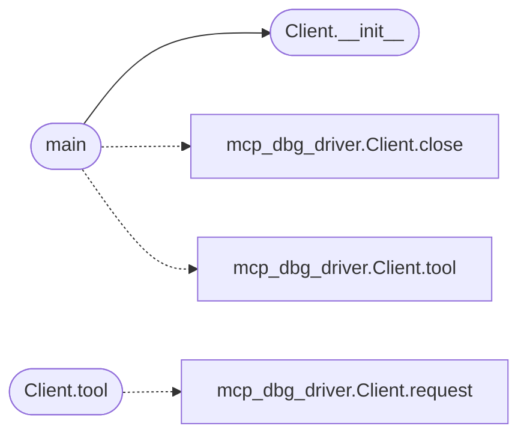

# `tools.minios_cli`

> Source: [tools/minios_cli.py:1](../../tools/minios_cli.py#L1) | language `py` | coverage 14.3% | [API index](../index.md)

minios_cli.py — drive MiniOS through the MCP bridge, not by hand.

Starts mcp/minios_mcp.py (which owns the QEMU child and the serial console)
over stdio JSON-RPC and executes a sequence of actions in one session, then
powers the machine off. This is the hammer the minios skill wants: never
boot QEMU by hand; every shell interaction goes through the bridge.

Usage: python3 tools/minios_cli.py ACTION [ARG] [ACTION [ARG] ...]

Actions:
  boot             boot the image, wait for the shell prompt
  status           {booted, pid, log_bytes}
  send LINE        send one shell line, wait for the next prompt, print output
  cat PATH         print a ramdisk file
  snapshot         print the unconsumed console tail
  expect MARKER    wait for a marker; print matched: true/false
  write PATH       send lines from stdin through minios_write
  poweroff         power off and assert QEMU exit

Example: python3 tools/minios_cli.py boot send "help" send "ls etc/" poweroff

## Contents

- **Classes:** [`Client`](#client)
- **Functions:** [`main`](#main)
- **Constants:** [`HERE`](#here), [`MCP`](#mcp), [`IMAGE`](#image), [`PIDFILE`](#pidfile), [`TMO`](#tmo)

## Call Graph

Solid arrows stay in this module, dashed arrows leave it.



## Classes

<a id="client"></a>

### `Client`

`class` | [tools/minios_cli.py:38](../../tools/minios_cli.py#L38)

```python
class Client
```

**Members**

| Member | Kind | Summary |
|---|---|---|
| [`__init__`](#client-__init__) | constructor |  |
| [`request`](#client-request) | method |  |
| [`tool`](#client-tool) | method |  |
| [`close`](#client-close) | method |  |

<a id="client-__init__"></a>

#### `Client.__init__`

`constructor` | [tools/minios_cli.py:39](../../tools/minios_cli.py#L39)

```python
def __init__(self)
```

*Called by:* [`main`](#main)

<a id="client-request"></a>

#### `Client.request`

`method` | [tools/minios_cli.py:56](../../tools/minios_cli.py#L56)

```python
def request(self, method, params=None)
```

**Parameters**

| Name | Type | Default | Description |
|---|---|---|---|
| `method` |  |  |  |
| `params` |  | `None` |  |

**Raises**

- `RuntimeError`: (raised in the body, not documented)
- `TimeoutError`: (raised in the body, not documented)

<a id="client-tool"></a>

#### `Client.tool`

`method` | [tools/minios_cli.py:77](../../tools/minios_cli.py#L77)

```python
def tool(self, name, params=None)
```

**Parameters**

| Name | Type | Default | Description |
|---|---|---|---|
| `name` |  |  |  |
| `params` |  | `None` |  |

**Raises**

- `AssertionError`: (raised in the body, not documented)

*Calls:* [`Client.request`](mcp.mcp_dbg_driver.py.md#client-request)

<a id="client-close"></a>

#### `Client.close`

`method` | [tools/minios_cli.py:87](../../tools/minios_cli.py#L87)

```python
def close(self)
```

---

## Functions

<a id="main"></a>

### `main`

`function` | [tools/minios_cli.py:100](../../tools/minios_cli.py#L100)

```python
def main()
```

*Calls:* [`Client.close`](mcp.mcp_dbg_driver.py.md#client-close), [`Client.tool`](mcp.mcp_dbg_driver.py.md#client-tool), [`Client.__init__`](#client-__init__)

---

## Constants

<a id="here"></a>

### `HERE`

`constant` | [tools/minios_cli.py:31](../../tools/minios_cli.py#L31)

```python
HERE = os.path.dirname(os.path.abspath(__file__))
```

---

<a id="mcp"></a>

### `MCP`

`constant` | [tools/minios_cli.py:32](../../tools/minios_cli.py#L32)

```python
MCP = os.path.join(HERE, '..', 'mcp', 'minios_mcp.py')
```

---

<a id="image"></a>

### `IMAGE`

`constant` | [tools/minios_cli.py:33](../../tools/minios_cli.py#L33)

```python
IMAGE = os.path.join(HERE, '..', 'os.img')
```

---

<a id="pidfile"></a>

### `PIDFILE`

`constant` | [tools/minios_cli.py:34](../../tools/minios_cli.py#L34)

```python
PIDFILE = os.path.join(tempfile.gettempdir(), 'minios_cli.pid')
```

---

<a id="tmo"></a>

### `TMO`

`constant` | [tools/minios_cli.py:35](../../tools/minios_cli.py#L35)

```python
TMO = 120.0
```

---
