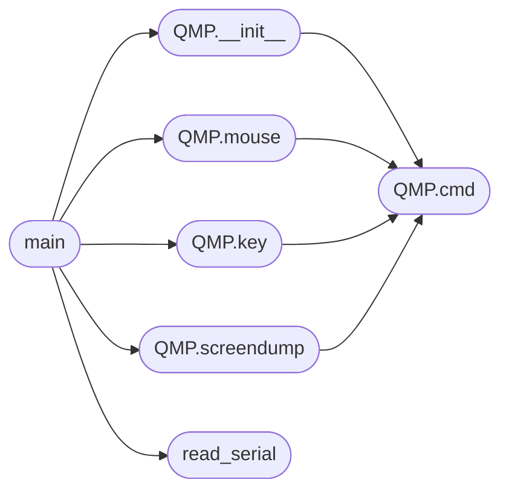

# `tools.minios_gui`

> Source: [tools/minios_gui.py:1](../../tools/minios_gui.py#L1) | language `py` | coverage 11.1% | [API index](../index.md)

minios_gui.py — inject VGA-mode input and capture the framebuffer.

Boots MiniOS with the emulated std VGA device (the linear framebuffer the
kernel's desktop renders into), a QMP socket to inject PS/2 mouse motion,
clicks and keyboard, and a pty serial console to drive the shell. After each
action it saves the current VGA framebuffer to a PNG via QMP [`screendump`](#qmp-screendump),
so a desktop crash, a vanished mouse cursor or a corrupted window is visible
without a physical display.

This is the tool for the VGA-mode bugs (mouse cursor vanishing, desktop
crash after a ring-3 program): it triggers real input events in the VGA
desktop and captures what the guest drew.

Usage:
  python3 tools/minios_gui.py [actions...]

Environment:
  MEM       guest RAM (default 1G, like boot_run.sh: the kernel heap alone
            ends at 384 MB, so a smaller guest never reaches the prompt)
  DISPLAY   X display for the SDL window (run under xvfb-run to stay headless)

Actions:
  send  LINE         send a shell line, wait for prompt
  mouse DX DY        inject relative mouse motion
  click              inject a left-button press+release
  key QCODE [up]     inject a keyboard key (qemu keycode, e.g. esc, return)
  dump NAME          screendump the VGA to $TMPDIR/gui_*/NAME.png
  sleep SECS         pause

## Contents

- **Classes:** [`QMP`](#qmp)
- **Functions:** [`read_serial`](#read_serial), [`main`](#main)
- **Constants:** [`HERE`](#here), [`IMAGE`](#image), [`WORK`](#work), [`QMP_SOCK`](#qmp_sock), [`DUMPS`](#dumps), [`DISPLAY`](#display), [`MEM`](#mem)

## Call Graph

Solid arrows stay in this module, dashed arrows leave it.



## Classes

<a id="qmp"></a>

### `QMP`

`class` | [tools/minios_gui.py:66](../../tools/minios_gui.py#L66)

```python
class QMP
```

**Members**

| Member | Kind | Summary |
|---|---|---|
| [`__init__`](#qmp-__init__) | constructor |  |
| [`cmd`](#qmp-cmd) | method |  |
| [`mouse`](#qmp-mouse) | method |  |
| [`key`](#qmp-key) | method |  |
| [`screendump`](#qmp-screendump) | method |  |

<a id="qmp-__init__"></a>

#### `QMP.__init__`

`constructor` | [tools/minios_gui.py:67](../../tools/minios_gui.py#L67)

```python
def __init__(self, path)
```

**Parameters**

| Name | Type | Default | Description |
|---|---|---|---|
| `path` |  |  |  |

*Calls:* [`QMP.cmd`](#qmp-cmd)

*Called by:* [`main`](#main)

<a id="qmp-cmd"></a>

#### `QMP.cmd`

`method` | [tools/minios_gui.py:79](../../tools/minios_gui.py#L79)

```python
def cmd(self, obj)
```

**Parameters**

| Name | Type | Default | Description |
|---|---|---|---|
| `obj` |  |  |  |

*Called by:* [`QMP.__init__`](#qmp-__init__), [`QMP.key`](#qmp-key), [`QMP.mouse`](#qmp-mouse), [`QMP.screendump`](#qmp-screendump), [`QMP.__init__`](tools.repro_gui.py.md#qmp-__init__), [`QMP.key`](tools.repro_gui.py.md#qmp-key), [`QMP.mouse`](tools.repro_gui.py.md#qmp-mouse)

<a id="qmp-mouse"></a>

#### `QMP.mouse`

`method` | [tools/minios_gui.py:98](../../tools/minios_gui.py#L98)

```python
def mouse(self, dx=0, dy=0, click=False)
```

**Parameters**

| Name | Type | Default | Description |
|---|---|---|---|
| `dx` |  | `0` |  |
| `dy` |  | `0` |  |
| `click` |  | `False` |  |

*Calls:* [`QMP.cmd`](#qmp-cmd)

*Called by:* [`main`](#main), [`main`](tools.repro_gui.py.md#main)

<a id="qmp-key"></a>

#### `QMP.key`

`method` | [tools/minios_gui.py:108](../../tools/minios_gui.py#L108)

```python
def key(self, qcode, up=True)
```

**Parameters**

| Name | Type | Default | Description |
|---|---|---|---|
| `qcode` |  |  |  |
| `up` |  | `True` |  |

*Calls:* [`QMP.cmd`](#qmp-cmd)

*Called by:* [`main`](tools.gdb_repro.py.md#main), [`main`](#main)

<a id="qmp-screendump"></a>

#### `QMP.screendump`

`method` | [tools/minios_gui.py:114](../../tools/minios_gui.py#L114)

```python
def screendump(self, path)
```

**Parameters**

| Name | Type | Default | Description |
|---|---|---|---|
| `path` |  |  |  |

*Calls:* [`QMP.cmd`](#qmp-cmd)

*Called by:* [`main`](#main)

---

## Functions

<a id="read_serial"></a>

### `read_serial`

`function` | [tools/minios_gui.py:50](../../tools/minios_gui.py#L50)

```python
def read_serial(master, timeout=1.0)
```

**Parameters**

| Name | Type | Default | Description |
|---|---|---|---|
| `master` |  |  |  |
| `timeout` |  | `1.0` |  |

*Called by:* [`main`](#main)

---

<a id="main"></a>

### `main`

`function` | [tools/minios_gui.py:118](../../tools/minios_gui.py#L118)

```python
def main()
```

*Calls:* [`QMP.__init__`](#qmp-__init__), [`QMP.key`](#qmp-key), [`QMP.mouse`](#qmp-mouse), [`QMP.screendump`](#qmp-screendump), [`read_serial`](#read_serial)

---

## Constants

<a id="here"></a>

### `HERE`

`constant` | [tools/minios_gui.py:41](../../tools/minios_gui.py#L41)

```python
HERE = os.path.dirname(os.path.abspath(__file__))
```

---

<a id="image"></a>

### `IMAGE`

`constant` | [tools/minios_gui.py:42](../../tools/minios_gui.py#L42)

```python
IMAGE = os.path.join(HERE, '..', 'os.img')
```

---

<a id="work"></a>

### `WORK`

`constant` | [tools/minios_gui.py:43](../../tools/minios_gui.py#L43)

```python
WORK = tempfile.mkdtemp(prefix='gui_')
```

---

<a id="qmp_sock"></a>

### `QMP_SOCK`

`constant` | [tools/minios_gui.py:44](../../tools/minios_gui.py#L44)

```python
QMP_SOCK = os.path.join(WORK, 'qmp.sock')
```

---

<a id="dumps"></a>

### `DUMPS`

`constant` | [tools/minios_gui.py:45](../../tools/minios_gui.py#L45)

```python
DUMPS = WORK
```

---

<a id="display"></a>

### `DISPLAY`

`constant` | [tools/minios_gui.py:46](../../tools/minios_gui.py#L46)

```python
DISPLAY = os.environ.get('DISPLAY', ':0')
```

---

<a id="mem"></a>

### `MEM`

`constant` | [tools/minios_gui.py:47](../../tools/minios_gui.py#L47)

```python
MEM = os.environ.get('MEM', '1G')
```

---
