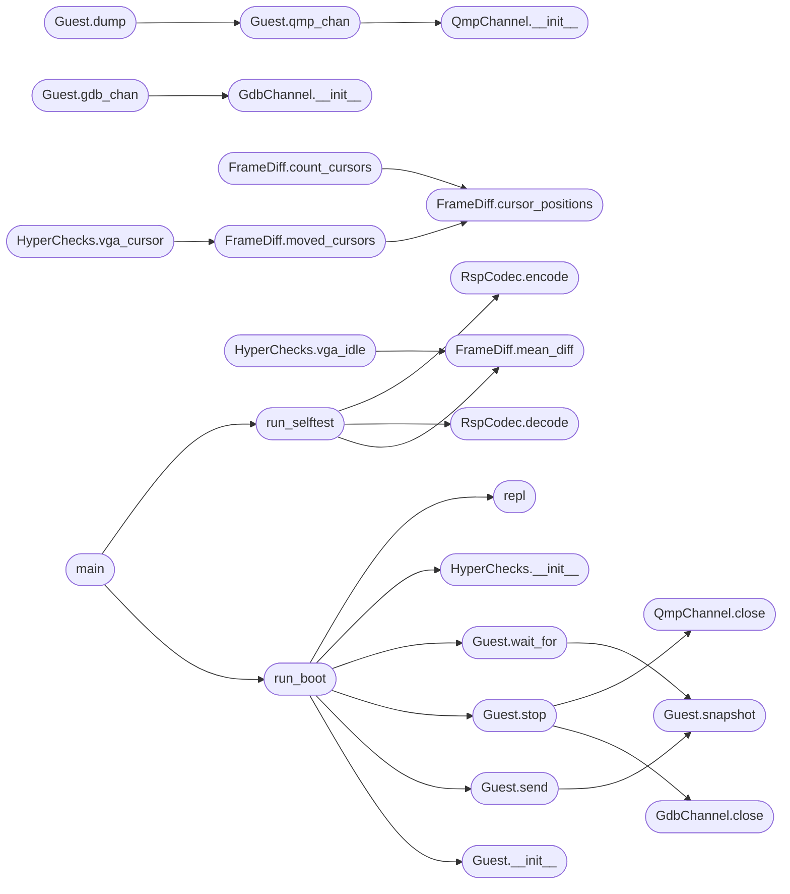

# `tools.minios_hyper`

> Source: [tools/minios_hyper.py:1](../../tools/minios_hyper.py#L1) | language `py` | coverage 66.7% | [API index](../index.md)

minios_hyper.py -- host-side ring-minus-one debugger for MiniOS.

QEMU already runs in host root mode above the guest kernel, so this tool
does not implement a hypervisor. It fuses the three introspection channels
QEMU exposes into one console: the serial shell, the QMP control socket
and the gdb remote stub. From the host it can drive shell commands, trace
syscalls, snapshot the VGA framebuffer and peek guest memory without any
guest cooperation beyond the existing builtins.

Purpose:
    debug the whole system (VGA desktop, syscalls, hangs) from the host
    where qemu runs, with reproducible scripted checks instead of eyeballs.

Usage:
    python3 tools/minios_hyper.py --selftest
    python3 tools/minios_hyper.py --boot --check vga_idle [--check vga_cursor]
                                  [--check gfx_frames] [--check pixel_oob]
                                  [--shell "trace verbose"] [--hold]
    python3 tools/minios_hyper.py --boot --interactive

Inputs:
    --boot runs os.img from the repository root with display none.
    --check names one scripted VGA/syscall probe; repeatable.
    --shell sends one extra guest line after boot.
    --selftest runs host-only unit vectors, no QEMU needed.
    --interactive drops into a tiny repl (help lists commands).

Outputs:
    PASS/FAIL lines on stdout plus screendump PNGs in a mkdtemp work dir.
    Exit 0 when every check passed, 1 otherwise.

Failure modes:
    missing qemu binary or os.img is a loud error, never a silent skip.
    a guest that never reaches the prompt fails the boot wait loudly.
    QMP or gdb channels that never answer fail their check loudly.

## Contents

- **Classes:** [`HyperConfig`](#hyperconfig), [`RspCodec`](#rspcodec), [`QmpChannel`](#qmpchannel), [`GdbChannel`](#gdbchannel), [`Guest`](#guest), [`FrameDiff`](#framediff), [`HyperChecks`](#hyperchecks)
- **Functions:** [`run_selftest`](#run_selftest), [`run_boot`](#run_boot), [`repl`](#repl), [`main`](#main)

## Type Diagram

```mermaid
classDiagram
    direction LR
    class HyperConfig
    HyperConfig : IMAGE_NAME
    HyperConfig : QEMU_BIN
    HyperConfig : MEM
    HyperConfig : BOOT_TIMEOUT
    HyperConfig : CMD_TIMEOUT
    HyperConfig : QMP_TIMEOUT
    HyperConfig : GDB_TIMEOUT
    HyperConfig : GDB_PORT
    HyperConfig : SETTLE
    HyperConfig : SEND_GAP
    HyperConfig : DUMP_GAP
    HyperConfig : IDLE_GAP
    HyperConfig : STABLE_MEAN_MAX
    HyperConfig : CURSOR_EXPECTED
    HyperConfig : TASKBAR_H
    HyperConfig : PROMPT
    HyperConfig : POWER
    HyperConfig : CHECKS
    class RspCodec
    RspCodec : encode()
    RspCodec : decode()
    class QmpChannel
    QmpChannel : __init__()
    QmpChannel : raw()
    QmpChannel : screendump()
    QmpChannel : rel()
    QmpChannel : key()
    QmpChannel : status()
    QmpChannel : close()
    class GdbChannel
    GdbChannel : __init__()
    GdbChannel : regs()
    GdbChannel : read_mem()
    GdbChannel : halt()
    GdbChannel : cont()
    GdbChannel : close()
    class Guest
    Guest : __init__()
    Guest : snapshot()
    Guest : wait_for()
    Guest : send()
    Guest : qmp_chan()
    Guest : gdb_chan()
    Guest : dump()
    Guest : stop()
    class FrameDiff
    FrameDiff : mean_diff()
    FrameDiff : cursor_positions()
    FrameDiff : count_cursors()
    FrameDiff : moved_cursors()
    class HyperChecks
    HyperChecks : __init__()
    HyperChecks : vga_idle()
    HyperChecks : vga_cursor()
    HyperChecks : gfx_frames()
    HyperChecks : pixel_oob()
    HyperChecks : sys_trace()
```



## Call Graph

Solid arrows stay in this module, dashed arrows leave it.



## Classes

<a id="hyperconfig"></a>

### `HyperConfig`

`class` | [tools/minios_hyper.py:50](../../tools/minios_hyper.py#L50)

```python
class HyperConfig
```

Central tunable set for the host debugger, no magic numbers elsewhere.

**Attributes**

| Name | Type | Default | Description |
|---|---|---|---|
| [`IMAGE_NAME`](#hyperconfig-image_name) |  | `'os.img'` |  |
| [`QEMU_BIN`](#hyperconfig-qemu_bin) |  | `os.environ.get('QEMU', 'qemu-system-x86_64')` |  |
| [`MEM`](#hyperconfig-mem) |  | `os.environ.get('MINIOS_MEM', '1G')` |  |
| [`BOOT_TIMEOUT`](#hyperconfig-boot_timeout) |  | `float(os.environ.get('MINIOS_HYPER_BOOT_TMO', '120'))` |  |
| [`CMD_TIMEOUT`](#hyperconfig-cmd_timeout) |  | `float(os.environ.get('MINIOS_HYPER_CMD_TMO', '20'))` |  |
| [`QMP_TIMEOUT`](#hyperconfig-qmp_timeout) |  | `4.0` |  |
| [`GDB_TIMEOUT`](#hyperconfig-gdb_timeout) |  | `4.0` |  |
| [`GDB_PORT`](#hyperconfig-gdb_port) |  | `int(os.environ.get('MINIOS_HYPER_GDB_PORT', '1234'))` |  |
| [`SETTLE`](#hyperconfig-settle) |  | `0.5` |  |
| [`SEND_GAP`](#hyperconfig-send_gap) |  | `0.02` |  |
| [`DUMP_GAP`](#hyperconfig-dump_gap) |  | `0.5` |  |
| [`IDLE_GAP`](#hyperconfig-idle_gap) |  | `3.0` |  |
| [`STABLE_MEAN_MAX`](#hyperconfig-stable_mean_max) |  | `2.0` |  |
| [`CURSOR_EXPECTED`](#hyperconfig-cursor_expected) |  | `1` |  |
| [`TASKBAR_H`](#hyperconfig-taskbar_h) |  | `12` |  |
| [`PROMPT`](#hyperconfig-prompt) |  | `'miniOS> '` |  |
| [`POWER`](#hyperconfig-power) |  | `'poweroff'` |  |
| [`CHECKS`](#hyperconfig-checks) |  | `('vga_idle', 'vga_cursor', 'gfx_frames', 'pixel_oob', 'sys_trace')` |  |

---

<a id="rspcodec"></a>

### `RspCodec`

`class` | [tools/minios_hyper.py:73](../../tools/minios_hyper.py#L73)

```python
class RspCodec
```

Encode and decode gdb remote serial protocol packets.

**Members**

| Member | Kind | Summary |
|---|---|---|
| [`encode`](#rspcodec-encode) | staticmethod | Wrap raw payload bytes into a $...#cs frame. |
| [`decode`](#rspcodec-decode) | staticmethod | Extract payload from a $...#cs frame, empty bytes on malformed. |

<a id="rspcodec-encode"></a>

#### `RspCodec.encode`

`staticmethod` | [tools/minios_hyper.py:77](../../tools/minios_hyper.py#L77)

Decorators: `@staticmethod`

```python
def encode(payload)
```

Wrap raw payload bytes into a $...#cs frame.

**Parameters**

| Name | Type | Default | Description |
|---|---|---|---|
| `payload` |  |  |  |

*Called by:* [`run_selftest`](#run_selftest)

<a id="rspcodec-decode"></a>

#### `RspCodec.decode`

`staticmethod` | [tools/minios_hyper.py:85](../../tools/minios_hyper.py#L85)

Decorators: `@staticmethod`

```python
def decode(frame)
```

Extract payload from a $...#cs frame, empty bytes on malformed.

**Parameters**

| Name | Type | Default | Description |
|---|---|---|---|
| `frame` |  |  |  |

*Called by:* [`run_selftest`](#run_selftest)

---

<a id="qmpchannel"></a>

### `QmpChannel`

`class` | [tools/minios_hyper.py:96](../../tools/minios_hyper.py#L96)

```python
class QmpChannel
```

Minimal QMP client over a unix socket.

**Members**

| Member | Kind | Summary |
|---|---|---|
| [`__init__`](#qmpchannel-__init__) | constructor |  |
| [`raw`](#qmpchannel-raw) | method | Send one QMP object and return the raw reply bytes. |
| [`screendump`](#qmpchannel-screendump) | method | Ask QEMU to write the VGA frame to path. |
| [`rel`](#qmpchannel-rel) | method | Inject relative mouse motion. |
| [`key`](#qmpchannel-key) | method | Tap one qemu keycode down and up. |
| [`status`](#qmpchannel-status) | method | Query the VM run state. |
| [`close`](#qmpchannel-close) | method |  |

<a id="qmpchannel-__init__"></a>

#### `QmpChannel.__init__`

`constructor` | [tools/minios_hyper.py:99](../../tools/minios_hyper.py#L99)

```python
def __init__(self, path)
```

**Parameters**

| Name | Type | Default | Description |
|---|---|---|---|
| `path` |  |  |  |

*Called by:* [`Guest.qmp_chan`](#guest-qmp_chan)

<a id="qmpchannel-raw"></a>

#### `QmpChannel.raw`

`method` | [tools/minios_hyper.py:117](../../tools/minios_hyper.py#L117)

```python
def raw(self, obj)
```

Send one QMP object and return the raw reply bytes.

**Parameters**

| Name | Type | Default | Description |
|---|---|---|---|
| `obj` |  |  |  |

<a id="qmpchannel-screendump"></a>

#### `QmpChannel.screendump`

`method` | [tools/minios_hyper.py:121](../../tools/minios_hyper.py#L121)

```python
def screendump(self, path)
```

Ask QEMU to write the VGA frame to path.

**Parameters**

| Name | Type | Default | Description |
|---|---|---|---|
| `path` |  |  |  |

<a id="qmpchannel-rel"></a>

#### `QmpChannel.rel`

`method` | [tools/minios_hyper.py:126](../../tools/minios_hyper.py#L126)

```python
def rel(self, dx, dy)
```

Inject relative mouse motion.

**Parameters**

| Name | Type | Default | Description |
|---|---|---|---|
| `dx` |  |  |  |
| `dy` |  |  |  |

*Called by:* [`main`](tools.probe_compute_vga.py.md#main)

<a id="qmpchannel-key"></a>

#### `QmpChannel.key`

`method` | [tools/minios_hyper.py:132](../../tools/minios_hyper.py#L132)

```python
def key(self, qcode)
```

Tap one qemu keycode down and up.

**Parameters**

| Name | Type | Default | Description |
|---|---|---|---|
| `qcode` |  |  |  |

<a id="qmpchannel-status"></a>

#### `QmpChannel.status`

`method` | [tools/minios_hyper.py:141](../../tools/minios_hyper.py#L141)

```python
def status(self)
```

Query the VM run state.

<a id="qmpchannel-close"></a>

#### `QmpChannel.close`

`method` | [tools/minios_hyper.py:145](../../tools/minios_hyper.py#L145)

```python
def close(self)
```

*Called by:* [`Guest.stop`](#guest-stop)

---

<a id="gdbchannel"></a>

### `GdbChannel`

`class` | [tools/minios_hyper.py:152](../../tools/minios_hyper.py#L152)

```python
class GdbChannel
```

Tiny gdb RSP client for QEMU -s, enough to read regs and memory.

**Members**

| Member | Kind | Summary |
|---|---|---|
| [`__init__`](#gdbchannel-__init__) | constructor |  |
| [`regs`](#gdbchannel-regs) | method | Return raw g-packet bytes, empty on failure. |
| [`read_mem`](#gdbchannel-read_mem) | method | Read length bytes at addr, None on failure or malformed reply. |
| [`halt`](#gdbchannel-halt) | method |  |
| [`cont`](#gdbchannel-cont) | method |  |
| [`close`](#gdbchannel-close) | method |  |

<a id="gdbchannel-__init__"></a>

#### `GdbChannel.__init__`

`constructor` | [tools/minios_hyper.py:155](../../tools/minios_hyper.py#L155)

```python
def __init__(self, port)
```

**Parameters**

| Name | Type | Default | Description |
|---|---|---|---|
| `port` |  |  |  |

*Called by:* [`Guest.gdb_chan`](#guest-gdb_chan)

<a id="gdbchannel-regs"></a>

#### `GdbChannel.regs`

`method` | [tools/minios_hyper.py:181](../../tools/minios_hyper.py#L181)

```python
def regs(self)
```

Return raw g-packet bytes, empty on failure.

<a id="gdbchannel-read_mem"></a>

#### `GdbChannel.read_mem`

`method` | [tools/minios_hyper.py:185](../../tools/minios_hyper.py#L185)

```python
def read_mem(self, addr, length)
```

Read length bytes at addr, None on failure or malformed reply.

**Parameters**

| Name | Type | Default | Description |
|---|---|---|---|
| `addr` |  |  |  |
| `length` |  |  |  |

<a id="gdbchannel-halt"></a>

#### `GdbChannel.halt`

`method` | [tools/minios_hyper.py:195](../../tools/minios_hyper.py#L195)

```python
def halt(self)
```

<a id="gdbchannel-cont"></a>

#### `GdbChannel.cont`

`method` | [tools/minios_hyper.py:201](../../tools/minios_hyper.py#L201)

```python
def cont(self)
```

<a id="gdbchannel-close"></a>

#### `GdbChannel.close`

`method` | [tools/minios_hyper.py:204](../../tools/minios_hyper.py#L204)

```python
def close(self)
```

*Called by:* [`Guest.stop`](#guest-stop)

---

<a id="guest"></a>

### `Guest`

`class` | [tools/minios_hyper.py:211](../../tools/minios_hyper.py#L211)

```python
class Guest
```

Owns the QEMU child plus its serial, QMP and gdb channels.

**Members**

| Member | Kind | Summary |
|---|---|---|
| [`__init__`](#guest-__init__) | constructor |  |
| [`snapshot`](#guest-snapshot) | method |  |
| [`wait_for`](#guest-wait_for) | method |  |
| [`send`](#guest-send) | method |  |
| [`qmp_chan`](#guest-qmp_chan) | method |  |
| [`gdb_chan`](#guest-gdb_chan) | method |  |
| [`dump`](#guest-dump) | method |  |
| [`stop`](#guest-stop) | method |  |

<a id="guest-__init__"></a>

#### `Guest.__init__`

`constructor` | [tools/minios_hyper.py:214](../../tools/minios_hyper.py#L214)

```python
def __init__(self, with_gdb=False)
```

**Parameters**

| Name | Type | Default | Description |
|---|---|---|---|
| `with_gdb` |  | `False` |  |

*Called by:* [`run_boot`](#run_boot)

<a id="guest-snapshot"></a>

#### `Guest.snapshot`

`method` | [tools/minios_hyper.py:276](../../tools/minios_hyper.py#L276)

```python
def snapshot(self)
```

*Called by:* [`Guest.send`](#guest-send), [`Guest.wait_for`](#guest-wait_for)

<a id="guest-wait_for"></a>

#### `Guest.wait_for`

`method` | [tools/minios_hyper.py:280](../../tools/minios_hyper.py#L280)

```python
def wait_for(self, marker, timeout=None)
```

**Parameters**

| Name | Type | Default | Description |
|---|---|---|---|
| `marker` |  |  |  |
| `timeout` |  | `None` |  |

*Calls:* [`Guest.snapshot`](#guest-snapshot)

*Called by:* [`run_boot`](#run_boot)

<a id="guest-send"></a>

#### `Guest.send`

`method` | [tools/minios_hyper.py:288](../../tools/minios_hyper.py#L288)

```python
def send(self, line, settle=None)
```

**Parameters**

| Name | Type | Default | Description |
|---|---|---|---|
| `line` |  |  |  |
| `settle` |  | `None` |  |

*Calls:* [`Guest.snapshot`](#guest-snapshot)

*Called by:* [`run_boot`](#run_boot)

<a id="guest-qmp_chan"></a>

#### `Guest.qmp_chan`

`method` | [tools/minios_hyper.py:298](../../tools/minios_hyper.py#L298)

```python
def qmp_chan(self)
```

*Calls:* [`QmpChannel.__init__`](#qmpchannel-__init__)

*Called by:* [`Guest.dump`](#guest-dump)

<a id="guest-gdb_chan"></a>

#### `Guest.gdb_chan`

`method` | [tools/minios_hyper.py:303](../../tools/minios_hyper.py#L303)

```python
def gdb_chan(self)
```

*Calls:* [`GdbChannel.__init__`](#gdbchannel-__init__)

<a id="guest-dump"></a>

#### `Guest.dump`

`method` | [tools/minios_hyper.py:308](../../tools/minios_hyper.py#L308)

```python
def dump(self, name)
```

**Parameters**

| Name | Type | Default | Description |
|---|---|---|---|
| `name` |  |  |  |

*Calls:* [`Guest.qmp_chan`](#guest-qmp_chan)

*Called by:* [`main`](tools.probe_compute_vga.py.md#main)

<a id="guest-stop"></a>

#### `Guest.stop`

`method` | [tools/minios_hyper.py:314](../../tools/minios_hyper.py#L314)

```python
def stop(self)
```

*Calls:* [`GdbChannel.close`](#gdbchannel-close), [`QmpChannel.close`](#qmpchannel-close)

*Called by:* [`run_boot`](#run_boot)

---

<a id="framediff"></a>

### `FrameDiff`

`class` | [tools/minios_hyper.py:339](../../tools/minios_hyper.py#L339)

```python
class FrameDiff
```

Host-side pixel math over QMP screendumps.

**Members**

| Member | Kind | Summary |
|---|---|---|
| [`mean_diff`](#framediff-mean_diff) | staticmethod | Mean absolute grey difference above the taskbar strip. |
| [`cursor_positions`](#framediff-cursor_positions) | staticmethod | Clustered arrow-template hit positions, static-safe. |
| [`count_cursors`](#framediff-count_cursors) | staticmethod | Clustered arrow-sprite count for one frame. |
| [`moved_cursors`](#framediff-moved_cursors) | staticmethod | Hits in after with no neighbour in before, the live pointer. |

<a id="framediff-mean_diff"></a>

#### `FrameDiff.mean_diff`

`staticmethod` | [tools/minios_hyper.py:343](../../tools/minios_hyper.py#L343)

Decorators: `@staticmethod`

```python
def mean_diff(a_path, b_path)
```

Mean absolute grey difference above the taskbar strip.

**Parameters**

| Name | Type | Default | Description |
|---|---|---|---|
| `a_path` |  |  |  |
| `b_path` |  |  |  |

*Called by:* [`HyperChecks.vga_idle`](#hyperchecks-vga_idle), [`run_selftest`](#run_selftest)

<a id="framediff-cursor_positions"></a>

#### `FrameDiff.cursor_positions`

`staticmethod` | [tools/minios_hyper.py:356](../../tools/minios_hyper.py#L356)

Decorators: `@staticmethod`

```python
def cursor_positions(shot_path)
```

Clustered arrow-template hit positions, static-safe.

**Parameters**

| Name | Type | Default | Description |
|---|---|---|---|
| `shot_path` |  |  |  |

*Called by:* [`FrameDiff.count_cursors`](#framediff-count_cursors), [`FrameDiff.moved_cursors`](#framediff-moved_cursors)

<a id="framediff-count_cursors"></a>

#### `FrameDiff.count_cursors`

`staticmethod` | [tools/minios_hyper.py:394](../../tools/minios_hyper.py#L394)

Decorators: `@staticmethod`

```python
def count_cursors(shot_path)
```

Clustered arrow-sprite count for one frame.

**Parameters**

| Name | Type | Default | Description |
|---|---|---|---|
| `shot_path` |  |  |  |

*Calls:* [`FrameDiff.cursor_positions`](#framediff-cursor_positions)

<a id="framediff-moved_cursors"></a>

#### `FrameDiff.moved_cursors`

`staticmethod` | [tools/minios_hyper.py:399](../../tools/minios_hyper.py#L399)

Decorators: `@staticmethod`

```python
def moved_cursors(before_path, after_path)
```

Hits in after with no neighbour in before, the live pointer.

**Parameters**

| Name | Type | Default | Description |
|---|---|---|---|
| `before_path` |  |  |  |
| `after_path` |  |  |  |

*Calls:* [`FrameDiff.cursor_positions`](#framediff-cursor_positions)

*Called by:* [`HyperChecks.vga_cursor`](#hyperchecks-vga_cursor)

---

<a id="hyperchecks"></a>

### `HyperChecks`

`class` | [tools/minios_hyper.py:409](../../tools/minios_hyper.py#L409)

```python
class HyperChecks
```

Scripted bug-hunting probes, each returns (ok, detail).

**Members**

| Member | Kind | Summary |
|---|---|---|
| [`__init__`](#hyperchecks-__init__) | constructor |  |
| [`vga_idle`](#hyperchecks-vga_idle) | method | Two idle frames must match, no unsolicited redraw or flicker. |
| [`vga_cursor`](#hyperchecks-vga_cursor) | method | One live pointer must move, static template hits are ignored. |
| [`gfx_frames`](#hyperchecks-gfx_frames) | method | The composited-frame counter must climb across a real present. |
| [`pixel_oob`](#hyperchecks-pixel_oob) | method | Out-of-range pixel probes must diagnose, never wrap or crash. |
| [`sys_trace`](#hyperchecks-sys_trace) | method | Verbose trace must show a named syscall for a real program. |

<a id="hyperchecks-__init__"></a>

#### `HyperChecks.__init__`

`constructor` | [tools/minios_hyper.py:412](../../tools/minios_hyper.py#L412)

```python
def __init__(self, guest)
```

**Parameters**

| Name | Type | Default | Description |
|---|---|---|---|
| `guest` |  |  |  |

*Called by:* [`run_boot`](#run_boot)

<a id="hyperchecks-vga_idle"></a>

#### `HyperChecks.vga_idle`

`method` | [tools/minios_hyper.py:415](../../tools/minios_hyper.py#L415)

```python
def vga_idle(self)
```

Two idle frames must match, no unsolicited redraw or flicker.

*Calls:* [`FrameDiff.mean_diff`](#framediff-mean_diff)

<a id="hyperchecks-vga_cursor"></a>

#### `HyperChecks.vga_cursor`

`method` | [tools/minios_hyper.py:427](../../tools/minios_hyper.py#L427)

```python
def vga_cursor(self)
```

One live pointer must move, static template hits are ignored.

*Calls:* [`FrameDiff.moved_cursors`](#framediff-moved_cursors)

<a id="hyperchecks-gfx_frames"></a>

#### `HyperChecks.gfx_frames`

`method` | [tools/minios_hyper.py:439](../../tools/minios_hyper.py#L439)

```python
def gfx_frames(self)
```

The composited-frame counter must climb across a real present.

<a id="hyperchecks-pixel_oob"></a>

#### `HyperChecks.pixel_oob`

`method` | [tools/minios_hyper.py:452](../../tools/minios_hyper.py#L452)

```python
def pixel_oob(self)
```

Out-of-range pixel probes must diagnose, never wrap or crash.

<a id="hyperchecks-sys_trace"></a>

#### `HyperChecks.sys_trace`

`method` | [tools/minios_hyper.py:465](../../tools/minios_hyper.py#L465)

```python
def sys_trace(self)
```

Verbose trace must show a named syscall for a real program.

---

## Functions

<a id="run_selftest"></a>

### `run_selftest`

`function` | [tools/minios_hyper.py:491](../../tools/minios_hyper.py#L491)

```python
def run_selftest()
```

Host-only vectors for the packet codec and pixel math, no QEMU.

*Calls:* [`FrameDiff.mean_diff`](#framediff-mean_diff), [`RspCodec.decode`](#rspcodec-decode), [`RspCodec.encode`](#rspcodec-encode)

*Called by:* [`main`](progs.piano.piano.c.md#main), [`main`](#main)

---

<a id="run_boot"></a>

### `run_boot`

`function` | [tools/minios_hyper.py:523](../../tools/minios_hyper.py#L523)

```python
def run_boot(checks, extra_shell, interactive)
```

Boot the guest and run the requested scripted checks.

**Parameters**

| Name | Type | Default | Description |
|---|---|---|---|
| `checks` |  |  |  |
| `extra_shell` |  |  |  |
| `interactive` |  |  |  |

*Calls:* [`Guest.__init__`](#guest-__init__), [`Guest.send`](#guest-send), [`Guest.stop`](#guest-stop), [`Guest.wait_for`](#guest-wait_for), [`HyperChecks.__init__`](#hyperchecks-__init__), [`repl`](#repl)

*Called by:* [`main`](#main)

---

<a id="repl"></a>

### `repl`

`function` | [tools/minios_hyper.py:561](../../tools/minios_hyper.py#L561)

```python
def repl(guest)
```

Tiny interactive loop joining shell, QMP and gdb reads.

**Parameters**

| Name | Type | Default | Description |
|---|---|---|---|
| `guest` |  |  |  |

*Called by:* [`main`](progs.lisp.lisp.c.md#main), [`main`](progs.lua.lua_main.c.md#main), [`run_boot`](#run_boot)

---

<a id="main"></a>

### `main`

`function` | [tools/minios_hyper.py:591](../../tools/minios_hyper.py#L591)

```python
def main(argv)
```

Parse argv and dispatch to selftest, boot checks or repl.

**Parameters**

| Name | Type | Default | Description |
|---|---|---|---|
| `argv` |  |  |  |

*Calls:* [`run_boot`](#run_boot), [`run_selftest`](#run_selftest)

---
