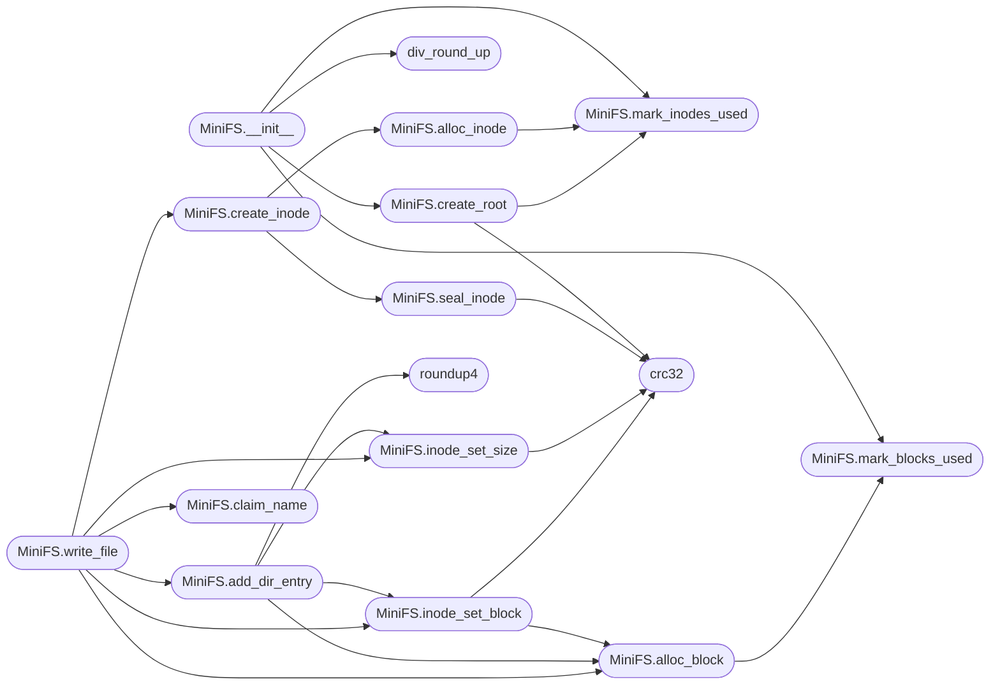

# `tools.mkfs.minifs`

> Source: [tools/mkfs.minifs.py:1](../../tools/mkfs.minifs.py#L1) | language `py` | coverage 17.4% | [API index](../index.md)

mkfs.minifs.py - Create a MiniFS filesystem image for MiniOS.

Usage: python3 mkfs.minifs.py <output_file> <total_blocks> [files...]
       python3 mkfs.minifs.py minifs.bin 32768
       python3 mkfs.minifs.py minifs.bin 32768 -d files/

## Contents

- **Classes:** [`MiniFS`](#minifs)
- **Functions:** [`roundup4`](#roundup4), [`div_round_up`](#div_round_up), [`crc16`](#crc16), [`crc32`](#crc32), [`count_free`](#count_free), [`main`](#main)
- **Constants:** [`MAGIC`](#magic), [`VERSION`](#version), [`BLOCK_SIZE`](#block_size), [`ROOT_INODE`](#root_inode), [`INODE_TABLE_BLOCKS`](#inode_table_blocks), [`S_IFREG`](#s_ifreg), [`S_IFDIR`](#s_ifdir), [`FT_FILE`](#ft_file), [`FT_DIR`](#ft_dir), [`DIR_ENTRY_HDR_SIZE`](#dir_entry_hdr_size)

## Call Graph

Solid arrows stay in this module, dashed arrows leave it.



## Classes

<a id="minifs"></a>

### `MiniFS`

`class` | [tools/mkfs.minifs.py:56](../../tools/mkfs.minifs.py#L56)

```python
class MiniFS
```

**Members**

| Member | Kind | Summary |
|---|---|---|
| [`__init__`](#minifs-__init__) | constructor |  |
| [`mark_inodes_used`](#minifs-mark_inodes_used) | method |  |
| [`mark_blocks_used`](#minifs-mark_blocks_used) | method |  |
| [`alloc_inode`](#minifs-alloc_inode) | method |  |
| [`alloc_block`](#minifs-alloc_block) | method |  |
| [`create_root`](#minifs-create_root) | method |  |
| [`seal_inode`](#minifs-seal_inode) | method | Store the inode checksum over its first 124 bytes; every mutation reseals, or the kernel rejects the inode on read. |
| [`create_inode`](#minifs-create_inode) | method |  |
| [`inode_set_size`](#minifs-inode_set_size) | method |  |
| [`inode_set_block`](#minifs-inode_set_block) | method |  |
| [`add_dir_entry`](#minifs-add_dir_entry) | method |  |
| [`claim_name`](#minifs-claim_name) | method | Record name in parent_ino. |
| [`write_file`](#minifs-write_file) | method |  |
| [`write_dir`](#minifs-write_dir) | method |  |
| [`serialize`](#minifs-serialize) | method |  |

<a id="minifs-__init__"></a>

#### `MiniFS.__init__`

`constructor` | [tools/mkfs.minifs.py:57](../../tools/mkfs.minifs.py#L57)

```python
def __init__(self, total_blocks)
```

**Parameters**

| Name | Type | Default | Description |
|---|---|---|---|
| `total_blocks` |  |  |  |

*Calls:* [`MiniFS.create_root`](#minifs-create_root), [`MiniFS.mark_blocks_used`](#minifs-mark_blocks_used), [`MiniFS.mark_inodes_used`](#minifs-mark_inodes_used), [`div_round_up`](#div_round_up)

*Called by:* [`main`](#main)

<a id="minifs-mark_inodes_used"></a>

#### `MiniFS.mark_inodes_used`

`method` | [tools/mkfs.minifs.py:80](../../tools/mkfs.minifs.py#L80)

```python
def mark_inodes_used(self, start, count)
```

**Parameters**

| Name | Type | Default | Description |
|---|---|---|---|
| `start` |  |  |  |
| `count` |  |  |  |

*Called by:* [`MiniFS.__init__`](#minifs-__init__), [`MiniFS.alloc_inode`](#minifs-alloc_inode), [`MiniFS.create_root`](#minifs-create_root)

<a id="minifs-mark_blocks_used"></a>

#### `MiniFS.mark_blocks_used`

`method` | [tools/mkfs.minifs.py:84](../../tools/mkfs.minifs.py#L84)

```python
def mark_blocks_used(self, start, count)
```

**Parameters**

| Name | Type | Default | Description |
|---|---|---|---|
| `start` |  |  |  |
| `count` |  |  |  |

*Called by:* [`MiniFS.__init__`](#minifs-__init__), [`MiniFS.alloc_block`](#minifs-alloc_block)

<a id="minifs-alloc_inode"></a>

#### `MiniFS.alloc_inode`

`method` | [tools/mkfs.minifs.py:88](../../tools/mkfs.minifs.py#L88)

```python
def alloc_inode(self)
```

*Calls:* [`MiniFS.mark_inodes_used`](#minifs-mark_inodes_used)

*Called by:* [`MiniFS.create_inode`](#minifs-create_inode)

<a id="minifs-alloc_block"></a>

#### `MiniFS.alloc_block`

`method` | [tools/mkfs.minifs.py:94](../../tools/mkfs.minifs.py#L94)

```python
def alloc_block(self)
```

*Calls:* [`MiniFS.mark_blocks_used`](#minifs-mark_blocks_used)

*Called by:* [`MiniFS.add_dir_entry`](#minifs-add_dir_entry), [`MiniFS.inode_set_block`](#minifs-inode_set_block), [`MiniFS.write_file`](#minifs-write_file)

<a id="minifs-create_root"></a>

#### `MiniFS.create_root`

`method` | [tools/mkfs.minifs.py:100](../../tools/mkfs.minifs.py#L100)

```python
def create_root(self)
```

*Calls:* [`bytes`](headers.sched.h.md#bytes), [`MiniFS.mark_inodes_used`](#minifs-mark_inodes_used), [`crc32`](#crc32)

*Called by:* [`MiniFS.__init__`](#minifs-__init__)

<a id="minifs-seal_inode"></a>

#### `MiniFS.seal_inode`

`method` | [tools/mkfs.minifs.py:108](../../tools/mkfs.minifs.py#L108)

```python
def seal_inode(self, ino)
```

Store the inode checksum over its first 124 bytes; every mutation reseals, or the kernel rejects the inode on read.

**Parameters**

| Name | Type | Default | Description |
|---|---|---|---|
| `ino` |  |  |  |

*Calls:* [`bytes`](headers.sched.h.md#bytes), [`crc32`](#crc32)

*Called by:* [`MiniFS.create_inode`](#minifs-create_inode)

<a id="minifs-create_inode"></a>

#### `MiniFS.create_inode`

`method` | [tools/mkfs.minifs.py:113](../../tools/mkfs.minifs.py#L113)

```python
def create_inode(self, mode, links=1)
```

**Parameters**

| Name | Type | Default | Description |
|---|---|---|---|
| `mode` |  |  |  |
| `links` |  | `1` |  |

*Calls:* [`MiniFS.alloc_inode`](#minifs-alloc_inode), [`MiniFS.seal_inode`](#minifs-seal_inode)

*Called by:* [`MiniFS.write_dir`](#minifs-write_dir), [`MiniFS.write_file`](#minifs-write_file)

<a id="minifs-inode_set_size"></a>

#### `MiniFS.inode_set_size`

`method` | [tools/mkfs.minifs.py:120](../../tools/mkfs.minifs.py#L120)

```python
def inode_set_size(self, ino, size)
```

**Parameters**

| Name | Type | Default | Description |
|---|---|---|---|
| `ino` |  |  |  |
| `size` |  |  |  |

*Calls:* [`bytes`](headers.sched.h.md#bytes), [`crc32`](#crc32)

*Called by:* [`MiniFS.add_dir_entry`](#minifs-add_dir_entry), [`MiniFS.write_file`](#minifs-write_file)

<a id="minifs-inode_set_block"></a>

#### `MiniFS.inode_set_block`

`method` | [tools/mkfs.minifs.py:124](../../tools/mkfs.minifs.py#L124)

```python
def inode_set_block(self, ino, logblk, phys)
```

**Parameters**

| Name | Type | Default | Description |
|---|---|---|---|
| `ino` |  |  |  |
| `logblk` |  |  |  |
| `phys` |  |  |  |

*Calls:* [`bytes`](headers.sched.h.md#bytes), [`MiniFS.alloc_block`](#minifs-alloc_block), [`crc32`](#crc32)

*Called by:* [`MiniFS.add_dir_entry`](#minifs-add_dir_entry), [`MiniFS.write_file`](#minifs-write_file)

<a id="minifs-add_dir_entry"></a>

#### `MiniFS.add_dir_entry`

`method` | [tools/mkfs.minifs.py:154](../../tools/mkfs.minifs.py#L154)

```python
def add_dir_entry(self, dir_ino, name, child_ino, ftype)
```

**Parameters**

| Name | Type | Default | Description |
|---|---|---|---|
| `dir_ino` |  |  |  |
| `name` |  |  |  |
| `child_ino` |  |  |  |
| `ftype` |  |  |  |

*Calls:* [`bytes`](headers.sched.h.md#bytes), [`MiniFS.alloc_block`](#minifs-alloc_block), [`MiniFS.inode_set_block`](#minifs-inode_set_block), [`MiniFS.inode_set_size`](#minifs-inode_set_size), [`roundup4`](#roundup4)

*Called by:* [`MiniFS.write_dir`](#minifs-write_dir), [`MiniFS.write_file`](#minifs-write_file)

<a id="minifs-claim_name"></a>

#### `MiniFS.claim_name`

`method` | [tools/mkfs.minifs.py:192](../../tools/mkfs.minifs.py#L192)

```python
def claim_name(self, parent_ino, name, is_dir)
```

Record name in parent_ino.

Returns the inode of an existing directory when a directory of the same name is packed again (two source trees merge, e.g. several etc/ roots); any other collision is a build error, never a duplicate entry that shadows a file.

**Parameters**

| Name | Type | Default | Description |
|---|---|---|---|
| `parent_ino` |  |  |  |
| `name` |  |  |  |
| `is_dir` |  |  |  |

**Raises**

- `SystemExit`: (raised in the body, not documented)

*Called by:* [`MiniFS.write_dir`](#minifs-write_dir), [`MiniFS.write_file`](#minifs-write_file)

<a id="minifs-write_file"></a>

#### `MiniFS.write_file`

`method` | [tools/mkfs.minifs.py:205](../../tools/mkfs.minifs.py#L205)

```python
def write_file(self, parent_ino, name, data)
```

**Parameters**

| Name | Type | Default | Description |
|---|---|---|---|
| `parent_ino` |  |  |  |
| `name` |  |  |  |
| `data` |  |  |  |

*Calls:* [`MiniFS.add_dir_entry`](#minifs-add_dir_entry), [`MiniFS.alloc_block`](#minifs-alloc_block), [`MiniFS.claim_name`](#minifs-claim_name), [`MiniFS.create_inode`](#minifs-create_inode), [`MiniFS.inode_set_block`](#minifs-inode_set_block), [`MiniFS.inode_set_size`](#minifs-inode_set_size)

*Called by:* [`main`](#main)

<a id="minifs-write_dir"></a>

#### `MiniFS.write_dir`

`method` | [tools/mkfs.minifs.py:224](../../tools/mkfs.minifs.py#L224)

```python
def write_dir(self, parent_ino, name)
```

**Parameters**

| Name | Type | Default | Description |
|---|---|---|---|
| `parent_ino` |  |  |  |
| `name` |  |  |  |

*Calls:* [`MiniFS.add_dir_entry`](#minifs-add_dir_entry), [`MiniFS.claim_name`](#minifs-claim_name), [`MiniFS.create_inode`](#minifs-create_inode)

*Called by:* [`main`](#main)

<a id="minifs-serialize"></a>

#### `MiniFS.serialize`

`method` | [tools/mkfs.minifs.py:236](../../tools/mkfs.minifs.py#L236)

```python
def serialize(self)
```

*Calls:* [`bytes`](headers.sched.h.md#bytes), [`count_free`](#count_free), [`crc16`](#crc16)

*Called by:* [`main`](#main)

---

## Functions

<a id="roundup4"></a>

### `roundup4`

`function` | [tools/mkfs.minifs.py:28](../../tools/mkfs.minifs.py#L28)

```python
def roundup4(v)
```

**Parameters**

| Name | Type | Default | Description |
|---|---|---|---|
| `v` |  |  |  |

*Called by:* [`minifs_dir_add_entry`](fs.minifs.c.md#minifs_dir_add_entry), [`MiniFS.add_dir_entry`](#minifs-add_dir_entry)

---

<a id="div_round_up"></a>

### `div_round_up`

`function` | [tools/mkfs.minifs.py:31](../../tools/mkfs.minifs.py#L31)

```python
def div_round_up(n, d)
```

**Parameters**

| Name | Type | Default | Description |
|---|---|---|---|
| `n` |  |  |  |
| `d` |  |  |  |

*Called by:* [`minifs_mount`](fs.minifs.c.md#minifs_mount), [`minifs_sync`](fs.minifs.c.md#minifs_sync), [`MiniFS.__init__`](#minifs-__init__)

---

<a id="crc16"></a>

### `crc16`

`function` | [tools/mkfs.minifs.py:34](../../tools/mkfs.minifs.py#L34)

```python
def crc16(data)
```

**Parameters**

| Name | Type | Default | Description |
|---|---|---|---|
| `data` |  |  |  |

*Called by:* [`MiniFS.serialize`](#minifs-serialize)

---

<a id="crc32"></a>

### `crc32`

`function` | [tools/mkfs.minifs.py:42](../../tools/mkfs.minifs.py#L42)

```python
def crc32(data)
```

**Parameters**

| Name | Type | Default | Description |
|---|---|---|---|
| `data` |  |  |  |

*Called by:* [`MiniFS.create_root`](#minifs-create_root), [`MiniFS.inode_set_block`](#minifs-inode_set_block), [`MiniFS.inode_set_size`](#minifs-inode_set_size), [`MiniFS.seal_inode`](#minifs-seal_inode)

---

<a id="count_free"></a>

### `count_free`

`function` | [tools/mkfs.minifs.py:50](../../tools/mkfs.minifs.py#L50)

```python
def count_free(bitmap, count)
```

Clear bits among the first count bits of bitmap: the superblock free counters must equal what the kernel allocator sees in the bitmaps.

**Parameters**

| Name | Type | Default | Description |
|---|---|---|---|
| `bitmap` |  |  |  |
| `count` |  |  |  |

*Called by:* [`MiniFS.serialize`](#minifs-serialize)

---

<a id="main"></a>

### `main`

`function` | [tools/mkfs.minifs.py:280](../../tools/mkfs.minifs.py#L280)

```python
def main()
```

*Calls:* [`MiniFS.__init__`](#minifs-__init__), [`MiniFS.serialize`](#minifs-serialize), [`MiniFS.write_dir`](#minifs-write_dir), [`MiniFS.write_file`](#minifs-write_file)

---

## Constants

<a id="magic"></a>

### `MAGIC`

`constant` | [tools/mkfs.minifs.py:12](../../tools/mkfs.minifs.py#L12)

```python
MAGIC = 1296649801
```

---

<a id="version"></a>

### `VERSION`

`constant` | [tools/mkfs.minifs.py:13](../../tools/mkfs.minifs.py#L13)

```python
VERSION = 1
```

---

<a id="block_size"></a>

### `BLOCK_SIZE`

`constant` | [tools/mkfs.minifs.py:14](../../tools/mkfs.minifs.py#L14)

```python
BLOCK_SIZE = 4096
```

---

<a id="root_inode"></a>

### `ROOT_INODE`

`constant` | [tools/mkfs.minifs.py:15](../../tools/mkfs.minifs.py#L15)

```python
ROOT_INODE = 2
```

---

<a id="inode_table_blocks"></a>

### `INODE_TABLE_BLOCKS`

`constant` | [tools/mkfs.minifs.py:21](../../tools/mkfs.minifs.py#L21)

```python
INODE_TABLE_BLOCKS = 64
```

---

<a id="s_ifreg"></a>

### `S_IFREG`

`constant` | [tools/mkfs.minifs.py:22](../../tools/mkfs.minifs.py#L22)

```python
S_IFREG = 32768
```

---

<a id="s_ifdir"></a>

### `S_IFDIR`

`constant` | [tools/mkfs.minifs.py:23](../../tools/mkfs.minifs.py#L23)

```python
S_IFDIR = 16384
```

---

<a id="ft_file"></a>

### `FT_FILE`

`constant` | [tools/mkfs.minifs.py:24](../../tools/mkfs.minifs.py#L24)

```python
FT_FILE = 1
```

---

<a id="ft_dir"></a>

### `FT_DIR`

`constant` | [tools/mkfs.minifs.py:25](../../tools/mkfs.minifs.py#L25)

```python
FT_DIR = 2
```

---

<a id="dir_entry_hdr_size"></a>

### `DIR_ENTRY_HDR_SIZE`

`constant` | [tools/mkfs.minifs.py:26](../../tools/mkfs.minifs.py#L26)

```python
DIR_ENTRY_HDR_SIZE = 8
```

---
