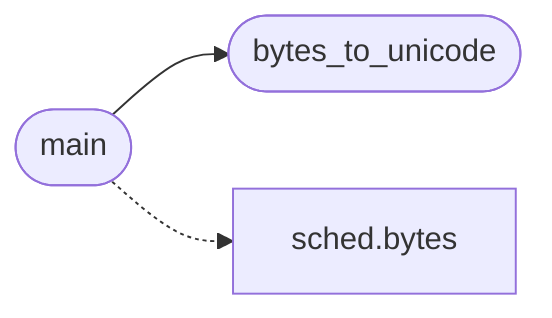

# `tools.mkvocab`

> Source: [tools/mkvocab.py:1](../../tools/mkvocab.py#L1) | language `py` | coverage 100.0% | [API index](../index.md)

Build progs/topogpt3/vocab.bin from the GPT-2 encoder.json.

Output format (little-endian, read by load_vocab in topogpt3.c):
    magic "VOCB", u32 token count, then per token: u16 byte length
    followed by the raw token bytes.

GPT-2 encoder keys are unicode strings using the bytes_to_unicode
mapping, so each token is decoded back to raw bytes through the
inverse map. Token 0-255 become the single bytes 0x00-0xFF.

## Contents

- **Functions:** [`bytes_to_unicode`](#bytes_to_unicode), [`main`](#main)

## Call Graph

Solid arrows stay in this module, dashed arrows leave it.



## Functions

<a id="bytes_to_unicode"></a>

### `bytes_to_unicode`

`function` | [tools/mkvocab.py:18](../../tools/mkvocab.py#L18)

```python
def bytes_to_unicode()
```

Reversible byte to unicode map used by the GPT-2 encoder.

*Called by:* [`main`](#main)

---

<a id="main"></a>

### `main`

`function` | [tools/mkvocab.py:35](../../tools/mkvocab.py#L35)

```python
def main(encoder_path, vocab_path)
```

Convert encoder.json to the VOCB binary vocabulary.

**Parameters**

| Name | Type | Default | Description |
|---|---|---|---|
| `encoder_path` |  |  | Path to the GPT-2 encoder.json file. |
| `vocab_path` |  |  | Destination path for the vocab.bin file. |

**Raises**

- `ValueError`: (raised in the body, not documented)

*Calls:* [`bytes`](headers.sched.h.md#bytes), [`bytes_to_unicode`](#bytes_to_unicode)

---
