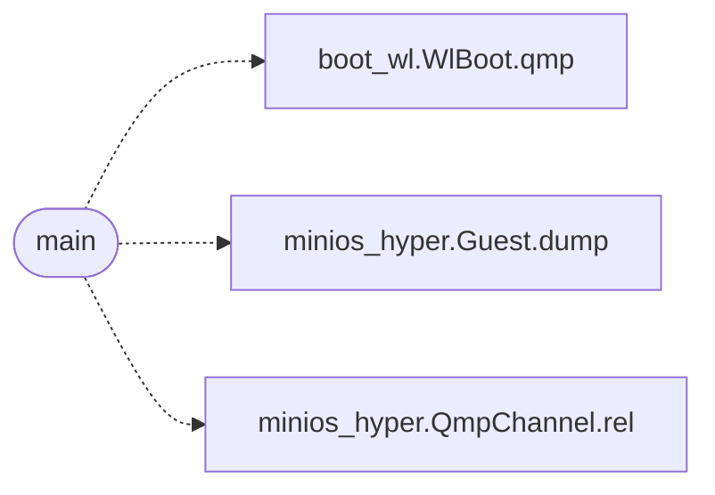

# `tools.probe_compute_vga`

> Source: [tools/probe_compute_vga.py:1](../../tools/probe_compute_vga.py#L1) | language `py` | coverage 50.0% | [API index](../index.md)

Docstring: VGA liveness probe during CPU-bound ring-3 compute.

Boots os.img headless, runs a command, moves the PS/2 mouse through QMP mid-run and screendumps. A live guest repaints cursor and clock even while a ring-3 loop never blocks: consecutive dumps must differ. Usage: tools/probe_compute_vga.py "<guest cmd>" [settle_secs]

## Contents

- **Functions:** [`main`](#main)
- **Constants:** [`HERE`](#here), [`WORK`](#work), [`QMP`](#qmp), [`SER`](#ser), [`HOLD`](#hold)

## Call Graph

Solid arrows stay in this module, dashed arrows leave it.



## Functions

<a id="main"></a>

### `main`

`function` | [tools/probe_compute_vga.py:22](../../tools/probe_compute_vga.py#L22)

```python
def main()
```

*Calls:* [`WlBoot.qmp`](tools.boot_wl.py.md#wlboot-qmp), [`Guest.dump`](tools.minios_hyper.py.md#guest-dump), [`QmpChannel.rel`](tools.minios_hyper.py.md#qmpchannel-rel)

---

## Constants

<a id="here"></a>

### `HERE`

`constant` | [tools/probe_compute_vga.py:15](../../tools/probe_compute_vga.py#L15)

```python
HERE = os.path.dirname(os.path.abspath(__file__)) + '/..'
```

---

<a id="work"></a>

### `WORK`

`constant` | [tools/probe_compute_vga.py:16](../../tools/probe_compute_vga.py#L16)

```python
WORK = tempfile.mkdtemp(prefix='probe_vga_')
```

---

<a id="qmp"></a>

### `QMP`

`constant` | [tools/probe_compute_vga.py:17](../../tools/probe_compute_vga.py#L17)

```python
QMP = os.path.join(WORK, 'qmp.sock')
```

---

<a id="ser"></a>

### `SER`

`constant` | [tools/probe_compute_vga.py:18](../../tools/probe_compute_vga.py#L18)

```python
SER = os.path.join(WORK, 'ser.sock')
```

---

<a id="hold"></a>

### `HOLD`

`constant` | [tools/probe_compute_vga.py:19](../../tools/probe_compute_vga.py#L19)

```python
HOLD = os.path.join(WORK, 'stdin.hold')
```

---
