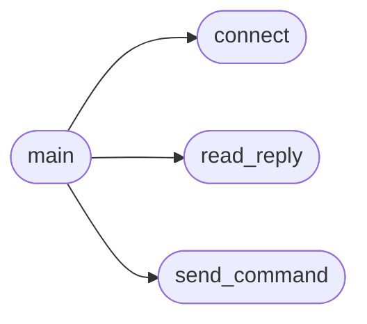

# `tools.qga_client`

> Source: [tools/qga_client.py:1](../../tools/qga_client.py#L1) | language `py` | coverage 40.0% | [API index](../index.md)

Minimal QEMU guest agent client for MiniOS.

Connects to the guest agent socket (a QEMU chardev mapped to the kernel's
COM2 agent port), sends one QGA JSON request per line, and prints the JSON
reply. Also drives the same protocol QEMU's own QMP guest-agent-command
uses, because the framing is whitespace-delimited.

Usage:
    qga_client.py <command> [arguments_json]
    qga_client.py --sock <path> <command> [arguments_json]

**Example**

```python
qga_client.py guest-ping
    qga_client.py guest-exec '{"path":"echo hi > /tmp/x"}'
    qga_client.py guest-file-read '{"handle":0,"count":100}'

The socket path defaults to /tmp/minios-ga.sock and can be overridden with
--sock or the MINIOS_GA_SOCK environment variable.
```

## Contents

- **Functions:** [`send_command`](#send_command), [`read_reply`](#read_reply), [`connect`](#connect), [`main`](#main)
- **Constants:** [`DEFAULT_SOCK`](#default_sock), [`CONNECT_TRIES`](#connect_tries), [`CONNECT_DELAY`](#connect_delay)

## Call Graph

Solid arrows stay in this module, dashed arrows leave it.



## Functions

<a id="send_command"></a>

### `send_command`

`function` | [tools/qga_client.py:33](../../tools/qga_client.py#L33)

```python
def send_command(sock, cmd, args=None)
```

**Parameters**

| Name | Type | Default | Description |
|---|---|---|---|
| `sock` |  |  |  |
| `cmd` |  |  |  |
| `args` |  | `None` |  |

*Called by:* [`main`](#main)

---

<a id="read_reply"></a>

### `read_reply`

`function` | [tools/qga_client.py:41](../../tools/qga_client.py#L41)

```python
def read_reply(sock, timeout=5.0)
```

Read one newline-terminated JSON object from the agent.

**Parameters**

| Name | Type | Default | Description |
|---|---|---|---|
| `sock` |  |  |  |
| `timeout` |  | `5.0` |  |

**Raises**

- `TimeoutError`: (raised in the body, not documented)

*Called by:* [`main`](#main)

---

<a id="connect"></a>

### `connect`

`function` | [tools/qga_client.py:57](../../tools/qga_client.py#L57)

```python
def connect(path)
```

**Parameters**

| Name | Type | Default | Description |
|---|---|---|---|
| `path` |  |  |  |

**Raises**

- `RuntimeError`: (raised in the body, not documented)

*Called by:* [`main`](#main)

---

<a id="main"></a>

### `main`

`function` | [tools/qga_client.py:74](../../tools/qga_client.py#L74)

```python
def main(argv)
```

**Parameters**

| Name | Type | Default | Description |
|---|---|---|---|
| `argv` |  |  |  |

*Calls:* [`connect`](#connect), [`read_reply`](#read_reply), [`send_command`](#send_command)

---

## Constants

<a id="default_sock"></a>

### `DEFAULT_SOCK`

`constant` | [tools/qga_client.py:28](../../tools/qga_client.py#L28)

```python
DEFAULT_SOCK = os.environ.get('MINIOS_GA_SOCK', '/tmp/minios-ga.sock')
```

---

<a id="connect_tries"></a>

### `CONNECT_TRIES`

`constant` | [tools/qga_client.py:29](../../tools/qga_client.py#L29)

```python
CONNECT_TRIES = 40
```

---

<a id="connect_delay"></a>

### `CONNECT_DELAY`

`constant` | [tools/qga_client.py:30](../../tools/qga_client.py#L30)

```python
CONNECT_DELAY = 0.25
```

---
