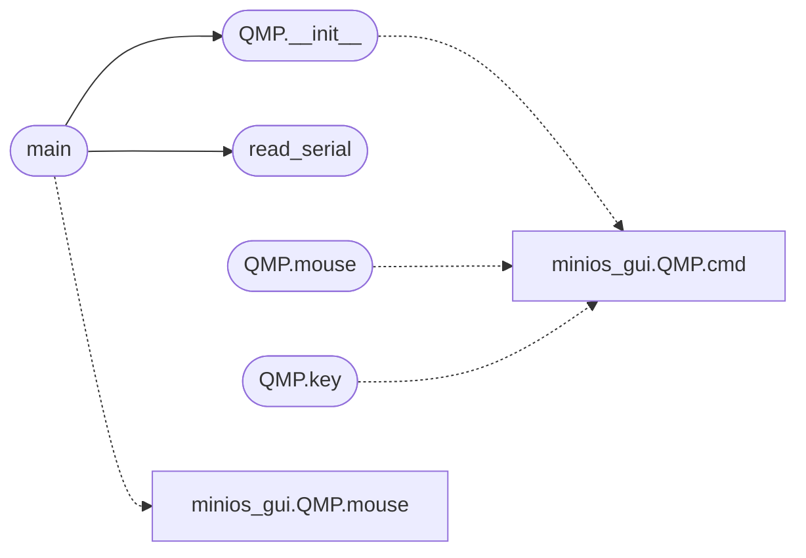

# `tools.repro_gui`

> Source: [tools/repro_gui.py:1](../../tools/repro_gui.py#L1) | language `py` | coverage 12.5% | [API index](../index.md)

repro_gui.py — reproduce the VGA/mouse state bug after ring-3 programs.

Boots MiniOS with a QMP socket (to inject PS/2 mouse motion into the guest)
and a pty serial console (to drive the shell), then runs a sequence of shell
commands and reports the mouse_state visible through `gfx` plus any kernel
EXCEPTION dump on the serial line. This is how the GUI-only bug (mouse
cursor vanishing / VGA crash after DOOM, SYS_SPAWN, etc.) is observed
without a physical display: the kernel desktop tick runs on the guest
framebuffer, and its failures surface on serial.

Usage: python3 tools/repro_gui.py send "micropython src/test.py" [send ...]

## Contents

- **Classes:** [`QMP`](#qmp)
- **Functions:** [`read_serial`](#read_serial), [`main`](#main)
- **Constants:** [`HERE`](#here), [`IMAGE`](#image), [`WORK`](#work), [`QMP_SOCK`](#qmp_sock)

## Call Graph

Solid arrows stay in this module, dashed arrows leave it.



## Classes

<a id="qmp"></a>

### `QMP`

`class` | [tools/repro_gui.py:46](../../tools/repro_gui.py#L46)

```python
class QMP
```

**Members**

| Member | Kind | Summary |
|---|---|---|
| [`__init__`](#qmp-__init__) | constructor |  |
| [`cmd`](#qmp-cmd) | method |  |
| [`mouse`](#qmp-mouse) | method |  |
| [`key`](#qmp-key) | method |  |

<a id="qmp-__init__"></a>

#### `QMP.__init__`

`constructor` | [tools/repro_gui.py:47](../../tools/repro_gui.py#L47)

```python
def __init__(self, path)
```

**Parameters**

| Name | Type | Default | Description |
|---|---|---|---|
| `path` |  |  |  |

*Calls:* [`QMP.cmd`](tools.minios_gui.py.md#qmp-cmd)

*Called by:* [`main`](#main)

<a id="qmp-cmd"></a>

#### `QMP.cmd`

`method` | [tools/repro_gui.py:59](../../tools/repro_gui.py#L59)

```python
def cmd(self, obj)
```

**Parameters**

| Name | Type | Default | Description |
|---|---|---|---|
| `obj` |  |  |  |

<a id="qmp-mouse"></a>

#### `QMP.mouse`

`method` | [tools/repro_gui.py:78](../../tools/repro_gui.py#L78)

```python
def mouse(self, dx=0, dy=0, left=None)
```

**Parameters**

| Name | Type | Default | Description |
|---|---|---|---|
| `dx` |  | `0` |  |
| `dy` |  | `0` |  |
| `left` |  | `None` |  |

*Calls:* [`QMP.cmd`](tools.minios_gui.py.md#qmp-cmd)

<a id="qmp-key"></a>

#### `QMP.key`

`method` | [tools/repro_gui.py:87](../../tools/repro_gui.py#L87)

```python
def key(self, qcode, down=True)
```

**Parameters**

| Name | Type | Default | Description |
|---|---|---|---|
| `qcode` |  |  |  |
| `down` |  | `True` |  |

*Calls:* [`QMP.cmd`](tools.minios_gui.py.md#qmp-cmd)

---

## Functions

<a id="read_serial"></a>

### `read_serial`

`function` | [tools/repro_gui.py:30](../../tools/repro_gui.py#L30)

```python
def read_serial(master, timeout=1.0)
```

**Parameters**

| Name | Type | Default | Description |
|---|---|---|---|
| `master` |  |  |  |
| `timeout` |  | `1.0` |  |

*Called by:* [`main`](#main)

---

<a id="main"></a>

### `main`

`function` | [tools/repro_gui.py:92](../../tools/repro_gui.py#L92)

```python
def main()
```

*Calls:* [`QMP.mouse`](tools.minios_gui.py.md#qmp-mouse), [`QMP.__init__`](#qmp-__init__), [`read_serial`](#read_serial)

---

## Constants

<a id="here"></a>

### `HERE`

`constant` | [tools/repro_gui.py:24](../../tools/repro_gui.py#L24)

```python
HERE = os.path.dirname(os.path.abspath(__file__))
```

---

<a id="image"></a>

### `IMAGE`

`constant` | [tools/repro_gui.py:25](../../tools/repro_gui.py#L25)

```python
IMAGE = os.path.join(HERE, '..', 'os.img')
```

---

<a id="work"></a>

### `WORK`

`constant` | [tools/repro_gui.py:26](../../tools/repro_gui.py#L26)

```python
WORK = tempfile.mkdtemp(prefix='repro_gui_')
```

---

<a id="qmp_sock"></a>

### `QMP_SOCK`

`constant` | [tools/repro_gui.py:27](../../tools/repro_gui.py#L27)

```python
QMP_SOCK = os.path.join(WORK, 'qmp.sock')
```

---
