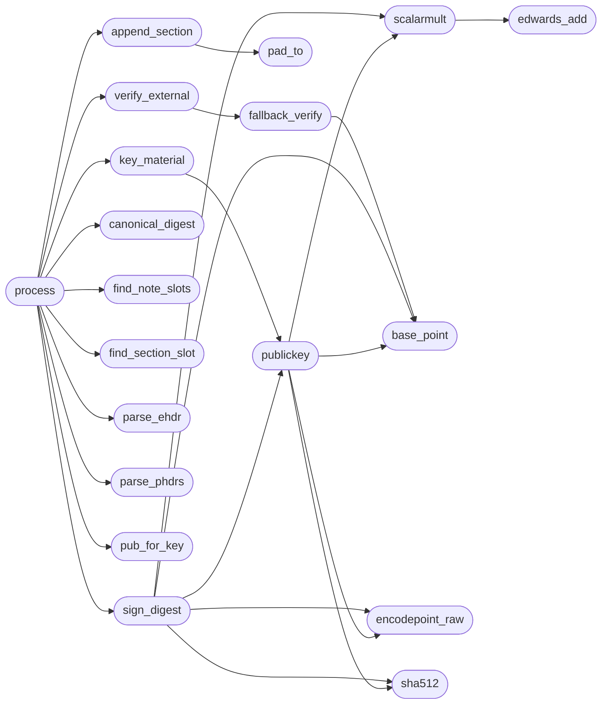

# `tools.sign_elf`

> Source: [tools/sign_elf.py:1](../../tools/sign_elf.py#L1) | language `py` | coverage 100.0% | [API index](../index.md)

Sign MiniOS user binaries with Ed25519 (development key). .

Usage: python3 tools/sign_elf.py [--check] [--key-id N] FILE [FILE ...] python3 tools/sign_elf.py [--check] [--key-id N] --walk DIR [DIR ...] . Inputs: ET_EXEC/ET_DYN ELF files. Other files are skipped, never modified. Outputs: the same files with a signature note carrying one key id byte plus the 64-byte signature, either patched into an existing PT_NOTE/SHT_NOTE slot or appended as a new non-allocated .note.minios.sign section. With --check nothing is written; unsigned or badly signed images are reported and the exit status is 1. . Failure modes: non-ELF input skips silently; truncated headers, missing section tables on images without a note slot, and unknown key ids fail loudly with a non-zero exit. Signing is idempotent: an image whose current bytes already verify under the requested key is left untouched, so rebuilds stay mtime-stable. . The development seed below is a published test key for dogfood builds only (docs/spec/kernel.md). Production images use key id 1 with a key file passed through MINIOS_SIGN_KEY.

## Contents

- **Classes:** [`Config`](#config)
- **Functions:** [`sha512`](#sha512), [`encodepoint_raw`](#encodepoint_raw), [`edwards_add`](#edwards_add), [`scalarmult`](#scalarmult), [`base_point`](#base_point), [`publickey`](#publickey), [`sign_digest`](#sign_digest), [`pad_to`](#pad_to), [`parse_ehdr`](#parse_ehdr), [`parse_phdrs`](#parse_phdrs), [`canonical_digest`](#canonical_digest), [`find_note_slots`](#find_note_slots), [`find_section_slot`](#find_section_slot), [`append_section`](#append_section), [`pub_for_key`](#pub_for_key), [`key_material`](#key_material), [`process`](#process), [`verify_external`](#verify_external), [`fallback_verify`](#fallback_verify), [`decode_point`](#decode_point), [`points_equal`](#points_equal), [`main`](#main)

## Call Graph

Solid arrows stay in this module, dashed arrows leave it.



## Classes

<a id="config"></a>

### `Config`

`class` | [tools/sign_elf.py:31](../../tools/sign_elf.py#L31)

```python
class Config
```

Central configuration, no magic numbers outside this class.

**Attributes**

| Name | Type | Default | Description |
|---|---|---|---|
| [`note_name`](#config-note_name) |  | `b'MiniOS'` |  |
| [`note_section`](#config-note_section) |  | `b'.note.minios.sign'` |  |
| [`note_sign_type`](#config-note_sign_type) |  | `2` |  |
| [`note_align`](#config-note_align) |  | `4` |  |
| [`key_dev`](#config-key_dev) |  | `0` |  |
| [`key_prod`](#config-key_prod) |  | `1` |  |
| [`sig_bytes`](#config-sig_bytes) |  | `64` |  |
| [`desc_bytes`](#config-desc_bytes) |  | `65` |  |
| [`desc_padded`](#config-desc_padded) |  | `68` |  |
| [`note_total`](#config-note_total) |  | `88` |  |
| [`pub_bytes`](#config-pub_bytes) |  | `32` |  |
| [`dev_pub_hex`](#config-dev_pub_hex) |  | `'df968c9d646953eded22bab208669cb7ec1a94e32be5ebeb95b3aeacb8d7561e'` |  |
| [`dev_seed_label`](#config-dev_seed_label) |  | `b'minios-dev-key-v1'` |  |
| [`field_p`](#config-field_p) |  | `2 ** 255 - 19` |  |
| [`group_l`](#config-group_l) |  | `2 ** 252 + 27742317777372353535851937790883648493` |  |
| [`curve_d`](#config-curve_d) |  | `-121665 * pow(121666, 2 ** 255 - 21, 2 ** 255 - 19) % (2 ** 255 - 19)` |  |
| [`e_machine_x86_64`](#config-e_machine_x86_64) |  | `62` |  |
| [`et_exec`](#config-et_exec) |  | `2` |  |
| [`et_dyn`](#config-et_dyn) |  | `3` |  |
| [`pt_load`](#config-pt_load) |  | `1` |  |
| [`pt_note`](#config-pt_note) |  | `4` |  |
| [`sht_note`](#config-sht_note) |  | `7` |  |
| [`ehdr_size`](#config-ehdr_size) |  | `64` |  |
| [`phdr_size`](#config-phdr_size) |  | `56` |  |
| [`shdr_size`](#config-shdr_size) |  | `64` |  |

---

## Functions

<a id="sha512"></a>

### `sha512`

`function` | [tools/sign_elf.py:61](../../tools/sign_elf.py#L61)

```python
def sha512(data)
```

One-shot SHA-512.

**Parameters**

| Name | Type | Default | Description |
|---|---|---|---|
| `data` |  |  |  |

*Called by:* [`fallback_verify`](#fallback_verify), [`publickey`](#publickey), [`sign_digest`](#sign_digest)

---

<a id="encodepoint_raw"></a>

### `encodepoint_raw`

`function` | [tools/sign_elf.py:66](../../tools/sign_elf.py#L66)

```python
def encodepoint_raw(x, y)
```

Encode affine (x, y) to 32 bytes.

**Parameters**

| Name | Type | Default | Description |
|---|---|---|---|
| `x` |  |  |  |
| `y` |  |  |  |

*Called by:* [`publickey`](#publickey), [`sign_digest`](#sign_digest)

---

<a id="edwards_add"></a>

### `edwards_add`

`function` | [tools/sign_elf.py:71](../../tools/sign_elf.py#L71)

```python
def edwards_add(p, q)
```

Add two extended points, all math mod field_p.

**Parameters**

| Name | Type | Default | Description |
|---|---|---|---|
| `p` |  |  |  |
| `q` |  |  |  |

*Called by:* [`fallback_verify`](#fallback_verify), [`scalarmult`](#scalarmult)

---

<a id="scalarmult"></a>

### `scalarmult`

`function` | [tools/sign_elf.py:88](../../tools/sign_elf.py#L88)

```python
def scalarmult(p, e)
```

Multiply extended point p by scalar e.

**Parameters**

| Name | Type | Default | Description |
|---|---|---|---|
| `p` |  |  |  |
| `e` |  |  |  |

*Calls:* [`edwards_add`](#edwards_add)

*Called by:* [`fallback_verify`](#fallback_verify), [`publickey`](#publickey), [`sign_digest`](#sign_digest)

---

<a id="base_point"></a>

### `base_point`

`function` | [tools/sign_elf.py:99](../../tools/sign_elf.py#L99)

```python
def base_point()
```

Recompute the base point from y = 4/5.

*Called by:* [`fallback_verify`](#fallback_verify), [`publickey`](#publickey), [`sign_digest`](#sign_digest)

---

<a id="publickey"></a>

### `publickey`

`function` | [tools/sign_elf.py:112](../../tools/sign_elf.py#L112)

```python
def publickey(seed)
```

Derive the 32-byte public key from a 32-byte seed.

**Parameters**

| Name | Type | Default | Description |
|---|---|---|---|
| `seed` |  |  |  |

*Calls:* [`base_point`](#base_point), [`encodepoint_raw`](#encodepoint_raw), [`scalarmult`](#scalarmult), [`sha512`](#sha512)

*Called by:* [`key_material`](#key_material), [`sign_digest`](#sign_digest)

---

<a id="sign_digest"></a>

### `sign_digest`

`function` | [tools/sign_elf.py:121](../../tools/sign_elf.py#L121)

```python
def sign_digest(digest, seed)
```

Sign a 64-byte canonical digest, returning 64 signature bytes.

**Parameters**

| Name | Type | Default | Description |
|---|---|---|---|
| `digest` |  |  |  |
| `seed` |  |  |  |

*Calls:* [`base_point`](#base_point), [`encodepoint_raw`](#encodepoint_raw), [`publickey`](#publickey), [`scalarmult`](#scalarmult), [`sha512`](#sha512)

*Called by:* [`process`](#process)

---

<a id="pad_to"></a>

### `pad_to`

`function` | [tools/sign_elf.py:135](../../tools/sign_elf.py#L135)

```python
def pad_to(blob, alignment)
```

Pad blob with zero bytes up to alignment.

**Parameters**

| Name | Type | Default | Description |
|---|---|---|---|
| `blob` |  |  |  |
| `alignment` |  |  |  |

*Called by:* [`append_section`](#append_section)

---

<a id="parse_ehdr"></a>

### `parse_ehdr`

`function` | [tools/sign_elf.py:143](../../tools/sign_elf.py#L143)

```python
def parse_ehdr(data)
```

Unpack the ELF header, raising ValueError when truncated.

**Parameters**

| Name | Type | Default | Description |
|---|---|---|---|
| `data` |  |  |  |

**Raises**

- `ValueError`: (raised in the body, not documented)

*Called by:* [`process`](#process)

---

<a id="parse_phdrs"></a>

### `parse_phdrs`

`function` | [tools/sign_elf.py:158](../../tools/sign_elf.py#L158)

```python
def parse_phdrs(data, ehdr)
```

Unpack the program headers, raising ValueError when out of range.

**Parameters**

| Name | Type | Default | Description |
|---|---|---|---|
| `data` |  |  |  |
| `ehdr` |  |  |  |

**Raises**

- `ValueError`: (raised in the body, not documented)

*Called by:* [`process`](#process)

---

<a id="canonical_digest"></a>

### `canonical_digest`

`function` | [tools/sign_elf.py:172](../../tools/sign_elf.py#L172)

```python
def canonical_digest(data, ehdr, phdrs)
```

Build the kernel-agreed digest: entry plus PT_LOAD segments.

File bytes below 64 (the ELF header) are excluded from the
segment feeds while the entry stays bound as a value: appending
the signature section rewrites the section index there, and a
digest covering it would invalidate its own signature.

**Parameters**

| Name | Type | Default | Description |
|---|---|---|---|
| `data` |  |  |  |
| `ehdr` |  |  |  |
| `phdrs` |  |  |  |

**Raises**

- `ValueError`: (raised in the body, not documented)

*Called by:* [`process`](#process)

---

<a id="find_note_slots"></a>

### `find_note_slots`

`function` | [tools/sign_elf.py:199](../../tools/sign_elf.py#L199)

```python
def find_note_slots(data, ehdr, phdrs)
```

Locate patchable signature slots, returning file offsets of descs.

**Parameters**

| Name | Type | Default | Description |
|---|---|---|---|
| `data` |  |  |  |
| `ehdr` |  |  |  |
| `phdrs` |  |  |  |

*Called by:* [`process`](#process)

---

<a id="find_section_slot"></a>

### `find_section_slot`

`function` | [tools/sign_elf.py:222](../../tools/sign_elf.py#L222)

```python
def find_section_slot(data, ehdr)
```

Locate the .note.minios.sign section descriptor, else -1.

**Parameters**

| Name | Type | Default | Description |
|---|---|---|---|
| `data` |  |  |  |
| `ehdr` |  |  |  |

*Called by:* [`process`](#process)

---

<a id="append_section"></a>

### `append_section`

`function` | [tools/sign_elf.py:257](../../tools/sign_elf.py#L257)

```python
def append_section(data, ehdr, desc)
```

Append a .note.minios.sign section, returning the new image.

**Parameters**

| Name | Type | Default | Description |
|---|---|---|---|
| `data` |  |  |  |
| `ehdr` |  |  |  |
| `desc` |  |  |  |

**Raises**

- `ValueError`: (raised in the body, not documented)

*Calls:* [`bytes`](headers.sched.h.md#bytes), [`pad_to`](#pad_to)

*Called by:* [`process`](#process)

---

<a id="pub_for_key"></a>

### `pub_for_key`

`function` | [tools/sign_elf.py:305](../../tools/sign_elf.py#L305)

```python
def pub_for_key(key_id)
```

Resolve the trusted public key for checking without secrets.

**Parameters**

| Name | Type | Default | Description |
|---|---|---|---|
| `key_id` |  |  |  |

**Raises**

- `ValueError`: (raised in the body, not documented)

*Called by:* [`process`](#process)

---

<a id="key_material"></a>

### `key_material`

`function` | [tools/sign_elf.py:321](../../tools/sign_elf.py#L321)

```python
def key_material(key_id)
```

Resolve the signing seed and public key for a key id.

**Parameters**

| Name | Type | Default | Description |
|---|---|---|---|
| `key_id` |  |  |  |

**Raises**

- `ValueError`: (raised in the body, not documented)

*Calls:* [`publickey`](#publickey)

*Called by:* [`process`](#process)

---

<a id="process"></a>

### `process`

`function` | [tools/sign_elf.py:341](../../tools/sign_elf.py#L341)

```python
def process(path, key_id, check_only)
```

Sign or verify one file, returning (action, detail).

**Parameters**

| Name | Type | Default | Description |
|---|---|---|---|
| `path` |  |  |  |
| `key_id` |  |  |  |
| `check_only` |  |  |  |

*Calls:* [`bytes`](headers.sched.h.md#bytes), [`append_section`](#append_section), [`canonical_digest`](#canonical_digest), [`find_note_slots`](#find_note_slots), [`find_section_slot`](#find_section_slot), [`key_material`](#key_material), [`parse_ehdr`](#parse_ehdr), [`parse_phdrs`](#parse_phdrs), [`pub_for_key`](#pub_for_key), [`sign_digest`](#sign_digest), [`verify_external`](#verify_external)

*Called by:* [`main`](#main)

---

<a id="verify_external"></a>

### `verify_external`

`function` | [tools/sign_elf.py:395](../../tools/sign_elf.py#L395)

```python
def verify_external(sig, digest, pub)
```

Verify with PyNaCl when present, else the local fallback.

**Parameters**

| Name | Type | Default | Description |
|---|---|---|---|
| `sig` |  |  |  |
| `digest` |  |  |  |
| `pub` |  |  |  |

*Calls:* [`fallback_verify`](#fallback_verify)

*Called by:* [`process`](#process)

---

<a id="fallback_verify"></a>

### `fallback_verify`

`function` | [tools/sign_elf.py:408](../../tools/sign_elf.py#L408)

```python
def fallback_verify(sig, digest, pub)
```

Pure-python Ed25519 verify for hosts without PyNaCl.

**Parameters**

| Name | Type | Default | Description |
|---|---|---|---|
| `sig` |  |  |  |
| `digest` |  |  |  |
| `pub` |  |  |  |

*Calls:* [`base_point`](#base_point), [`decode_point`](#decode_point), [`edwards_add`](#edwards_add), [`points_equal`](#points_equal), [`scalarmult`](#scalarmult), [`sha512`](#sha512)

*Called by:* [`verify_external`](#verify_external)

---

<a id="decode_point"></a>

### `decode_point`

`function` | [tools/sign_elf.py:429](../../tools/sign_elf.py#L429)

```python
def decode_point(raw)
```

Decode a point encoding to extended coordinates.

**Parameters**

| Name | Type | Default | Description |
|---|---|---|---|
| `raw` |  |  |  |

**Raises**

- `ValueError`: (raised in the body, not documented)

*Called by:* [`fallback_verify`](#fallback_verify)

---

<a id="points_equal"></a>

### `points_equal`

`function` | [tools/sign_elf.py:447](../../tools/sign_elf.py#L447)

```python
def points_equal(p, q)
```

Compare extended points by cross-multiplied coordinates.

**Parameters**

| Name | Type | Default | Description |
|---|---|---|---|
| `p` |  |  |  |
| `q` |  |  |  |

*Called by:* [`fallback_verify`](#fallback_verify)

---

<a id="main"></a>

### `main`

`function` | [tools/sign_elf.py:454](../../tools/sign_elf.py#L454)

```python
def main(argv)
```

Drive signing or checking over files and directory walks.

**Parameters**

| Name | Type | Default | Description |
|---|---|---|---|
| `argv` |  |  |  |

*Calls:* [`process`](#process)

---
