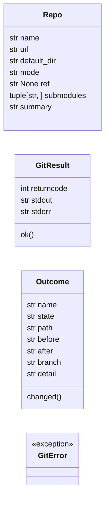
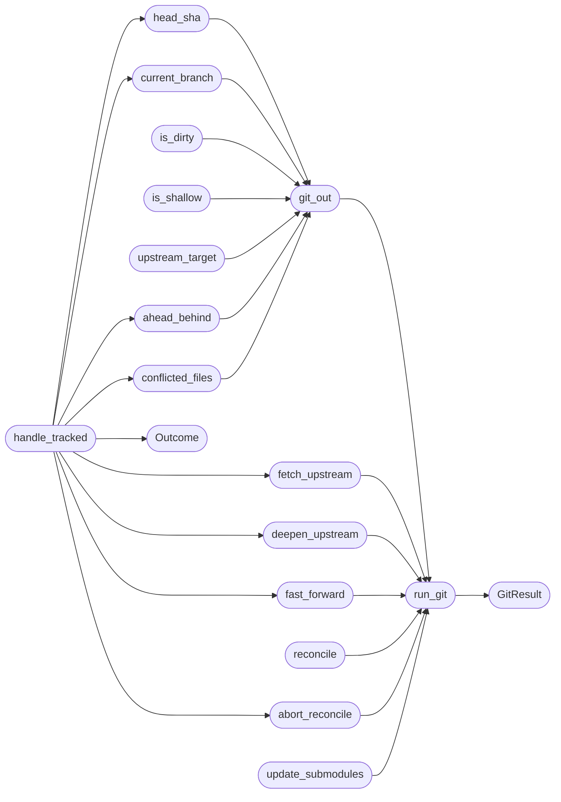

# `tools.update_sources`

> Source: [tools/update_sources.py:1](../../tools/update_sources.py#L1) | language `py` | coverage 94.1% | [API index](../index.md)

Update the sibling source checkouts MiniOS builds against.

MiniOS is built from this repository plus one checkout per external source:
the toolchain trio (miniGCC, ld, cvm), the browser (FreeDom), the
interpreters (micropython, cpython, lua), the UI and audio libraries (nuklear,
nuked-opl3) and the reference sources (raycastlib, quake2generic, the
gameboy recompiler). This tool refreshes any subset of them in place.

Safety contract (never violated):

- Local work is never discarded. A dirty worktree is reported and skipped,
  never reset, never stashed, never force-updated.
- History is never rewritten and local commits are never dropped. A checkout
  that carries local commits is merged with the upstream tip; a merge that
  conflicts is aborted and reported, so the checkout stays clean.
- Pinned checkouts stay pinned. A checkout bound to a release tag is
  verified against that tag and restored to it when it drifted.
- Every update records the pre-update revision, so `make update-rollback`
  can put the fleet back exactly where it was.

Usage:
    python3 tools/update_sources.py [options] [NAME ...]

    With no NAME every managed checkout is updated. With one or more NAMEs
    (or --only NAME) only those checkouts are touched.

Options:
    --status         report the state of every checkout, no network access
    --list           list the managed checkouts and exit
    --dry-run        report what would change, touch nothing
    --no-fetch       do not contact the network, only report what is behind
    --strategy MODE  how a diverged branch is reconciled: merge (default),
                     rebase or ff (report only, never touch the branch)
    --rollback       restore the revisions recorded by the last update
    --repo NAME=DIR  override the checkout path of NAME
    --repo NAME=URL  override the origin URL of NAME
    --snapshot PATH  snapshot file (default build/sources-snapshot.json)
    --git PATH       git binary to use (default git)

Output:
    One line per checkout: state, path, revision and a short detail. The
    state is one of updated, current, pinned, repinned, skipped, diverged,
    conflict, absent, not-a-clone, would-update or failed.

Exit codes:
    0  every selected checkout is up to date or was updated
    1  at least one checkout failed to update (the others still ran)
    2  usage error (unknown repository name)

## Contents

- **Classes:** [`Repo`](#repo), [`GitResult`](#gitresult), [`Outcome`](#outcome)
- **Exceptions:** [`GitError`](#giterror)
- **Functions:** [`run_git`](#run_git), [`git_out`](#git_out), [`head_sha`](#head_sha), [`short_sha`](#short_sha), [`current_branch`](#current_branch), [`is_dirty`](#is_dirty), [`is_shallow`](#is_shallow), [`resolve_path`](#resolve_path), [`fetch_upstream`](#fetch_upstream), [`deepen_upstream`](#deepen_upstream), [`upstream_target`](#upstream_target), [`ahead_behind`](#ahead_behind), [`fast_forward`](#fast_forward), [`reconcile`](#reconcile), [`abort_reconcile`](#abort_reconcile), [`conflicted_files`](#conflicted_files), [`update_submodules`](#update_submodules), [`handle_tracked`](#handle_tracked), [`handle_pinned`](#handle_pinned), [`handle_repo`](#handle_repo), [`write_snapshot`](#write_snapshot), [`rollback`](#rollback), [`print_status`](#print_status), [`print_outcome`](#print_outcome), [`select_repos`](#select_repos), [`parse_overrides`](#parse_overrides), [`main`](#main)
- **Constants:** [`REPO_ROOT`](#repo_root), [`DEFAULT_SNAPSHOT`](#default_snapshot), [`MODE_TRACK`](#mode_track), [`MODE_PINNED`](#mode_pinned), [`MODE_REFERENCE`](#mode_reference), [`STRATEGY_FF`](#strategy_ff), [`STRATEGY_MERGE`](#strategy_merge), [`STRATEGY_REBASE`](#strategy_rebase), [`STRATEGIES`](#strategies), [`STATE_UPDATED`](#state_updated), [`STATE_CURRENT`](#state_current), [`STATE_PINNED`](#state_pinned), [`STATE_REPINNED`](#state_repinned), [`STATE_SKIPPED`](#state_skipped), [`STATE_DIVERGED`](#state_diverged), [`STATE_CONFLICT`](#state_conflict), [`STATE_ABSENT`](#state_absent), [`STATE_NOT_A_CLONE`](#state_not_a_clone), [`STATE_WOULD_UPDATE`](#state_would_update), [`STATE_FAILED`](#state_failed), [`STATE_WIDTH`](#state_width), [`FETCH_TIMEOUT_SECONDS`](#fetch_timeout_seconds), [`DEEPEN_STEP_COMMITS`](#deepen_step_commits), [`MAX_DEEPEN_STEPS`](#max_deepen_steps), [`REPOS`](#repos), [`REPOS_BY_NAME`](#repos_by_name)

## Type Diagram



## Call Graph

Solid arrows stay in this module, dashed arrows leave it.



## Classes

<a id="repo"></a>

### `Repo`

`class` `dataclass` | [tools/update_sources.py:96](../../tools/update_sources.py#L96)

Decorators: `@dataclass(frozen=True)`

```python
class Repo
```

A managed external checkout.

**Attributes**

| Name | Type | Default | Description |
|---|---|---|---|
| [`name`](#repo-name) | `str` |  |  |
| [`url`](#repo-url) | `str` |  |  |
| [`default_dir`](#repo-default_dir) | `str` |  |  |
| [`mode`](#repo-mode) | `str` |  |  |
| [`ref`](#repo-ref) | `str \| None` | `None` |  |
| [`submodules`](#repo-submodules) | `tuple[str, ...]` | `()` |  |
| [`summary`](#repo-summary) | `str` | `''` |  |

---

<a id="gitresult"></a>

### `GitResult`

`class` `dataclass` | [tools/update_sources.py:203](../../tools/update_sources.py#L203)

Decorators: `@dataclass`

```python
class GitResult
```

Outcome of one git invocation.

**Attributes**

| Name | Type | Default | Description |
|---|---|---|---|
| [`returncode`](#gitresult-returncode) | `int` |  |  |
| [`stdout`](#gitresult-stdout) | `str` |  |  |
| [`stderr`](#gitresult-stderr) | `str` |  |  |

**Members**

| Member | Kind | Summary |
|---|---|---|
| [`ok`](#gitresult-ok) | property |  |

<a id="gitresult-ok"></a>

#### `GitResult.ok`

`property` | [tools/update_sources.py:211](../../tools/update_sources.py#L211)

Decorators: `@property`

```python
def ok(self) -> bool
```

**Returns:** `bool`

*Called by:* [`efi_main`](boot.uefi_stub.c.md#efi_main), [`__attribute__`](kernel.c.md#__attribute__), [`pf_window_present`](progs.freedomui.platform_minios.c.md#pf_window_present), [`main`](progs.nuklear.node_editor.c.md#main), [`q2snd_probe`](progs.quake2generic.snddma_minios.c.md#q2snd_probe), [`main`](progs.src.fptest.c.md#main)

---

<a id="outcome"></a>

### `Outcome`

`class` `dataclass` | [tools/update_sources.py:216](../../tools/update_sources.py#L216)

Decorators: `@dataclass`

```python
class Outcome
```

Result of handling one checkout.

**Attributes**

| Name | Type | Default | Description |
|---|---|---|---|
| [`name`](#outcome-name) | `str` |  |  |
| [`state`](#outcome-state) | `str` |  |  |
| [`path`](#outcome-path) | `str` |  |  |
| [`before`](#outcome-before) | `str` | `''` |  |
| [`after`](#outcome-after) | `str` | `''` |  |
| [`branch`](#outcome-branch) | `str` | `''` |  |
| [`detail`](#outcome-detail) | `str` | `''` |  |

**Members**

| Member | Kind | Summary |
|---|---|---|
| [`changed`](#outcome-changed) | property |  |

<a id="outcome-changed"></a>

#### `Outcome.changed`

`property` | [tools/update_sources.py:228](../../tools/update_sources.py#L228)

Decorators: `@property`

```python
def changed(self) -> bool
```

**Returns:** `bool`

---

## Exceptions

<a id="giterror"></a>

### `GitError`

`exception` | [tools/update_sources.py:232](../../tools/update_sources.py#L232)

```python
class GitError(RuntimeError)
```

Bases: `RuntimeError`

Raised when git fails in a way the caller cannot recover from.

---

## Functions

<a id="run_git"></a>

### `run_git`

`function` | [tools/update_sources.py:236](../../tools/update_sources.py#L236)

```python
def run_git(git: str, cwd: Path, *args: str) -> GitResult
```

Run git in a directory and capture its output.

**Parameters**

| Name | Type | Default | Description |
|---|---|---|---|
| `git` | `str` |  |  |
| `cwd` | `Path` |  |  |
| `*args` | `str` |  |  |

**Returns:** `GitResult`

*Calls:* [`GitResult`](#gitresult)

*Called by:* [`abort_reconcile`](#abort_reconcile), [`deepen_upstream`](#deepen_upstream), [`fast_forward`](#fast_forward), [`fetch_upstream`](#fetch_upstream), [`git_out`](#git_out), [`handle_pinned`](#handle_pinned), [`reconcile`](#reconcile), [`rollback`](#rollback), [`update_submodules`](#update_submodules)

---

<a id="git_out"></a>

### `git_out`

`function` | [tools/update_sources.py:253](../../tools/update_sources.py#L253)

```python
def git_out(git: str, cwd: Path, *args: str) -> str
```

Run git and return stdout, or the empty string on failure.

**Parameters**

| Name | Type | Default | Description |
|---|---|---|---|
| `git` | `str` |  |  |
| `cwd` | `Path` |  |  |
| `*args` | `str` |  |  |

**Returns:** `str`

*Calls:* [`run_git`](#run_git)

*Called by:* [`ahead_behind`](#ahead_behind), [`conflicted_files`](#conflicted_files), [`current_branch`](#current_branch), [`handle_pinned`](#handle_pinned), [`head_sha`](#head_sha), [`is_dirty`](#is_dirty), [`is_shallow`](#is_shallow), [`print_status`](#print_status), [`upstream_target`](#upstream_target)

---

<a id="head_sha"></a>

### `head_sha`

`function` | [tools/update_sources.py:261](../../tools/update_sources.py#L261)

```python
def head_sha(git: str, path: Path) -> str
```

Return the checked-out revision, or the empty string.

**Parameters**

| Name | Type | Default | Description |
|---|---|---|---|
| `git` | `str` |  |  |
| `path` | `Path` |  |  |

**Returns:** `str`

*Calls:* [`git_out`](#git_out)

*Called by:* [`handle_pinned`](#handle_pinned), [`handle_tracked`](#handle_tracked), [`print_status`](#print_status), [`rollback`](#rollback)

---

<a id="short_sha"></a>

### `short_sha`

`function` | [tools/update_sources.py:266](../../tools/update_sources.py#L266)

```python
def short_sha(sha: str) -> str
```

Shorten a revision for display.

**Parameters**

| Name | Type | Default | Description |
|---|---|---|---|
| `sha` | `str` |  |  |

**Returns:** `str`

*Called by:* [`handle_tracked`](#handle_tracked), [`print_status`](#print_status), [`rollback`](#rollback)

---

<a id="current_branch"></a>

### `current_branch`

`function` | [tools/update_sources.py:271](../../tools/update_sources.py#L271)

```python
def current_branch(git: str, path: Path) -> str
```

Return the checked-out branch name, empty when detached.

**Parameters**

| Name | Type | Default | Description |
|---|---|---|---|
| `git` | `str` |  |  |
| `path` | `Path` |  |  |

**Returns:** `str`

*Calls:* [`git_out`](#git_out)

*Called by:* [`handle_pinned`](#handle_pinned), [`handle_tracked`](#handle_tracked), [`print_status`](#print_status)

---

<a id="is_dirty"></a>

### `is_dirty`

`function` | [tools/update_sources.py:276](../../tools/update_sources.py#L276)

```python
def is_dirty(git: str, path: Path) -> bool
```

Report whether the worktree carries uncommitted changes.

**Parameters**

| Name | Type | Default | Description |
|---|---|---|---|
| `git` | `str` |  |  |
| `path` | `Path` |  |  |

**Returns:** `bool`

*Calls:* [`git_out`](#git_out)

*Called by:* [`handle_pinned`](#handle_pinned), [`handle_tracked`](#handle_tracked), [`rollback`](#rollback)

---

<a id="is_shallow"></a>

### `is_shallow`

`function` | [tools/update_sources.py:281](../../tools/update_sources.py#L281)

```python
def is_shallow(git: str, path: Path) -> bool
```

Report whether the checkout is a shallow clone.

**Parameters**

| Name | Type | Default | Description |
|---|---|---|---|
| `git` | `str` |  |  |
| `path` | `Path` |  |  |

**Returns:** `bool`

*Calls:* [`git_out`](#git_out)

*Called by:* [`handle_tracked`](#handle_tracked)

---

<a id="resolve_path"></a>

### `resolve_path`

`function` | [tools/update_sources.py:286](../../tools/update_sources.py#L286)

```python
def resolve_path(directory: str) -> Path
```

Resolve a checkout directory against the repository root.

**Parameters**

| Name | Type | Default | Description |
|---|---|---|---|
| `directory` | `str` |  |  |

**Returns:** `Path`

*Called by:* [`handle_repo`](#handle_repo), [`main`](#main), [`print_status`](#print_status), [`rollback`](#rollback)

---

<a id="fetch_upstream"></a>

### `fetch_upstream`

`function` | [tools/update_sources.py:294](../../tools/update_sources.py#L294)

```python
def fetch_upstream(git: str, path: Path, branch: str, shallow_depth: int | None) -> GitResult
```

Fetch the upstream branch, optionally with a bounded depth.

**Parameters**

| Name | Type | Default | Description |
|---|---|---|---|
| `git` | `str` |  |  |
| `path` | `Path` |  |  |
| `branch` | `str` |  |  |
| `shallow_depth` | `int \| None` |  |  |

**Returns:** `GitResult`

*Calls:* [`run_git`](#run_git)

*Called by:* [`handle_tracked`](#handle_tracked)

---

<a id="deepen_upstream"></a>

### `deepen_upstream`

`function` | [tools/update_sources.py:306](../../tools/update_sources.py#L306)

```python
def deepen_upstream(git: str, path: Path, branch: str, commits: int) -> GitResult
```

Deepen a shallow checkout so a fast-forward becomes provable.

**Parameters**

| Name | Type | Default | Description |
|---|---|---|---|
| `git` | `str` |  |  |
| `path` | `Path` |  |  |
| `branch` | `str` |  |  |
| `commits` | `int` |  |  |

**Returns:** `GitResult`

*Calls:* [`run_git`](#run_git)

*Called by:* [`handle_tracked`](#handle_tracked)

---

<a id="upstream_target"></a>

### `upstream_target`

`function` | [tools/update_sources.py:316](../../tools/update_sources.py#L316)

```python
def upstream_target(git: str, path: Path, branch: str) -> str
```

Return the revision the upstream branch points at.

**Parameters**

| Name | Type | Default | Description |
|---|---|---|---|
| `git` | `str` |  |  |
| `path` | `Path` |  |  |
| `branch` | `str` |  |  |

**Returns:** `str`

*Calls:* [`git_out`](#git_out)

*Called by:* [`handle_tracked`](#handle_tracked)

---

<a id="ahead_behind"></a>

### `ahead_behind`

`function` | [tools/update_sources.py:325](../../tools/update_sources.py#L325)

```python
def ahead_behind(git: str, path: Path, branch: str) -> tuple[int, int]
```

Return the (ahead, behind) commit counts against the upstream branch.

**Parameters**

| Name | Type | Default | Description |
|---|---|---|---|
| `git` | `str` |  |  |
| `path` | `Path` |  |  |
| `branch` | `str` |  |  |

**Returns:** `tuple[int, int]`

*Calls:* [`git_out`](#git_out)

*Called by:* [`handle_tracked`](#handle_tracked), [`print_status`](#print_status)

---

<a id="fast_forward"></a>

### `fast_forward`

`function` | [tools/update_sources.py:339](../../tools/update_sources.py#L339)

```python
def fast_forward(git: str, path: Path, target: str) -> GitResult
```

Merge an upstream revision, refusing anything but a fast-forward.

**Parameters**

| Name | Type | Default | Description |
|---|---|---|---|
| `git` | `str` |  |  |
| `path` | `Path` |  |  |
| `target` | `str` |  |  |

**Returns:** `GitResult`

*Calls:* [`run_git`](#run_git)

*Called by:* [`handle_tracked`](#handle_tracked)

---

<a id="reconcile"></a>

### `reconcile`

`function` | [tools/update_sources.py:344](../../tools/update_sources.py#L344)

```python
def reconcile(git: str, path: Path, target: str, strategy: str) -> GitResult
```

Integrate an upstream revision into a branch that carries local commits.

**Parameters**

| Name | Type | Default | Description |
|---|---|---|---|
| `git` | `str` |  |  |
| `path` | `Path` |  |  |
| `target` | `str` |  |  |
| `strategy` | `str` |  |  |

**Returns:** `GitResult`

*Calls:* [`run_git`](#run_git)

*Called by:* [`handle_tracked`](#handle_tracked)

---

<a id="abort_reconcile"></a>

### `abort_reconcile`

`function` | [tools/update_sources.py:351](../../tools/update_sources.py#L351)

```python
def abort_reconcile(git: str, path: Path, strategy: str) -> None
```

Undo a failed reconciliation so the checkout stays clean.

**Parameters**

| Name | Type | Default | Description |
|---|---|---|---|
| `git` | `str` |  |  |
| `path` | `Path` |  |  |
| `strategy` | `str` |  |  |

*Calls:* [`run_git`](#run_git)

*Called by:* [`handle_tracked`](#handle_tracked)

---

<a id="conflicted_files"></a>

### `conflicted_files`

`function` | [tools/update_sources.py:359](../../tools/update_sources.py#L359)

```python
def conflicted_files(git: str, path: Path) -> list[str]
```

List the files a failed reconciliation left unmerged.

**Parameters**

| Name | Type | Default | Description |
|---|---|---|---|
| `git` | `str` |  |  |
| `path` | `Path` |  |  |

**Returns:** `list[str]`

*Calls:* [`git_out`](#git_out)

*Called by:* [`handle_tracked`](#handle_tracked)

---

<a id="update_submodules"></a>

### `update_submodules`

`function` | [tools/update_sources.py:365](../../tools/update_sources.py#L365)

```python
def update_submodules(git: str, path: Path, submodules: tuple[str, ...]) -> str
```

Initialize and refresh the submodules of a checkout.

**Parameters**

| Name | Type | Default | Description |
|---|---|---|---|
| `git` | `str` |  |  |
| `path` | `Path` |  |  |
| `submodules` | `tuple[str, ...]` |  |  |

**Returns:** `str`

*Calls:* [`run_git`](#run_git)

*Called by:* [`handle_pinned`](#handle_pinned)

---

<a id="handle_tracked"></a>

### `handle_tracked`

`function` | [tools/update_sources.py:375](../../tools/update_sources.py#L375)

```python
def handle_tracked(git: str, repo: Repo, path: Path, dry_run: bool, fetch_enabled: bool, strategy: str) -> Outcome
```

Bring a tracked checkout to the upstream tip, keeping local commits.

**Parameters**

| Name | Type | Default | Description |
|---|---|---|---|
| `git` | `str` |  |  |
| `repo` | `Repo` |  |  |
| `path` | `Path` |  |  |
| `dry_run` | `bool` |  |  |
| `fetch_enabled` | `bool` |  |  |
| `strategy` | `str` |  |  |

**Returns:** `Outcome`

*Calls:* [`Outcome`](#outcome), [`abort_reconcile`](#abort_reconcile), [`ahead_behind`](#ahead_behind), [`conflicted_files`](#conflicted_files), [`current_branch`](#current_branch), [`deepen_upstream`](#deepen_upstream), [`fast_forward`](#fast_forward), [`fetch_upstream`](#fetch_upstream), [`head_sha`](#head_sha), [`is_dirty`](#is_dirty), [`is_shallow`](#is_shallow), [`reconcile`](#reconcile) and 2 more

*Called by:* [`handle_repo`](#handle_repo)

---

<a id="handle_pinned"></a>

### `handle_pinned`

`function` | [tools/update_sources.py:446](../../tools/update_sources.py#L446)

```python
def handle_pinned(git: str, repo: Repo, path: Path, dry_run: bool, fetch_enabled: bool) -> Outcome
```

Hold a checkout at the release tag it is pinned to.

**Parameters**

| Name | Type | Default | Description |
|---|---|---|---|
| `git` | `str` |  |  |
| `repo` | `Repo` |  |  |
| `path` | `Path` |  |  |
| `dry_run` | `bool` |  |  |
| `fetch_enabled` | `bool` |  |  |

**Returns:** `Outcome`

*Calls:* [`Outcome`](#outcome), [`current_branch`](#current_branch), [`git_out`](#git_out), [`head_sha`](#head_sha), [`is_dirty`](#is_dirty), [`run_git`](#run_git), [`update_submodules`](#update_submodules)

*Called by:* [`handle_repo`](#handle_repo)

---

<a id="handle_repo"></a>

### `handle_repo`

`function` | [tools/update_sources.py:493](../../tools/update_sources.py#L493)

```python
def handle_repo(git: str, repo: Repo, directory: str, dry_run: bool, fetch_enabled: bool, strategy: str) -> Outcome
```

Dispatch one checkout to the handler its mode asks for.

**Parameters**

| Name | Type | Default | Description |
|---|---|---|---|
| `git` | `str` |  |  |
| `repo` | `Repo` |  |  |
| `directory` | `str` |  |  |
| `dry_run` | `bool` |  |  |
| `fetch_enabled` | `bool` |  |  |
| `strategy` | `str` |  |  |

**Returns:** `Outcome`

*Calls:* [`Outcome`](#outcome), [`handle_pinned`](#handle_pinned), [`handle_tracked`](#handle_tracked), [`resolve_path`](#resolve_path)

*Called by:* [`main`](#main)

---

<a id="write_snapshot"></a>

### `write_snapshot`

`function` | [tools/update_sources.py:513](../../tools/update_sources.py#L513)

```python
def write_snapshot(path: Path, outcomes: list[Outcome]) -> None
```

Record the pre-update revision of every checkout that moved.

**Parameters**

| Name | Type | Default | Description |
|---|---|---|---|
| `path` | `Path` |  |  |
| `outcomes` | `list[Outcome]` |  |  |

*Called by:* [`main`](#main)

---

<a id="rollback"></a>

### `rollback`

`function` | [tools/update_sources.py:535](../../tools/update_sources.py#L535)

```python
def rollback(git: str, snapshot_path: Path, directories: dict[str, str]) -> int
```

Restore the revisions recorded by the last update.

**Parameters**

| Name | Type | Default | Description |
|---|---|---|---|
| `git` | `str` |  |  |
| `snapshot_path` | `Path` |  |  |
| `directories` | `dict[str, str]` |  |  |

**Returns:** `int`

*Calls:* [`head_sha`](#head_sha), [`is_dirty`](#is_dirty), [`resolve_path`](#resolve_path), [`run_git`](#run_git), [`short_sha`](#short_sha)

*Called by:* [`main`](#main)

---

<a id="print_status"></a>

### `print_status`

`function` | [tools/update_sources.py:572](../../tools/update_sources.py#L572)

```python
def print_status(git: str, selected: list[Repo], directories: dict[str, str]) -> None
```

Print the revision of every managed checkout.

**Parameters**

| Name | Type | Default | Description |
|---|---|---|---|
| `git` | `str` |  |  |
| `selected` | `list[Repo]` |  |  |
| `directories` | `dict[str, str]` |  |  |

*Calls:* [`ahead_behind`](#ahead_behind), [`current_branch`](#current_branch), [`git_out`](#git_out), [`head_sha`](#head_sha), [`resolve_path`](#resolve_path), [`short_sha`](#short_sha)

*Called by:* [`main`](#main)

---

<a id="print_outcome"></a>

### `print_outcome`

`function` | [tools/update_sources.py:594](../../tools/update_sources.py#L594)

```python
def print_outcome(outcome: Outcome) -> None
```

Print one checkout result.

**Parameters**

| Name | Type | Default | Description |
|---|---|---|---|
| `outcome` | `Outcome` |  |  |

*Called by:* [`main`](#main)

---

<a id="select_repos"></a>

### `select_repos`

`function` | [tools/update_sources.py:599](../../tools/update_sources.py#L599)

```python
def select_repos(names: list[str]) -> list[Repo]
```

Resolve the requested repository names, failing on unknown ones.

**Parameters**

| Name | Type | Default | Description |
|---|---|---|---|
| `names` | `list[str]` |  |  |

**Returns:** `list[Repo]`

**Raises**

- `SystemExit`: (raised in the body, not documented)

*Called by:* [`main`](#main)

---

<a id="parse_overrides"></a>

### `parse_overrides`

`function` | [tools/update_sources.py:614](../../tools/update_sources.py#L614)

```python
def parse_overrides(pairs: list[str]) -> tuple[dict[str, str], dict[str, str]]
```

Split the --repo overrides into directory and URL maps.

**Parameters**

| Name | Type | Default | Description |
|---|---|---|---|
| `pairs` | `list[str]` |  |  |

**Returns:** `tuple[dict[str, str], dict[str, str]]`

**Raises**

- `SystemExit`: (raised in the body, not documented)

*Called by:* [`main`](#main)

---

<a id="main"></a>

### `main`

`function` | [tools/update_sources.py:634](../../tools/update_sources.py#L634)

```python
def main(argv: list[str]) -> int
```

Run the updater and report what happened.

**Parameters**

| Name | Type | Default | Description |
|---|---|---|---|
| `argv` | `list[str]` |  |  |

**Returns:** `int`

*Calls:* [`Repo`](#repo), [`handle_repo`](#handle_repo), [`parse_overrides`](#parse_overrides), [`print_outcome`](#print_outcome), [`print_status`](#print_status), [`resolve_path`](#resolve_path), [`rollback`](#rollback), [`select_repos`](#select_repos), [`write_snapshot`](#write_snapshot)

---

## Constants

<a id="repo_root"></a>

### `REPO_ROOT`

`constant` | [tools/update_sources.py:62](../../tools/update_sources.py#L62)

```python
REPO_ROOT = Path(__file__).resolve().parent.parent
```

---

<a id="default_snapshot"></a>

### `DEFAULT_SNAPSHOT`

`constant` | [tools/update_sources.py:64](../../tools/update_sources.py#L64)

```python
DEFAULT_SNAPSHOT = 'build/sources-snapshot.json'
```

---

<a id="mode_track"></a>

### `MODE_TRACK`

`constant` | [tools/update_sources.py:66](../../tools/update_sources.py#L66)

```python
MODE_TRACK = 'track'
```

---

<a id="mode_pinned"></a>

### `MODE_PINNED`

`constant` | [tools/update_sources.py:67](../../tools/update_sources.py#L67)

```python
MODE_PINNED = 'pinned'
```

---

<a id="mode_reference"></a>

### `MODE_REFERENCE`

`constant` | [tools/update_sources.py:68](../../tools/update_sources.py#L68)

```python
MODE_REFERENCE = 'reference'
```

---

<a id="strategy_ff"></a>

### `STRATEGY_FF`

`constant` | [tools/update_sources.py:70](../../tools/update_sources.py#L70)

```python
STRATEGY_FF = 'ff'
```

---

<a id="strategy_merge"></a>

### `STRATEGY_MERGE`

`constant` | [tools/update_sources.py:71](../../tools/update_sources.py#L71)

```python
STRATEGY_MERGE = 'merge'
```

---

<a id="strategy_rebase"></a>

### `STRATEGY_REBASE`

`constant` | [tools/update_sources.py:72](../../tools/update_sources.py#L72)

```python
STRATEGY_REBASE = 'rebase'
```

---

<a id="strategies"></a>

### `STRATEGIES`

`constant` | [tools/update_sources.py:74](../../tools/update_sources.py#L74)

```python
STRATEGIES = (STRATEGY_FF, STRATEGY_MERGE, STRATEGY_REBASE)
```

---

<a id="state_updated"></a>

### `STATE_UPDATED`

`constant` | [tools/update_sources.py:76](../../tools/update_sources.py#L76)

```python
STATE_UPDATED = 'updated'
```

---

<a id="state_current"></a>

### `STATE_CURRENT`

`constant` | [tools/update_sources.py:77](../../tools/update_sources.py#L77)

```python
STATE_CURRENT = 'current'
```

---

<a id="state_pinned"></a>

### `STATE_PINNED`

`constant` | [tools/update_sources.py:78](../../tools/update_sources.py#L78)

```python
STATE_PINNED = 'pinned'
```

---

<a id="state_repinned"></a>

### `STATE_REPINNED`

`constant` | [tools/update_sources.py:79](../../tools/update_sources.py#L79)

```python
STATE_REPINNED = 'repinned'
```

---

<a id="state_skipped"></a>

### `STATE_SKIPPED`

`constant` | [tools/update_sources.py:80](../../tools/update_sources.py#L80)

```python
STATE_SKIPPED = 'skipped'
```

---

<a id="state_diverged"></a>

### `STATE_DIVERGED`

`constant` | [tools/update_sources.py:81](../../tools/update_sources.py#L81)

```python
STATE_DIVERGED = 'diverged'
```

---

<a id="state_conflict"></a>

### `STATE_CONFLICT`

`constant` | [tools/update_sources.py:82](../../tools/update_sources.py#L82)

```python
STATE_CONFLICT = 'conflict'
```

---

<a id="state_absent"></a>

### `STATE_ABSENT`

`constant` | [tools/update_sources.py:83](../../tools/update_sources.py#L83)

```python
STATE_ABSENT = 'absent'
```

---

<a id="state_not_a_clone"></a>

### `STATE_NOT_A_CLONE`

`constant` | [tools/update_sources.py:84](../../tools/update_sources.py#L84)

```python
STATE_NOT_A_CLONE = 'not-a-clone'
```

---

<a id="state_would_update"></a>

### `STATE_WOULD_UPDATE`

`constant` | [tools/update_sources.py:85](../../tools/update_sources.py#L85)

```python
STATE_WOULD_UPDATE = 'would-update'
```

---

<a id="state_failed"></a>

### `STATE_FAILED`

`constant` | [tools/update_sources.py:86](../../tools/update_sources.py#L86)

```python
STATE_FAILED = 'failed'
```

---

<a id="state_width"></a>

### `STATE_WIDTH`

`constant` | [tools/update_sources.py:88](../../tools/update_sources.py#L88)

```python
STATE_WIDTH = 13
```

---

<a id="fetch_timeout_seconds"></a>

### `FETCH_TIMEOUT_SECONDS`

`constant` | [tools/update_sources.py:90](../../tools/update_sources.py#L90)

```python
FETCH_TIMEOUT_SECONDS = 600
```

---

<a id="deepen_step_commits"></a>

### `DEEPEN_STEP_COMMITS`

`constant` | [tools/update_sources.py:91](../../tools/update_sources.py#L91)

```python
DEEPEN_STEP_COMMITS = 50
```

---

<a id="max_deepen_steps"></a>

### `MAX_DEEPEN_STEPS`

`constant` | [tools/update_sources.py:92](../../tools/update_sources.py#L92)

```python
MAX_DEEPEN_STEPS = 8
```

---

<a id="repos"></a>

### `REPOS`

`constant` | [tools/update_sources.py:108](../../tools/update_sources.py#L108)

```python
REPOS: tuple[Repo, ...]
```

---

<a id="repos_by_name"></a>

### `REPOS_BY_NAME`

`constant` | [tools/update_sources.py:199](../../tools/update_sources.py#L199)

```python
REPOS_BY_NAME = {repo.name: repo for repo in REPOS}
```

---
