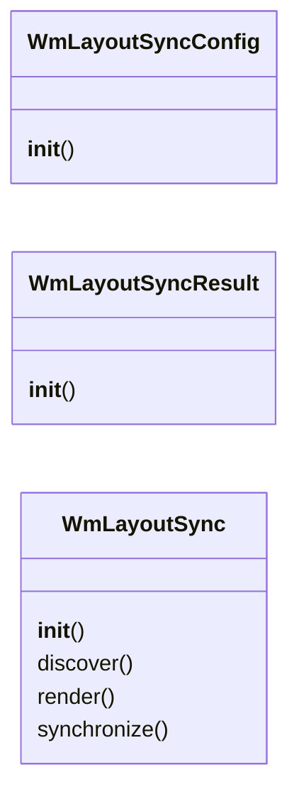
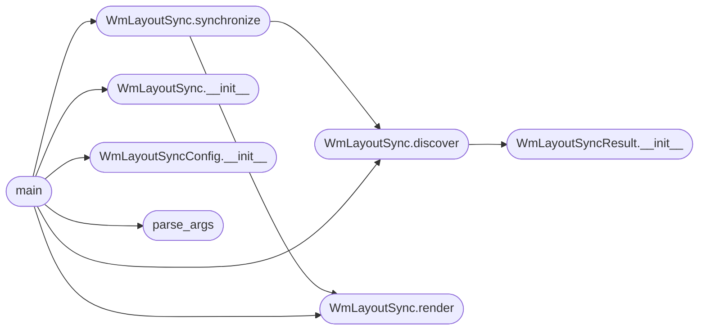

# `tools.wm_layout_sync`

> Source: [tools/wm_layout_sync.py:1](../../tools/wm_layout_sync.py#L1) | language `py` | coverage 100.0% | [API index](../index.md)

Docstring: Synchronize the WM layout manifest from source truth.

I read wm_layout.h and tests/test_wm.c and regenerate
docs/wm_layout_manifest.md so documentation never drifts from code.
I fail closed with nonzero exit on missing contracts or mode gaps.

## Contents

- **Classes:** [`WmLayoutSyncConfig`](#wmlayoutsyncconfig), [`WmLayoutSyncResult`](#wmlayoutsyncresult), [`WmLayoutSync`](#wmlayoutsync)
- **Functions:** [`parse_args`](#parse_args), [`main`](#main)

## Type Diagram



## Call Graph

Solid arrows stay in this module, dashed arrows leave it.



## Classes

<a id="wmlayoutsyncconfig"></a>

### `WmLayoutSyncConfig`

`class` | [tools/wm_layout_sync.py:17](../../tools/wm_layout_sync.py#L17)

```python
class WmLayoutSyncConfig
```

Docstring: Centralized paths and bounds for layout sync.

**Members**

| Member | Kind | Summary |
|---|---|---|
| [`__init__`](#wmlayoutsyncconfig-__init__) | constructor | Docstring: Bind all paths to one repository root. |

<a id="wmlayoutsyncconfig-__init__"></a>

#### `WmLayoutSyncConfig.__init__`

`constructor` | [tools/wm_layout_sync.py:20](../../tools/wm_layout_sync.py#L20)

```python
def __init__(self, root: pathlib.Path) -> None
```

Docstring: Bind all paths to one repository root.

**Parameters**

| Name | Type | Default | Description |
|---|---|---|---|
| `root` | `pathlib.Path` |  |  |

*Called by:* [`main`](#main)

---

<a id="wmlayoutsyncresult"></a>

### `WmLayoutSyncResult`

`class` | [tools/wm_layout_sync.py:36](../../tools/wm_layout_sync.py#L36)

```python
class WmLayoutSyncResult
```

Docstring: Outcome of one manifest synchronization.

**Members**

| Member | Kind | Summary |
|---|---|---|
| [`__init__`](#wmlayoutsyncresult-__init__) | constructor | Docstring: Store discovered modes, symbols and check count. |

<a id="wmlayoutsyncresult-__init__"></a>

#### `WmLayoutSyncResult.__init__`

`constructor` | [tools/wm_layout_sync.py:39](../../tools/wm_layout_sync.py#L39)

```python
def __init__(self, modes: list[str], symbols: list[str], checks: int) -> None
```

Docstring: Store discovered modes, symbols and check count.

**Parameters**

| Name | Type | Default | Description |
|---|---|---|---|
| `modes` | `list[str]` |  |  |
| `symbols` | `list[str]` |  |  |
| `checks` | `int` |  |  |

*Called by:* [`WmLayoutSync.discover`](#wmlayoutsync-discover)

---

<a id="wmlayoutsync"></a>

### `WmLayoutSync`

`class` | [tools/wm_layout_sync.py:46](../../tools/wm_layout_sync.py#L46)

```python
class WmLayoutSync
```

Docstring: Manifest builder driven only by source files.

**Members**

| Member | Kind | Summary |
|---|---|---|
| [`__init__`](#wmlayoutsync-__init__) | constructor | Docstring: Hold config as the sole tunable source. |
| [`discover`](#wmlayoutsync-discover) | method | Docstring: Extract modes, symbols and test checks from sources. |
| [`render`](#wmlayoutsync-render) | method | Docstring: Build manifest markdown from discovery result. |
| [`synchronize`](#wmlayoutsync-synchronize) | method | Docstring: Discover, render and optionally write the manifest. |

<a id="wmlayoutsync-__init__"></a>

#### `WmLayoutSync.__init__`

`constructor` | [tools/wm_layout_sync.py:49](../../tools/wm_layout_sync.py#L49)

```python
def __init__(self, config: WmLayoutSyncConfig) -> None
```

Docstring: Hold config as the sole tunable source.

**Parameters**

| Name | Type | Default | Description |
|---|---|---|---|
| `config` | `WmLayoutSyncConfig` |  |  |

*Called by:* [`main`](#main)

<a id="wmlayoutsync-discover"></a>

#### `WmLayoutSync.discover`

`method` | [tools/wm_layout_sync.py:53](../../tools/wm_layout_sync.py#L53)

```python
def discover(self) -> WmLayoutSyncResult
```

Docstring: Extract modes, symbols and test checks from sources.

**Returns:** `WmLayoutSyncResult`

**Raises**

- `ValueError`: (raised in the body, not documented)

*Calls:* [`WmLayoutSyncResult.__init__`](#wmlayoutsyncresult-__init__)

*Called by:* [`WmLayoutSync.synchronize`](#wmlayoutsync-synchronize), [`main`](#main)

<a id="wmlayoutsync-render"></a>

#### `WmLayoutSync.render`

`method` | [tools/wm_layout_sync.py:66](../../tools/wm_layout_sync.py#L66)

```python
def render(self, result: WmLayoutSyncResult) -> str
```

Docstring: Build manifest markdown from discovery result.

**Parameters**

| Name | Type | Default | Description |
|---|---|---|---|
| `result` | `WmLayoutSyncResult` |  |  |

**Returns:** `str`

*Called by:* [`main`](progs.src.opl3.c.md#main), [`WmLayoutSync.synchronize`](#wmlayoutsync-synchronize), [`main`](#main)

<a id="wmlayoutsync-synchronize"></a>

#### `WmLayoutSync.synchronize`

`method` | [tools/wm_layout_sync.py:101](../../tools/wm_layout_sync.py#L101)

```python
def synchronize(self, write: bool) -> WmLayoutSyncResult
```

Docstring: Discover, render and optionally write the manifest.

**Parameters**

| Name | Type | Default | Description |
|---|---|---|---|
| `write` | `bool` |  |  |

**Returns:** `WmLayoutSyncResult`

*Calls:* [`WmLayoutSync.discover`](#wmlayoutsync-discover), [`WmLayoutSync.render`](#wmlayoutsync-render)

*Called by:* [`main`](#main)

---

## Functions

<a id="parse_args"></a>

### `parse_args`

`function` | [tools/wm_layout_sync.py:151](../../tools/wm_layout_sync.py#L151)

```python
def parse_args(argv: list[str]) -> argparse.Namespace
```

Docstring: Parse CLI flags for check or write modes.

**Parameters**

| Name | Type | Default | Description |
|---|---|---|---|
| `argv` | `list[str]` |  |  |

**Returns:** `argparse.Namespace`

*Called by:* [`main`](#main)

---

<a id="main"></a>

### `main`

`function` | [tools/wm_layout_sync.py:159](../../tools/wm_layout_sync.py#L159)

```python
def main(argv: list[str]) -> int
```

Docstring: Run discovery and write or verify the manifest.

**Parameters**

| Name | Type | Default | Description |
|---|---|---|---|
| `argv` | `list[str]` |  |  |

**Returns:** `int`

*Calls:* [`WmLayoutSync.__init__`](#wmlayoutsync-__init__), [`WmLayoutSync.discover`](#wmlayoutsync-discover), [`WmLayoutSync.render`](#wmlayoutsync-render), [`WmLayoutSync.synchronize`](#wmlayoutsync-synchronize), [`WmLayoutSyncConfig.__init__`](#wmlayoutsyncconfig-__init__), [`parse_args`](#parse_args)

---
