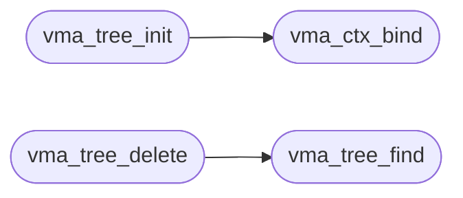

# `vma.c`

> Source: [vma.c:1](../../vma.c#L1) | language `c` | coverage 9.1% | [API index](../index.md)

## Contents

- **Functions:** [`vma_ctx_init`](#vma_ctx_init), [`vma_ctx_bind`](#vma_ctx_bind), [`vma_ctx_save`](#vma_ctx_save), [`vma_view_save`](#vma_view_save), [`vma_view_load`](#vma_view_load), [`vma_tree_init`](#vma_tree_init), [`vma_tree_insert`](#vma_tree_insert), [`vma_tree_find`](#vma_tree_find), [`vma_tree_find_containing`](#vma_tree_find_containing), [`vma_tree_delete`](#vma_tree_delete)

## Call Graph

Solid arrows stay in this module, dashed arrows leave it.



## Functions

<a id="vma_ctx_init"></a>

### `vma_ctx_init`

`function` | [vma.c:37](../../vma.c#L37)

```c
void vma_ctx_init(vma_ctx_t *c, vma_node_t *pool)
```

**Parameters**

| Name | Type | Default | Description |
|---|---|---|---|
| `c` | `vma_ctx_t *` |  |  |
| `pool` | `vma_node_t *` |  |  |

---

<a id="vma_ctx_bind"></a>

### `vma_ctx_bind`

`function` | [vma.c:52](../../vma.c#L52)

```c
void vma_ctx_bind(vma_ctx_t *c)
```

**Parameters**

| Name | Type | Default | Description |
|---|---|---|---|
| `c` | `vma_ctx_t *` |  |  |

*Called by:* [`vma_tree_init`](#vma_tree_init)

---

<a id="vma_ctx_save"></a>

### `vma_ctx_save`

`function` | [vma.c:64](../../vma.c#L64)

```c
void vma_ctx_save(vma_ctx_t *c)
```

**Parameters**

| Name | Type | Default | Description |
|---|---|---|---|
| `c` | `vma_ctx_t *` |  |  |

---

<a id="vma_view_save"></a>

### `vma_view_save`

`function` | [vma.c:74](../../vma.c#L74)

```c
void vma_view_save(vma_view_t *v)
```

**Parameters**

| Name | Type | Default | Description |
|---|---|---|---|
| `v` | `vma_view_t *` |  |  |

---

<a id="vma_view_load"></a>

### `vma_view_load`

`function` | [vma.c:86](../../vma.c#L86)

```c
void vma_view_load(const vma_view_t *v)
```

**Parameters**

| Name | Type | Default | Description |
|---|---|---|---|
| `v` | `vma_view_t *` |  |  |

---

<a id="vma_tree_init"></a>

### `vma_tree_init`

`function` | [vma.c:98](../../vma.c#L98)

```c
void vma_tree_init(void)
```

*Calls:* [`vma_ctx_bind`](#vma_ctx_bind)

---

<a id="vma_tree_insert"></a>

### `vma_tree_insert`

`function` | [vma.c:187](../../vma.c#L187)

```c
vma_node_t *vma_tree_insert(vma_node_t **root, unsigned long base, unsigned long len)
```

**Parameters**

| Name | Type | Default | Description |
|---|---|---|---|
| `root` | `vma_node_t **` |  |  |
| `base` | `unsigned long` |  |  |
| `len` | `unsigned long` |  |  |

**Returns:** `vma_node_t *`

---

<a id="vma_tree_find"></a>

### `vma_tree_find`

`function` | [vma.c:220](../../vma.c#L220)

```c
vma_node_t *vma_tree_find(vma_node_t *root, unsigned long base)
```

**Parameters**

| Name | Type | Default | Description |
|---|---|---|---|
| `root` | `vma_node_t *` |  |  |
| `base` | `unsigned long` |  |  |

**Returns:** `vma_node_t *`

*Called by:* [`vma_tree_delete`](#vma_tree_delete)

---

<a id="vma_tree_find_containing"></a>

### `vma_tree_find_containing`

`function` | [vma.c:238](../../vma.c#L238)

```c
vma_node_t *vma_tree_find_containing(vma_node_t *root, unsigned long va)
```

Docstring: Find the live node containing va (base <= va < base+len), or VMA_NIL.

The fault path needs interior hits; the exact-base find above cannot serve it. Pure tree walk, no MRU (the MRU keys exact bases only). Overflow-closed: a wrapping range never contains.

**Parameters**

| Name | Type | Default | Description |
|---|---|---|---|
| `root` | `vma_node_t *` |  |  |
| `va` | `unsigned long` |  |  |

**Returns:** `vma_node_t *`

---

<a id="vma_tree_delete"></a>

### `vma_tree_delete`

`function` | [vma.c:319](../../vma.c#L319)

```c
int vma_tree_delete(vma_node_t **root, unsigned long base)
```

**Parameters**

| Name | Type | Default | Description |
|---|---|---|---|
| `root` | `vma_node_t **` |  |  |
| `base` | `unsigned long` |  |  |

**Returns:** `int`

*Calls:* [`vma_tree_find`](#vma_tree_find)

---
