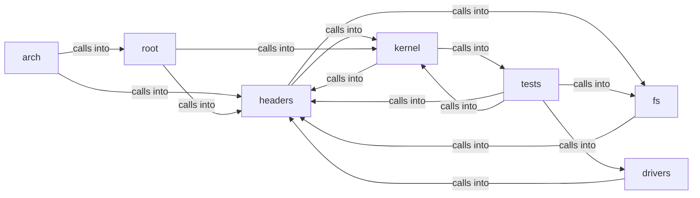

# headers: kernel

headers: kernel groups 146 files (S, c, h) around SPINLOCK_H, spinlock_t, irqflags_t, SPINLOCK_INIT, spin_init. SMP application-processor bootstrap stub.

## arch (1.1)

arch groups 4 files (S) around ap_stub_start, ap_pm, ap_lm, ap_patch_slot, ap_gdt32. SMP application-processor bootstrap stub.

## drivers (1.2)

drivers groups 15 files (c) around XHC_CAP_OFF, XHC_OP_USBCMD, XHC_OP_USBSTS, XHC_OP_PAGESIZE, XHC_OP_CRCR. Docstring: drivers/ahci.c -- Polled AHCI (SATA) disk driver.

## fs (1.3)

fs groups 7 files (c) around fsimg_open_file, fsimg_open_dev, fsimg_dev_read, fsimg_read, fsimg_split. ext_geo_t: Filesystem geometry from the superblock.

## headers (1.4)

headers groups 60 files (h) around SPINLOCK_H, spinlock_t, irqflags_t, SPINLOCK_INIT, spin_init. generated from ap_stub.bin - do not edit

## kernel (1.5)

kernel groups 29 files (c) around LDSO_EHSIZE, LDSO_PHENTSZ, LDSO_DYN_ENT, LDSO_HASH_HDR, ldso_rd16. Docstring: kernel/batch.c -- Ordered batch executor.

## root (1.6)

root groups 4 files (c) around table, KSYM_MAX, syscall_kstack, syscall_init, ksyscall. Mediator: boot orchestration and the syscall trampoline.

## tests (1.7)

tests groups 27 files (c) around CHECK, stub_dispatch, main, test_read, test_pcm_open. Docstring: Host test for kernel/batch.c (make test-batch).

**Files**:

- arch/x86/ap_entry.S
- arch/x86/boot/stage1.S
- arch/x86/boot/stage2.S
- arch/x86/syscall_entry.S
- drivers/ahci.c
- drivers/block.c
- drivers/driver.c
- drivers/ide.c
- drivers/kbd.c
- drivers/mouse.c
- drivers/nvme.c
- drivers/pcm2.c
- drivers/pcspk.c
- drivers/rtc.c
- drivers/sb16.c
- drivers/usbblk.c
- drivers/usbhid.c
- drivers/virtio_blk.c
- drivers/xhci.c
- fs/ext4.c
- fs/fat32.c
- fs/fsimg.c
- fs/kfile.c
- fs/minifs.c
- fs/pcache.c
- fs/vfs.c
- headers/ap_stub.h
- headers/arch/x86/boot/bootdefs.h
- headers/arch/x86/cpu_setup.h
- headers/arch/x86/hal_io.h
- headers/arch/x86/msr.h
- headers/batch.h
- headers/block.h
- headers/driver.h
- headers/drivers/ahci.h
- headers/drivers/kbd.h
- headers/drivers/modifiers.h
- headers/drivers/mouse.h
- headers/drivers/nvme.h
- headers/drivers/pci.h
- headers/drivers/usbblk.h
- headers/drivers/usbhid.h
- headers/drivers/virtio_blk.h
- headers/drivers/xhci.h
- headers/editor.h
- headers/ext4.h
- headers/fat32.h
- headers/fsimg.h
- headers/futex.h
- headers/httpd.h
- headers/ide.h
- headers/kernel.h
- headers/kernel/console_in.h
- headers/ldso.h
- headers/lz4_kernel.h
- headers/minifetch.h
- headers/minifs.h
- headers/panic.h
- headers/pcache.h
- headers/pcm2.h
- headers/pcspk.h
- headers/percpu_rq.h
- headers/pipe.h
- headers/proc_sec.h
- headers/qga.h
- headers/randmix.h
- headers/rcu.h
- headers/rtc.h
- headers/sanitize.h
- headers/sb16.h
- headers/sched.h
- headers/seccomp_bpf.h
- headers/shell.h
- headers/sign.h
- headers/smp.h
- headers/spawn.h
- headers/spinlock.h
- headers/sync.h
- headers/syscall_asm.h
- headers/syscalls_proc.h
- headers/tick.h
- headers/tlb.h
- headers/vga_fb.h
- headers/vma.h
- headers/wm_events.h
- headers/zip.h
- kernel.c
- kernel/batch.c
- kernel/console.c
- kernel/console_in.c
- kernel/ed25519.c
- kernel/editor.c
- kernel/exec.c
- kernel/futex.c
- kernel/ldso_parse.c
- kernel/loader.c
- kernel/lz4_kernel.c
- kernel/minifetch.c
- kernel/mm.c
- kernel/mm/cow.c
- kernel/mm/paging.c
- kernel/mm/swap.c
- kernel/mm/tlb.c
- kernel/panic.c
- kernel/percpu_rq.c
- kernel/proc_sec.c
- kernel/rcu.c
- kernel/sched.c
- kernel/seccomp_bpf.c
- kernel/serial.c
- kernel/shell.c
- kernel/spawn.c
- kernel/sync.c
- kernel/syscalls.c
- kernel/syscalls_proc.c
- kernel/tick.c
- qga.c
- smp.c
- tests/test_batch.c
- tests/test_driver.c
- tests/test_ext4.c
- tests/test_fat32.c
- tests/test_fault.c
- tests/test_futex.c
- tests/test_hal_io.c
- tests/test_httpd.c
- tests/test_ldso.c
- tests/test_modifiers.c
- tests/test_panic.c
- tests/test_pcache.c
- tests/test_pci.c
- tests/test_percpu_rq.c
- tests/test_pipe.c
- tests/test_randmix.c
- tests/test_rcu.c
- tests/test_rtc.c
- tests/test_sanitize.c
- tests/test_seccomp_bpf.c
- tests/test_sign.c
- tests/test_sync.c
- tests/test_tick.c
- tests/test_usbblk.c
- tests/test_usbhid.c
- tests/test_vma.c
- tests/test_xhci.c
- vma.c
