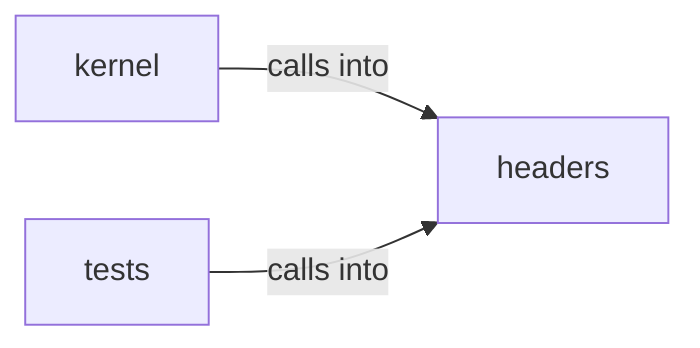

# headers: vga_fb

headers: vga_fb groups 17 files (c, h) around WM_GEOM_H, wm_geom_config_t, WM_GEOM_CONFIG_DEFAULT, wm_rect_t, wm_rect_valid. embedded icon pixel data for desktop shortcuts.

## headers (6.1)

headers groups 12 files (h) around WM_GEOM_H, wm_geom_config_t, WM_GEOM_CONFIG_DEFAULT, wm_rect_t, wm_rect_valid. embedded icon pixel data for desktop shortcuts.

## kernel (6.2)

kernel groups 3 files (c) around CURSOR_TIP_X, CURSOR_TIP_Y, cursor_save_bg, cursor_is_set, cursor_has_set_neighbour. Docstring: Hardware pointer sprite layer (kernel/vga_cursor.c).

## tests (6.3)

tests groups 2 files (c) around CHECK, main, CHECK, main. Docstring: Host test for headers/vga_fx.h (make test-fx).

**Files**:

- headers/desktop_icons.h
- headers/desktop_shortcuts.h
- headers/kernel/vga_cursor.h
- headers/vga_fx.h
- headers/wm_events.h
- headers/wm_focus.h
- headers/wm_geom.h
- headers/wm_gfxview.h
- headers/wm_layout.h
- headers/wm_render.h
- headers/wm_tiling.h
- headers/wm_window.h
- kernel/vga_cursor.c
- kernel/vga_fb.c
- kernel/vga_fx.c
- tests/test_fx.c
- tests/test_wm.c
