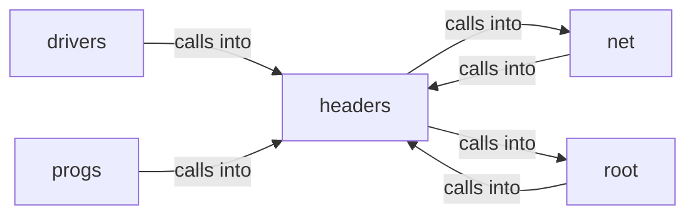

# net

net groups 14 files (c, h) around NET_H, NET_IP_ADDR, NET_NETMASK, NET_GATEWAY, NET_DNS. Docstring: drivers/virtio_net.c -- Polled legacy virtio-net driver.

## drivers (7.1)

drivers groups 1 files (c) around VNET_VENDOR, VNET_DEV_LEGACY, VNET_DEV_TRANS, VNET_F_ACK, VNET_F_DRIVER. Docstring: drivers/virtio_net.c -- Polled legacy virtio-net driver.

## headers (7.2)

headers groups 6 files (h) around NET_H, NET_IP_ADDR, NET_NETMASK, NET_GATEWAY, NET_DNS. Docstring: drivers/virtio_net.h -- virtio-net boundary.

## net (7.3)

net groups 5 files (c) around net_drv_send, net_drv_poll, net_drv_present, net_put16, net_put32. MiniOS network stack: virtio-net preferred, rtl8139 fallback, under

## progs (7.4)

progs groups 1 files (c) around syscall, _POSIX_C_SOURCE, _DEFAULT_SOURCE, parse_port, main. tlsget - minimal HTTPS GET over the ring-3 TLS stack.

## root (7.5)

root groups 1 files (c) around tls_test_send, tls_test_recv, tls_test_recv_timeout, tls_test_close, CHECK. host-side tests for the kernel TLS stack.

**Files**:

- drivers/virtio_net.c
- headers/drivers/virtio_net.h
- headers/net.h
- headers/net/rtl8139.h
- headers/tls.h
- headers/tls_port.h
- headers/tls_roots.h
- net/net.c
- net/rtl8139.c
- net/tls.c
- net/tls_crypto.c
- net/tls_x509.c
- progs/tls_u/tls_u_main.c
- tls_test.c
