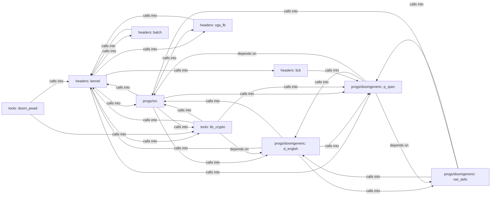

## Details

Static architecture map of 596 files (S, c, h, lua, py, s, sh) in 10 components: headers: kernel, progs/doomgeneric: d_englsh, progs/src, progs/doomgeneric: p_spec, tools: tls_crypto, headers: vga_fb, progs/doomgeneric: net_defs, headers: batch. Structure is extracted statically without LLM calls; component prose may be enriched locally.

### headers: kernel (1)

headers: kernel groups 137 files (S, c, h) around SPINLOCK_H, spinlock_t, irqflags_t, SPINLOCK_INIT, spin_init. SMP application-processor bootstrap stub.

**Related Classes/Methods**:

- <a href="../headers/spinlock.h#L2-L37">headers/spinlock.h::SPINLOCK_H</a>
- <a href="../headers/spinlock.h#L38-L40">headers/spinlock.h::spinlock_t</a>
- <a href="../headers/spinlock.h#L41-L43">headers/spinlock.h::irqflags_t</a>
- <a href="../headers/spinlock.h#L44-L45">headers/spinlock.h::SPINLOCK_INIT</a>
- <a href="../headers/spinlock.h#L46-L55">headers/spinlock.h::spin_init</a>
- <a href="../headers/spinlock.h">headers/spinlock.h::spin_save_irq</a>
- <a href="../headers/spinlock.h">headers/spinlock.h::spin_restore_irq</a>
- <a href="../headers/spinlock.h#L58-L63">headers/spinlock.h::spin_lock</a>

### progs/doomgeneric: d_englsh (2)

progs/doomgeneric: d_englsh groups 99 files (c, h) around __DOOMTYPE__, strcasecmp, strncasecmp, PACKEDATTR, PACKEDATTR. Copyright(C) 1993-1996 Id Software, Inc.

**Related Classes/Methods**:

- <a href="../progs/doomgeneric/doomtype.h#L22-L29">progs/doomgeneric/doomtype.h::__DOOMTYPE__</a>
- <a href="../progs/doomgeneric/doomtype.h">progs/doomgeneric/doomtype.h::strcasecmp</a>
- <a href="../progs/doomgeneric/doomtype.h#L31-L49">progs/doomgeneric/doomtype.h::strncasecmp</a>
- <a href="../progs/doomgeneric/doomtype.h#L50-L51">progs/doomgeneric/doomtype.h::PACKEDATTR</a>
- <a href="../progs/doomgeneric/doomtype.h#L52-L67">progs/doomgeneric/doomtype.h::PACKEDATTR</a>
- <a href="../progs/doomgeneric/doomtype.h#L68-L80">progs/doomgeneric/doomtype.h::boolean</a>
- <a href="../progs/doomgeneric/doomtype.h#L81-L87">progs/doomgeneric/doomtype.h::byte</a>
- <a href="../progs/doomgeneric/doomtype.h">progs/doomgeneric/doomtype.h::DIR_SEPARATOR</a>

### progs/src (3)

progs/src groups 86 files (c, h) around kstrlen, kstrcpy, kstrncpy, kstrncat, kstrcmp. Docstring: abi.h -- Boot-time ABI manifest gate contract.

**Related Classes/Methods**:

- <a href="../kernel/string.c#L17-L22">kernel/string.c::kstrlen</a>
- <a href="../kernel/string.c#L23-L28">kernel/string.c::kstrcpy</a>
- <a href="../kernel/string.c#L29-L34">kernel/string.c::kstrncpy</a>
- <a href="../kernel/string.c#L35-L42">kernel/string.c::kstrncat</a>
- <a href="../kernel/string.c#L43-L47">kernel/string.c::kstrcmp</a>
- <a href="../kernel/string.c#L48-L52">kernel/string.c::kstrncmp</a>
- <a href="../kernel/string.c#L53-L57">kernel/string.c::kstrchr</a>
- <a href="../kernel/string.c#L58-L67">kernel/string.c::kstrstr</a>

### progs/doomgeneric: p_spec (4)

progs/doomgeneric: p_spec groups 69 files (c, h) around __DOOMDEF__, DOOM_VERSION, DOOM_191_VERSION, RANGECHECK, MAXPLAYERS. Copyright(C) 1993-1996 Id Software, Inc.

**Related Classes/Methods**:

- <a href="../progs/doomgeneric/doomdef.h#L21-L33">progs/doomgeneric/doomdef.h::__DOOMDEF__</a>
- <a href="../progs/doomgeneric/doomdef.h#L34-L36">progs/doomgeneric/doomdef.h::DOOM_VERSION</a>
- <a href="../progs/doomgeneric/doomdef.h#L37-L41">progs/doomgeneric/doomdef.h::DOOM_191_VERSION</a>
- <a href="../progs/doomgeneric/doomdef.h#L42-L44">progs/doomgeneric/doomdef.h::RANGECHECK</a>
- <a href="../progs/doomgeneric/doomdef.h#L45-L76">progs/doomgeneric/doomdef.h::MAXPLAYERS</a>
- <a href="../progs/doomgeneric/doomdef.h">progs/doomgeneric/doomdef.h::MTF_EASY</a>
- <a href="../progs/doomgeneric/doomdef.h">progs/doomgeneric/doomdef.h::MTF_NORMAL</a>
- <a href="../progs/doomgeneric/doomdef.h#L79-L81">progs/doomgeneric/doomdef.h::MTF_HARD</a>

### tools: tls_crypto (5)

tools: tls_crypto groups 44 files (c, h, py) around ktime_rdtsc, ktime_init, ktime_ms, ktime_us, KTIME_H. pure time-conversion helpers shared by the kernel clock

**Related Classes/Methods**:

- <a href="../kernel/time.c#L13-L18">kernel/time.c::ktime_rdtsc</a>
- <a href="../kernel/time.c#L19-L32">kernel/time.c::ktime_init</a>
- <a href="../kernel/time.c#L33-L40">kernel/time.c::ktime_ms</a>
- <a href="../kernel/time.c#L41-L44">kernel/time.c::ktime_us</a>
- <a href="../headers/ktime.h#L2-L18">headers/ktime.h::KTIME_H</a>
- <a href="../headers/ktime.h#L19-L29">headers/ktime.h::ktime_us_from_delta</a>
- <a href="../headers/ktime.h#L30-L36">headers/ktime.h::wall_us_from_parts</a>
- <a href="../progs/lua/minios.c#L37-L51">progs/lua/minios.c::msys5</a>

### headers: vga_fb (6)

headers: vga_fb groups 22 files (c, h) around WM_GEOM_H, wm_geom_config_t, WM_GEOM_CONFIG_DEFAULT, wm_rect_t, wm_rect_valid. Docstring: Desktop profile avatar, generated by tools/gen_avatar.py.

**Related Classes/Methods**:

- <a href="../headers/wm_geom.h#L11-L13">headers/wm_geom.h::WM_GEOM_H</a>
- <a href="../headers/wm_geom.h#L14-L21">headers/wm_geom.h::wm_geom_config_t</a>
- <a href="../headers/wm_geom.h#L22-L24">headers/wm_geom.h::WM_GEOM_CONFIG_DEFAULT</a>
- <a href="../headers/wm_geom.h#L25-L32">headers/wm_geom.h::wm_rect_t</a>
- <a href="../headers/wm_geom.h#L33-L38">headers/wm_geom.h::wm_rect_valid</a>
- <a href="../headers/wm_geom.h#L39-L47">headers/wm_geom.h::wm_rect_contains</a>
- <a href="../headers/wm_geom.h#L48-L58">headers/wm_geom.h::wm_title_bar_rect</a>
- <a href="../headers/wm_geom.h#L59-L70">headers/wm_geom.h::wm_content_rect</a>

### progs/doomgeneric: net_defs (7)

progs/doomgeneric: net_defs groups 13 files (c, h) around NET_DEFS_H, MAXNETNODES, NET_MAXPLAYERS, MAXPLAYERNAME, BACKUPTICS. Copyright(C) 1993-1996 Id Software, Inc.

**Related Classes/Methods**:

- <a href="../progs/doomgeneric/net_defs.h#L19-L30">progs/doomgeneric/net_defs.h::NET_DEFS_H</a>
- <a href="../progs/doomgeneric/net_defs.h#L31-L36">progs/doomgeneric/net_defs.h::MAXNETNODES</a>
- <a href="../progs/doomgeneric/net_defs.h#L37-L40">progs/doomgeneric/net_defs.h::NET_MAXPLAYERS</a>
- <a href="../progs/doomgeneric/net_defs.h#L41-L44">progs/doomgeneric/net_defs.h::MAXPLAYERNAME</a>
- <a href="../progs/doomgeneric/net_defs.h">progs/doomgeneric/net_defs.h::BACKUPTICS</a>
- <a href="../progs/doomgeneric/net_defs.h#L46-L47">progs/doomgeneric/net_defs.h::net_module_t</a>
- <a href="../progs/doomgeneric/net_defs.h">progs/doomgeneric/net_defs.h::net_packet_t</a>
- <a href="../progs/doomgeneric/net_defs.h">progs/doomgeneric/net_defs.h::net_addr_t</a>

### headers: batch (8)

headers: batch groups 3 files (c, h) around BATCH_H, BATCH_MAX_OPS, BATCH_OP_NOP, BATCH_OP_YIELD, BATCH_OP_TIME. Docstring: batch.h -- Batched synchronous syscall submission.

**Related Classes/Methods**:

- <a href="../headers/batch.h#L2-L40">headers/batch.h::BATCH_H</a>
- <a href="../headers/batch.h#L41-L42">headers/batch.h::BATCH_MAX_OPS</a>
- <a href="../headers/batch.h">headers/batch.h::BATCH_OP_NOP</a>
- <a href="../headers/batch.h">headers/batch.h::BATCH_OP_YIELD</a>
- <a href="../headers/batch.h">headers/batch.h::BATCH_OP_TIME</a>
- <a href="../headers/batch.h#L46-L47">headers/batch.h::BATCH_OP_GETPID</a>
- <a href="../headers/batch.h">headers/batch.h::BATCH_OK</a>
- <a href="../headers/batch.h">headers/batch.h::BATCH_ERR_COUNT</a>

### headers: tick (9)

headers: tick groups 3 files (c, h) around TICK_H, tick_config_t, TICK_MAX_AUDIO_LISTENERS, TICK_MAX_DESKTOP_LISTENERS, TICK_MAX_USB_LISTENERS. Docstring: Tick listener bus contract.

**Related Classes/Methods**:

- <a href="../headers/tick.h#L19-L21">headers/tick.h::TICK_H</a>
- <a href="../headers/tick.h#L22-L28">headers/tick.h::tick_config_t</a>
- <a href="../headers/tick.h#L29-L30">headers/tick.h::TICK_MAX_AUDIO_LISTENERS</a>
- <a href="../headers/tick.h#L31-L33">headers/tick.h::TICK_MAX_DESKTOP_LISTENERS</a>
- <a href="../headers/tick.h#L34-L36">headers/tick.h::TICK_MAX_USB_LISTENERS</a>
- <a href="../headers/tick.h#L37-L46">headers/tick.h::TICK_CONFIG_DEFAULT</a>
- <a href="../headers/tick.h#L47-L53">headers/tick.h::tick_reset</a>
- <a href="../headers/tick.h#L54-L60">headers/tick.h::tick_register_audio</a>

### tools: doom_pwad (10)

tools: doom_pwad groups 2 files (py) around DoomPwadConfig, PwadError, pad_tex, parse_grid, grid_extents. host contract suite for tools/doom_pwad.py.

**Related Classes/Methods**:

- <a href="../tools/doom_pwad.py#L52-L160">tools/doom_pwad.py::DoomPwadConfig</a>
- <a href="../tools/doom_pwad.py#L161-L164">tools/doom_pwad.py::PwadError</a>
- <a href="../tools/doom_pwad.py#L165-L171">tools/doom_pwad.py::pad_tex</a>
- <a href="../tools/doom_pwad.py#L172-L194">tools/doom_pwad.py::parse_grid</a>
- <a href="../tools/doom_pwad.py#L195-L202">tools/doom_pwad.py::grid_extents</a>
- <a href="../tools/doom_pwad.py#L203-L209">tools/doom_pwad.py::is_wall</a>
- <a href="../tools/doom_pwad.py#L210-L239">tools/doom_pwad.py::flood_reachable</a>
- <a href="../tools/doom_pwad.py#L240-L268">tools/doom_pwad.py::validate_grid</a>
