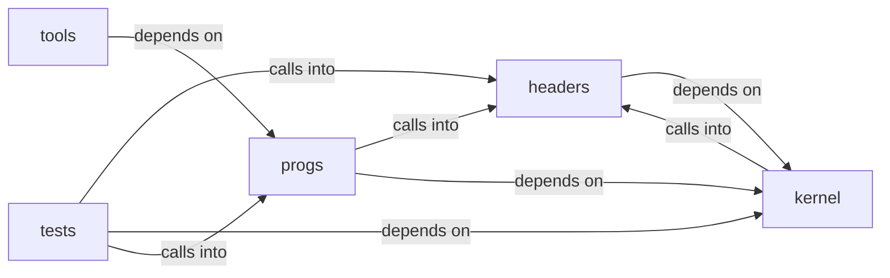

# progs/src

progs/src groups 86 files (c, h, py) around kstrlen, kstrcpy, kstrncpy, kstrncat, kstrcmp. Docstring: abi.h -- Boot-time ABI manifest gate contract.

## headers (3.1)

headers groups 8 files (h) around SECCOMP_BPF_H, sbpf_insn, sbpf_data, SBPF_MAX_INSNS, SBPF_DATA_SIZE. Docstring: abi.h -- Boot-time ABI manifest gate contract.

## kernel (3.2)

kernel groups 4 files (c) around kstrlen, kstrcpy, kstrncpy, kstrncat, kstrcmp. Docstring: kernel/abi.c -- Boot-time ABI manifest gate.

## progs (3.3)

progs groups 55 files (c, h, py) around MINIOS_ABI_H, MINIOS_ABI_VERSION, MINIOS_ABI_CHECKSUM, MINIOS_USER_LOAD_BASE, MINIOS_USER_LOAD_END. tile map editor that builds playable Doom PWADs.

## tests (3.4)

tests groups 18 files (c, h) around observe, TEST_STUB_KERNEL_H, PCI_MMIO_SIZE, __attribute__, __attribute__. Docstring: Host-test stand-in for headers/kernel.h (tests/stubs first on

## tools (3.5)

tools groups 1 files (c) around main. Docstring: tools/abi_stamp.c -- Build-time ABI manifest generator.

**Files**:

- headers/abi.h
- headers/arena.h
- headers/audio.h
- headers/httpd.h
- headers/leakcheck.h
- headers/pcm_ring.h
- headers/seccomp_bpf.h
- headers/sign.h
- kernel/abi.c
- kernel/ed25519.c
- kernel/seccomp_bpf.c
- kernel/string.c
- progs/doomedit/doomedit.c
- progs/doomgeneric/doomgeneric_minios.c
- progs/doomgeneric/memio.c
- progs/doomgeneric/memio.h
- progs/file/file.c
- progs/file/file_assoc.h
- progs/freedomui/freedomui_minios.c
- progs/freedomui/media_unavailable.c
- progs/freedomui/platform_minios.c
- progs/freedomui/ps2_keymap.c
- progs/freedomui/ps2_keymap.h
- progs/lisp/lisp.c
- progs/lua/lua_main.c
- progs/lua/minios.c
- progs/micropython/variants/minios/lib/hello.py
- progs/micropython/variants/minios/minios_module.c
- progs/minicraft/minicraft.c
- progs/minios_abi.h
- progs/minios_png.h
- progs/nk_palette.h
- progs/nuklear/cvm_emit.c
- progs/nuklear/cvm_emit.h
- progs/nuklear/font8x8.c
- progs/nuklear/node_editor.c
- progs/nuklear/nuklear_minios.c
- progs/nuklear/nuklear_minios.h
- progs/nuklear/nuklear_theme.c
- progs/nuklear/nuklear_theme.h
- progs/paint/paint.c
- progs/piano/piano.c
- progs/pokemon/platform_minios.c
- progs/quake2generic/snddma_minios.c
- progs/src/apsse.c
- progs/src/audio.c
- progs/src/fptest.c
- progs/src/freedom.c
- progs/src/freedom_wl.c
- progs/src/lxnet.c
- progs/src/lxproc.c
- progs/src/lxsecc.c
- progs/src/lxtls.c
- progs/src/mthreads.h
- progs/src/opl3.c
- progs/src/sbtone.c
- progs/src/scfuzz.c
- progs/src/shell.py
- progs/src/test.py
- progs/src/thdemo.c
- progs/topogpt3/topogpt3.c
- progs/vedit/vedit.c
- progs/wl/wl_client.h
- progs/wl/wl_mbox.h
- progs/wl/wl_mini.h
- progs/wl/wl_pixbuf.h
- progs/wl/wlcomp.c
- tests/stubs/kernel.h
- tests/test_abi.c
- tests/test_arena.c
- tests/test_file_assoc.c
- tests/test_freedom_wl.c
- tests/test_freedomui.c
- tests/test_httpd.c
- tests/test_leakcheck.c
- tests/test_minios_png.c
- tests/test_paint.c
- tests/test_pcm.c
- tests/test_ps2_keymap.c
- tests/test_sanitize.c
- tests/test_seccomp_bpf.c
- tests/test_sign.c
- tests/test_theme.c
- tests/test_vedit_build.c
- tests/test_wl.c
- tools/abi_stamp.c
