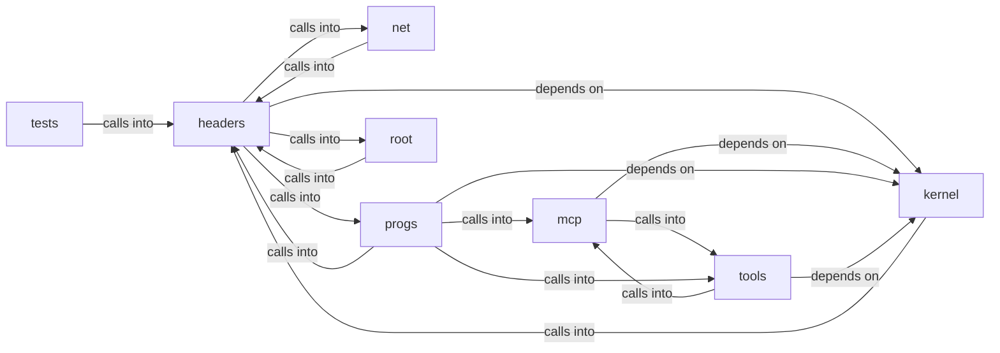

# tools: tls_crypto

tools: tls_crypto groups 44 files (c, h, py) around ktime_rdtsc, ktime_init, ktime_ms, ktime_us, KTIME_H. pure time-conversion helpers shared by the kernel clock

## headers (5.1)

headers groups 5 files (h) around KTIME_H, ktime_us_from_delta, wall_us_from_parts, TLS_H, TLS_CT_CCS. pure time-conversion helpers shared by the kernel clock

## kernel (5.2)

kernel groups 1 files (c) around ktime_rdtsc, ktime_init, ktime_ms, ktime_us. ktime_us: Microsecond resolution over the same calibrated ratio (Phase 0.2/0.3...

## mcp (5.3)

mcp groups 4 files (py) around AddonError, _clean, _unquote, parse_addon_yaml, fail. Debug driver: boot MiniOS through the MCP bridge and run freedom.

## net (5.4)

net groups 3 files (c) around tls_fail, tls_fd_of, tls_free_fd, tls_aad, number. TLS 1.2 client sessions for MiniOS.

## progs (5.5)

progs groups 11 files (c, py) around msys5, SYS_TIME_MS, SYS_PALETTE, SYS_PCSPK_INIT, SYS_PCSPK_TONE. msys5: /* ── raw syscall helpers (x86-64 Linux ABI) ─────────────────────────── static...

## root (5.6)

root groups 1 files (c) around tls_test_send, tls_test_recv, tls_test_recv_timeout, tls_test_close, CHECK. host-side tests for the kernel TLS stack.

## tests (5.7)

tests groups 1 files (c) around CHECK, main. host test for the pure conversion math in ktime.h

## tools (5.8)

tools groups 18 files (py) around note, Guest, __init__, _ser, _reader. boot the miniOS Wayland-mini desktop in one step.

**Files**:

- headers/ktime.h
- headers/tls.h
- headers/tls_port.h
- headers/tls_roots.h
- headers/tls_test_roots.h
- kernel/time.c
- mcp/mcp_dbg_driver.py
- mcp/mcp_dogfood.py
- mcp/minios_addons.py
- mcp/minios_mcp.py
- net/tls.c
- net/tls_crypto.c
- net/tls_x509.c
- progs/doomgeneric/doomgeneric_xlib.c
- progs/lua/minios.c
- progs/micropython/variants/minios/lib/hello.py
- progs/micropython/variants/minios/lib/mip.py
- progs/src/lxabi.c
- progs/src/lxsel.c
- progs/src/shell.py
- progs/src/test.py
- progs/src/test_py.py
- progs/tls_u/tls_u_main.c
- progs/tls_u/tls_u_port.c
- tests/test_ktime.c
- tls_test.c
- tools/boot_wl.py
- tools/gdb_repro.py
- tools/minios_cli.py
- tools/minios_gui.py
- tools/minios_hyper.py
- tools/probe_compute_vga.py
- tools/probe_minicraft.py
- tools/qga_client.py
- tools/repro_gui.py
- tools/test_gui_fashion.py
- tools/test_gui_freedom.py
- tools/test_gui_gfxview.py
- tools/test_gui_icon_cwd.py
- tools/test_gui_menu.py
- tools/test_gui_wm.py
- tools/test_gui_zoom.py
- tools/test_http_server.py
- tools/tls_test.py
